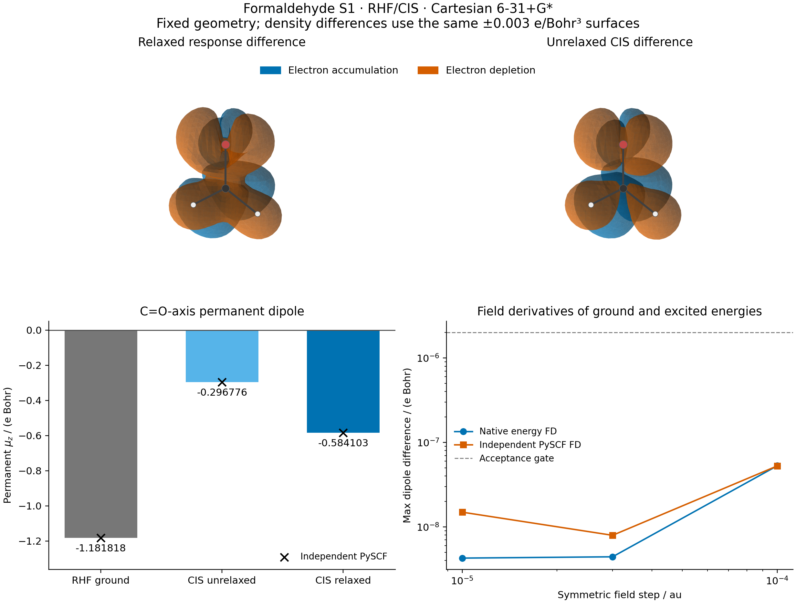

# X04 — relaxed CIS density and permanent dipole



This example evaluates the permanent dipole and relaxed one-body response density
of the first singlet CIS state of formaldehyde. It reuses native RHF integrals,
implicit orbital response, the shared AO-to-MO transformation, and the existing
CIS solver. The independent reference uses PySCF RHF, its public `get_ab`, and
SciPy dense diagonalization. No PySCF calculation enters the GradSCF path.

The fixed geometry is shared with X01/X02: C=O 1.21 Angstrom, C–H 1.10 Angstrom,
H–C–H 116 degrees; C is at the origin, O on +z, and the molecule lies in yz.
The exact coordinates are in [gradscf.json](gradscf.json). This is a model
geometry, not an experimental structure or a basis-converged prediction.

## Physical definitions

At fixed nuclear coordinates, the added AO operator is
`h(V,F) = h(0,0) + (V+V.T)/2 + sum_a F_a r_a` in atomic units. The total
energy includes `-F dot sum_A Z_A R_A`. The perturbation matrix is real and
has shape `(nao,nao)`; antisymmetric coordinates represent the zero physical
operator. The matrix is held fixed under a geometry derivative unless the
caller explicitly supplies its geometry dependence.

For the tracked state, `D_rel = d(E_RHF + omega_CIS)/dV` and
`mu = -d(E_RHF + omega_CIS)/dF`. Both derivatives include RHF orbital
relaxation. The identity `mu = sum_A Z_A R_A - Tr(D_rel r)` is checked.

The normalized real singlet amplitudes satisfy `sum_ia X_ia**2 = 1`. The
unrelaxed wavefunction density is instead `D_CIS = D_RHF + A - D`, with
`A = C_v X.T X C_v.T` and `D = C_o X X.T C_o.T`. Attachment and detachment
each carry exactly one electron in the AO overlap metric. Their difference
describes the unrelaxed CIS wavefunction; it omits the occupied–virtual
relaxation contribution in `D_rel`.

The relaxed density is an energy-derivative object. Its metric natural
occupations range from **-0.00338231 to 2.01019254** here, so positivity and
wavefunction representability are explicitly not asserted. The unrelaxed
1-RDM passes the [0,2] occupation bound, up to roundoff. The relaxation
correction has zero occupied–occupied and virtual–virtual blocks to
`8.98e-16` in the orthonormal MO frame; its occupied–virtual block norm is
0.15800950.

## Settings and measured results

Cartesian 6-31+G* has 42 AOs, 8 occupied orbitals, and 16 electrons. Six singlet
CIS roots are retained; S1 is isolated and tracked under all perturbations.
The 272-dimensional forward problem uses the shared dense solver. The
explicit response policy uses the existing direct solver, `max_dense=512`
and `rtol=1e-10`; the molecular implicit SCF response uses tolerance `1e-10`,
maximum 100 iterations, and restart 40. RHF thresholds are energy `1e-12`,
density `1e-11`, and orbital gradient `1e-10`, with at most 180 cycles.
Failed SCF, response, or state-tracking checks abort the calculation.

| Quantity | Value |
| --- | ---: |
| RHF energy / Eh | -113.86991395917161 |
| S1 excitation / Eh | 0.1682806543336986 |
| S1 total energy / Eh | -113.70163330483791 |
| RHF permanent mu_z / e Bohr | -1.18181822005851 |
| Unrelaxed CIS permanent mu_z / e Bohr | -0.29677623300697 |
| Relaxed CIS permanent mu_z / e Bohr | -0.58410309889076 |
| Relaxed excited-minus-ground mu_z / e Bohr | 0.59771512116775 |

The x/y dipoles vanish to numerical precision. Exact AO metric traces give
16 electrons for all three densities, 1 electron for each attachment and
detachment operator, and `Tr[(D_rel-D_RHF)S] = -5.07e-16`.

Both implementations reconverge at symmetric perturbations of `1e-4`,
`3e-5`, and `1e-5` au. Three Cartesian fields and six real symmetric AO
directions (seed 104, unit Frobenius norm in an orthonormal AO frame) are
tested. A separate constant operator `V=cS` gives the exact electron-count
slope for both ground and excited energies. Every displaced state is
matched by the phase-invariant AO transition metric, with minimum overlap
0.85, runner-up margin 0.2, and minimum energy gap `1e-4` Eh.

| Independent PySCF comparison | Measured maximum error | Gate |
| --- | ---: | ---: |
| Ground energy / Eh | 4.26e-14 | 1e-8 |
| S1 excitation / Eh | 1.19e-13 | 1e-7 |
| Ground AO density | 6.51e-13 | 2e-7 |
| Unrelaxed AO density | 4.06e-13 | 2e-7 |
| Unrelaxed dipole / e Bohr | 2.38e-13 | 2e-7 |
| Relaxed dipole, finite field / e Bohr | 1.49e-8 | 2e-6 |
| Relaxed density, six AO contractions | 7.21e-9 | 2e-6 |
| Constant-overlap shift slope | 3.73e-11 | 1e-7 |

The finite-difference gates use the final step, specified before execution.
All three steps are retained: reference field errors are `5.27e-8`,
`7.94e-9`, and `1.49e-8` e Bohr. The final rise reflects the finite-difference
roundoff floor; monotonic convergence is not claimed. Native energy finite
differences agree with the AD dipole to `4.26e-9` e Bohr at the final step.

The independent unrelaxed matrix comes from public PySCF CISD density
machinery applied to the normalized singles-only wavefunction, without a
CISD solve. The relaxed matrix is independently checked through the six
controlled contractions, electron-count shift, and three electric-field
directions. This is **not** a componentwise external relaxed-RDM validation.
The [reference record](pyscf.json) contains all steps and tracking diagnostics.

## Validation, figures, and provenance

The focused H2/6-31G* density tests first failed before the extension
(`6 failed`) and then passed (`6 passed in 30.23 s`). The independent
fixed-MO normalization/gauge/NTO tests similarly changed from `5 failed`
to `5 passed in 6.87 s`. HF/PBE dipole response, NH UHF/UKS, and existing
CIS higher-geometry/tracking checks passed together: **11 passed in
839.23 s**. Logs are preserved in [validation/](validation/).

The figure uses existing GradSCF AO sampling and scikit-image marching
cubes. Both difference fields use the same +/-0.003 electrons/Bohr^3
isosurface, view, and bounds. The molecular skeleton is drawn as an
orientation overlay. The finite visualization box extends 8 Bohr beyond
the atoms, with spacing at most 0.25 Bohr. Boundary field amplitudes are
below the displayed isovalue. Uniform-grid integrals are visualization
diagnostics only; electron-count gates use exact AO traces. Full grid and
mesh metadata are in [field_diagnostics.json](field_diagnostics.json).

All numerical work and rendering ran on `jy_gpu_1` (reported hostname
`c20`), CPU float64, OMP/BLAS thread settings of 2, Python 3.11.15,
JAX 0.10.0, PySCF 2.13.0. JAX has separate compilation/runtime thread pools;
these settings do not establish an exclusive two-core allocation.
The native calculation including finite-difference checks took **239.45 s**
and peaked at **3,204,136 KiB RSS**; the independent calculation took
**61.24 s**. These are complete single-process workflow timings, not isolated
solver benchmarks. Compilation-cache reuse was disabled.

The frozen snapshot is
`/home/yjiao/gradscf_checks/ad-showcase-excited-properties-20261015`.
Its base revision is `8f8c93d25fcc150aace9ad5c6a8e070c4f2937af`; the full
executed Python source-tree SHA256 is
`3f10f593debf25c322cde3ac7243a4d85b4ddfd7652d982d2ad51dbdae5b7174`.
Input-record and executed-script hashes are embedded in the JSON files.
Later measured-output comments do not change the numerical source paths.
This snapshot predates the separate stationary-value core integration;
these results do not certify that subsequent combined tree.

The plotting-only dependencies were installed offline into this snapshot's
`plot_deps` directory, without changing the shared environment. Official
wheel SHA256, sizes, Python/Linux compatibility, and existing dependency
constraints are recorded in `plot_dependency_manifest.json` and
`plot_dependency_verification.json`. The four wheels total 15.37 MB; no
NumPy/SciPy upgrade or browser installation was performed.

Run from the snapshot root with the recorded interpreter:

```bash
export CUDA_VISIBLE_DEVICES= JAX_PLATFORMS=cpu JAX_ENABLE_X64=1
export JAX_ENABLE_COMPILATION_CACHE=false OMP_NUM_THREADS=2 OPENBLAS_NUM_THREADS=2
PYTHONPATH=src timeout 7200 /home/yjiao/opt/miniconda3/envs/jax_scf/bin/python examples/tdscf/formaldehyde_cis_density.py
PYTHONPATH=src timeout 7200 /home/yjiao/opt/miniconda3/envs/jax_scf/bin/python examples/tdscf/compare_formaldehyde_cis_density.py
PYTHONPATH=plot_deps:src timeout 600 /home/yjiao/opt/miniconda3/envs/jax_scf/bin/python examples/tdscf/plot_formaldehyde_cis_density.py
```

This delivered component covers isolated real RHF/CIS singlets at one fixed
geometry and basis. It does not establish TDDFT/EOM excited densities,
degenerate-state response, basis convergence, or experimental agreement.
