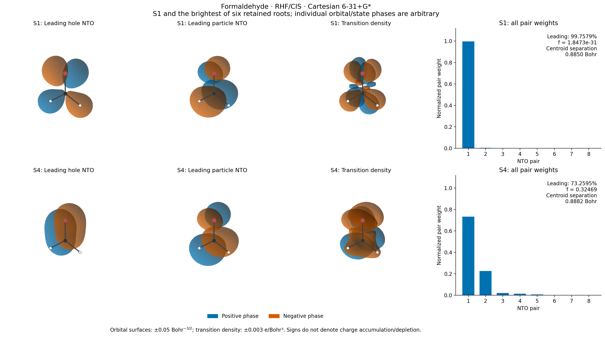

# X05 — CIS transition density and natural transition orbitals



This analysis reuses the independently validated native orbitals and six CIS
roots from [X04](../X04_formaldehyde_cis_density/README.md), at the same fixed
formaldehyde geometry and Cartesian 6-31+G* basis. It selects S1 and the largest
oscillator strength **within the first six singlets**, which is S4. This finite
window is not a complete absorption spectrum or a statement about all bright
states. The standalone reference rebuilds RHF and CIS from independent PySCF
integrals and uses public NTO and transition-moment routines.

## Normalization and gauge

The normalized real singlet CIS amplitudes have `sum_ia X_ia**2 = 1`. With
metric-orthonormal occupied and virtual coefficients, the AO transition matrix
is `T = sqrt(2) C_o X C_v.T`, using
`T[p,q] = <excited | a_q^dagger a_p | ground>`. Thus `Tr(T S)=0` and
`Tr(T.T S T S)=2`. The electric transition moment is `-Tr(T r)`; the nuclear
transition term vanishes between orthogonal electronic states. The length-gauge
oscillator strength is `(2/3) omega |mu_01|**2` in atomic units.

The SVD `X=U diag(s) V.T` defines hole and particle NTOs `H=C_o U`, `P=C_v V`
and weights `w=s**2`, which sum to one. The complete reconstruction is
`T=sqrt(2) H diag(sqrt(w)) P.T`. Weighted projectors recover the one-electron
detachment `H diag(w) H.T` and attachment `P diag(w) P.T` operators.
These describe the unrelaxed CIS wavefunction; they do not include the relaxed
response density of X04.

Only the leading NTO pair is drawn. The full transition-density field uses
every amplitude, and the weight plots include all eight pairs. The leading
pair explains 99.7579% of the S1 norm but only 73.2595% of S4; a single-pair
description of S4 would omit a substantial 22.4718% second pair.

Individual orbital phases and the overall excited-state sign are arbitrary.
Separate occupied/virtual orbital rotations with consistently transformed
amplitudes leave the AO operators unchanged. Equal singular values permit
rotations of the NTO frame, so individual vectors within a degenerate group
are not compared or differentiated. The host SVD helper records groups within
`1e-8` weight; S1 has a numerically zero-weight group, while S4 has no such
group. Weighted density projectors, weights, phase-invariant transition
overlaps, and dipole outer products provide the comparison quantities.

The independent reference uses PySCF `get_nto`, `transition_dipole`, and
`oscillator_strength` after SciPy diagonalization of public `get_ab`. PySCF
stores singlet TDA X with norm squared one half, so the input is `X/sqrt(2)`.
Its current `get_nto` normalizes the selected X array in place and independently
chooses hole/particle signs. Each NTO call therefore receives fresh arrays;
transition moments are evaluated on an untouched driver. Reference T is
reconstructed with the full NTO coupling matrix, preserving those sign and
subspace choices. See the [public PySCF implementation](https://pyscf.org/_modules/pyscf/tdscf/rhf.html).

## Measured results and independent gates

| Quantity | S1 | S4 |
| --- | ---: | ---: |
| Excitation / Eh | 0.168280654334 | 0.358643074410 |
| Oscillator strength | 1.8473e-31 | 0.324693185513 |
| Leading NTO weight | 0.997578885155 | 0.732594907632 |
| Second NTO weight | 0.002301256421 | 0.224717685044 |
| Electron centroid z / Bohr | 0.567659582010 | 0.548048760407 |
| Hole centroid z / Bohr | 1.452701569061 | 1.436298404051 |
| Electron–hole centroid separation / Bohr | 0.885041987052 | 0.888249643644 |

The centroid separation is a precisely defined first-moment diagnostic, not
a complete charge-transfer classification. Attachment and detachment each
have exact AO-metric trace one. Their centroid difference reproduces the
unrelaxed permanent-dipole change. S1 is dark at this planar geometry to
numerical precision; the tiny displayed f is numerical residual, not a
predicted weak absorption intensity.

| Independent comparison | Maximum absolute error | Gate |
| --- | ---: | ---: |
| Six excitation energies / Eh | 1.75e-13 | 1e-8 |
| Six oscillator strengths | 4.07e-13 | 2e-7 |
| Transition-dipole outer products | 1.54e-12 | 2e-7 |
| NTO weights | 2.10e-12 | 2e-7 |
| Weighted attachment AO matrix | 3.19e-12 | 2e-7 |
| Weighted detachment AO matrix | 5.96e-13 | 2e-7 |
| Absolute transition metric overlap minus one | 4.44e-16 | 2e-7 |
| Reference NTO reconstruction of T | 3.59e-14 | 1e-10 |
| Electron/hole centroids / Bohr | 1.42e-12 | 2e-7 |

Native NTO reconstruction and metric orthonormality errors are below `3.34e-15`.
The independent dense root residual is `8.81e-15`. The focused fixed-MO tests
already passed **5 tests in 6.87 s**, after failing before the new helper.
They compare the singlet one-body and transition density to independent
PySCF CISD-to-FCI contractions, test occupied/virtual gauge rotations and
state signs, verify exact degenerate-pair reconstruction, and reject invalid
amplitudes. Their red/green logs are retained with
[X04 validation](../X04_formaldehyde_cis_density/validation/).

## Reproduction and provenance

- [gradscf.json](gradscf.json): all selected-state matrices, NTO columns,
  weights, centroids, normalization/reconstruction errors and input hashes.
- [pyscf.json](pyscf.json): independent values, full NTO coupling matrices,
  tolerances and measured errors.
- [states.csv](states.csv): all six energies, transition dipoles and strengths.
- [nto_weights.csv](nto_weights.csv): all eight weights of each selected state.
- [field_diagnostics.json](field_diagnostics.json): rendering bounds, grid,
  isovalues, boundary amplitudes and source hashes.

All analysis, independent calculation and rendering ran on `jy_gpu_1`
(reported hostname `c20`), CPU float64, OMP/BLAS thread settings of 2,
JAX 0.10.0 and PySCF
2.13.0. The native analysis took **1.53 s**, excluding the already recorded
X04 electronic solve. The fresh independent RHF/CIS calculation and property
comparison took **0.76 s**; rendering took **15.87 s**. These are workflow
timings with distinct scopes, not a solver speed comparison. JAX has separate
thread pools; an exclusive two-core allocation is not claimed.

The frozen source snapshot is
`/home/yjiao/gradscf_checks/ad-showcase-excited-properties-20261015`.
The reused X04 source tree SHA256 is
`3f10f593debf25c322cde3ac7243a4d85b4ddfd7652d982d2ad51dbdae5b7174`;
its input record SHA256 is
`e38a21f585bede907eb06d300bdae0d841a29bde13745abfa92860e2b7633b0e`.
The executed one-body helper SHA256 is
`a164318afc916b20b3006fe64f44014c9ca507b9604a5fcbe451a97834ce4457`.
Executed-script hashes precede the added measured-output comments.

The figures use common view/bounds, leading orbital surfaces at
`+/-0.05 Bohr^(-3/2)`, and transition-density surfaces at
`+/-0.003 electrons/Bohr^3`. Blue/orange encode phase, not charge accumulation
and depletion. The molecular skeleton is an orientation overlay. The box and
grid follow X04, and all displayed surfaces pass the boundary check. Plotting
dependencies remain isolated in the snapshot's `plot_deps`, documented in
[X04](../X04_formaldehyde_cis_density/README.md).

```bash
export CUDA_VISIBLE_DEVICES= JAX_PLATFORMS=cpu JAX_ENABLE_X64=1
export JAX_ENABLE_COMPILATION_CACHE=false OMP_NUM_THREADS=2 OPENBLAS_NUM_THREADS=2
PYTHONPATH=src timeout 300 /home/yjiao/opt/miniconda3/envs/jax_scf/bin/python examples/tdscf/formaldehyde_cis_ntos.py
PYTHONPATH=src timeout 300 /home/yjiao/opt/miniconda3/envs/jax_scf/bin/python examples/tdscf/compare_formaldehyde_cis_ntos.py
PYTHONPATH=plot_deps:src timeout 600 /home/yjiao/opt/miniconda3/envs/jax_scf/bin/python examples/tdscf/plot_formaldehyde_cis_ntos.py
```

The validated component is real singlet RHF/CIS at one finite basis and fixed
geometry. TDDFT with nonzero Y, EOM transition densities, response of degenerate
NTO frames, basis convergence and experimental assignment require separate gates.
