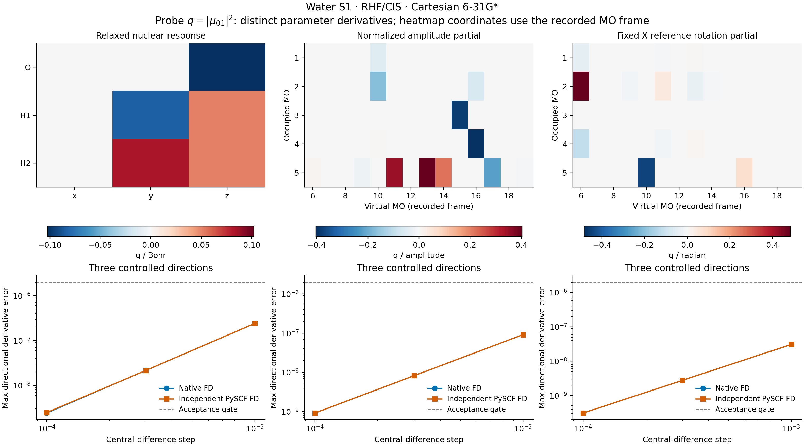

# X06 — water CIS wavefunction sensitivities



The existing [water CIS example](../../../examples/ci/cis_h2o_gradients.py)
now uses the physical, gauge-invariant scalar
`q = |mu_01|^2`, the squared singlet transition dipole in `(e Bohr)^2`.
The molecular geometry and 6-31G* basis are retained. Native integrals,
implicit RHF response, AO-to-MO transformation and CIS eigenpair response
come from the existing shared implementations.

## Three parameter directions

1. **Nuclear coordinates:** `dq/dR` follows the relaxed HF orbitals and CIS
   state and differentiates the moving AO position integrals. All displaced
   states are matched to the same reference state using the phase-invariant
   transition-density overlap.
2. **Excitation amplitudes:** `dq/dX` varies the normalized CIS state while
   holding the orbitals and AO position integrals fixed. Normalization is
   part of the scalar function, so the radial derivative vanishes:
   `sum_ia X_ia dq/dX_ia = 0`.
3. **Reference orbitals:** occupied–virtual angles define the orthogonal
   rotation `C -> C exp([[0,theta],[-theta.T,0]])`, with X held fixed. This
   changes the reference and excited wavefunctions' orbital embedding. It is
   a separate chart partial derivative, **not** a reconverged HF/CIS response
   or a component of the nuclear derivative. No CIS eigenproblem is solved
   away from an HF stationary reference. The original three selected Givens
   rotations are retained and checked against the complete OV heatmap.

These three derivatives do not automatically add to the nuclear response;
they belong to different parameter maps. Heatmap entries for amplitudes and
reference rotations refer to the recorded MO frame. The scalar q is invariant
under a state sign and separate occupied/virtual rotations with the covariant
amplitude transformation `X -> U.T X V`; its component gradients transform
accordingly. The AO transition and attachment operators are checked under
the same rotations. The auxiliary NTO purity `Tr[(X X.T)^2] = 0.999388222111`
is recorded as a state-character diagnostic; no SVD-frame derivative is used.

The transition convention is `T=sqrt(2) C_o X C_v.T` for unit-normalized
real singlet X, and `mu_01=-Tr(T r)`. Orthogonal electronic states have no
nuclear transition term. The helper explicitly requires the shared
`EigenResponseConfig(target="eigenpairs")` for transition derivatives; an
energy-only response cannot silently yield a derivative with stopped X.

## Calculation and results

The Cartesian geometry in Angstrom is O `(0,0,0.1173)`, H
`(0,0.7572,-0.4692)`, H `(0,-0.7572,-0.4692)`. It has 19 AOs, 5 occupied
orbitals and 70 singlet single excitations. Six dense CIS roots are retained,
and the selected state is S1. The existing direct response is bounded by
`max_dense=128`, with `rtol=1e-11`; no new eigenvalue algorithm is introduced.
RHF energy/density/gradient tolerances are `1e-12`, `1e-11`, `1e-11`, with
180 initial cycles and 300 implicit-workflow iterations allowed. The implicit
SCF response uses tolerance `1e-10`, maximum 100 iterations and restart 40.

| Quantity | Measured value |
| --- | ---: |
| RHF energy / Eh | -76.01050498825715 |
| S1 excitation / Eh | 0.352523200011760 |
| Transition mu_x / e Bohr | 0.269774285359531 |
| Squared transition moment q / (e Bohr)^2 | 0.0727781650412459 |
| Oscillator strength | 0.0171039944208827 |
| O z derivative / q per Bohr | -0.102139696611208 |
| H1 y derivative / q per Bohr | -0.0833223493556252 |
| H1 z derivative / q per Bohr | 0.0510698483056125 |

The transition y/z components vanish to numerical precision. Equal-and-opposite
atomic contributions give the expected translation-invariant scalar response.
Full arrays are in [gradscf.json](gradscf.json) and the three CSV heatmap tables.

For each parameter family, three unit directions (seed 106) are tested with
symmetric steps `1e-3`, `3e-4`, and `1e-4`. Geometry directions remove rigid
translation; amplitude directions are tangent to the normalized state sphere.
The final-step acceptance gate is an absolute directional-derivative error
of `2e-6`, fixed before execution. All steps are retained.

| Parameter family | Native FD maximum error | Independent FD maximum error |
| --- | ---: | ---: |
| Nuclear coordinates | 2.42e-9 | 2.48e-9 |
| Normalized amplitudes | 9.18e-10 | 9.18e-10 |
| Fixed-X reference rotations | 3.08e-10 | 3.08e-10 |

The independent geometry oracle rebuilds PySCF RHF, public `get_ab`, and
SciPy dense roots at every displacement, and uses public `transition_dipole`.
The initial native/reference transition operators are matched in the AO
overlap metric. Across geometries the minimum accepted overlap is 0.85,
runner-up margin 0.2, and retained-root gap `1e-4` Eh. The amplitude/reference
partials instead share the explicitly recorded C/X inputs, use independent
PySCF AO integrals and its public transition-moment contraction, and use
SciPy's matrix exponential for reference rotations. They are independent
contraction/FD checks on a common specified state, not independent electronic
state optimizations. Details are in [pyscf.json](pyscf.json).

State-sign and same-block gauge scalar errors are at most `1.12e-16`, AO
operator errors at most `2.00e-15`, and amplitude-gradient covariance error
is `4.31e-16`. The focused H2 transition-chain and fixed-MO gauge/partial
tests changed from **2 failed, 1 passed** to **3 passed in 36.56 s**. The H2
gate includes independent geometry differences for both q and f and rejects
derivatives when amplitudes are stopped. Logs are in [validation/](validation/).

## Files, execution, and limits

- [gradscf.json](gradscf.json), [pyscf.json](pyscf.json): states, physical
  definitions, gradients, tracking, all finite differences and source hashes.
- [nuclear_gradient.csv](nuclear_gradient.csv),
  [amplitude_gradient.csv](amplitude_gradient.csv), and
  [reference_rotation_gradient.csv](reference_rotation_gradient.csv): raw
  heatmap values and units.
- [probe_sensitivities.png](probe_sensitivities.png) and
  [probe_sensitivities.pdf](probe_sensitivities.pdf): separately scaled signed
  sensitivities, with native and independent direction checks.

All numerical work and plotting ran on `jy_gpu_1` (hostname `c20`), CPU
float64, OMP/BLAS thread settings of 2, Python 3.11.15, JAX 0.10.0, PySCF 2.13.0. Native
derivatives and checks took **65.59 s**, with peak RSS **1,803,796 KiB**;
the independent workflow took **4.60 s**. Their tasks differ, so these are
provenance timings rather than a speed comparison. Compilation-cache reuse
was disabled. JAX has separate compilation/runtime thread pools; these settings
do not establish an exclusive two-core allocation.

The frozen source snapshot is
`/home/yjiao/gradscf_checks/ad-showcase-excited-character-20261015`, based on
the previously validated property snapshot. Its executed Python source-tree
SHA256 is `2bf58e608f290fbf3b3ef1fcee483a336ef94740be3c269bf622cf92f217502a`.
Executed-script hashes precede the added measured-output comments. This
snapshot does not incorporate the separately developed stationary-value or
nonlinear higher-response changes.

```bash
export CUDA_VISIBLE_DEVICES= JAX_PLATFORMS=cpu JAX_ENABLE_X64=1
export JAX_ENABLE_COMPILATION_CACHE=false OMP_NUM_THREADS=2 OPENBLAS_NUM_THREADS=2
PYTHONPATH=src timeout 900 /home/yjiao/opt/miniconda3/envs/jax_scf/bin/python examples/ci/cis_h2o_gradients.py
PYTHONPATH=src timeout 900 /home/yjiao/opt/miniconda3/envs/jax_scf/bin/python examples/ci/compare_cis_h2o_probes.py
timeout 300 /home/yjiao/opt/miniconda3/envs/jax_scf/bin/python examples/ci/plot_cis_h2o_probes.py
```

This component covers first derivatives of an isolated real RHF/CIS singlet
at one water geometry. It does not establish raw coefficient gradients as
gauge-independent observables, response at crossings, higher derivatives of
the probe, TDDFT/EOM response, or basis convergence.
