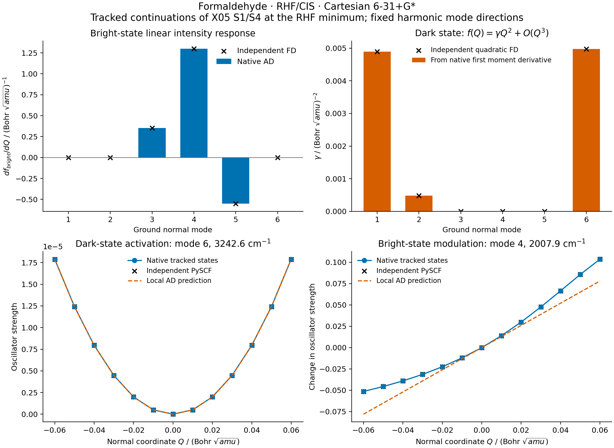

# X07 — oscillator-strength geometry response



This component follows the dark S1 and the bright S4 selected in
[X05](../X05_formaldehyde_cis_ntos/README.md) to the independently validated
RHF ground minimum from [X10](../X10_formaldehyde_cis_emission/README.md).
It calculates the full Cartesian Jacobian of the transition moment and
oscillator strength, projects it onto the six ground normal modes, and
checks all six internal directions against independent PySCF calculations.
The method is real singlet RHF/CIS with Cartesian 6-31+G*, 42 AOs and a
272-dimensional single-excitation space.

## State identity and derivative definitions

A direct jump from the fixed X05 geometry to the RHF minimum failed the
predeclared transition-density overlap gate: the best match was 0.722308,
below 0.85. The failed log is retained. Eight linear geometry increments
then passed without changing the overlap, runner-up margin (0.2), or root-gap
(`1e-4` Eh) gates. Both anchors are updated only after both matches pass.
The smallest S4 overlap between accepted increments is 0.9930128; both
branches finish at sorted roots S1/S4. This is an explicit continuation of
the X05 states, not a new assertion that S4 is globally the brightest state.
Matching uses transition-density overlaps, not many-electron wavefunction
overlaps. The independent PySCF calculation repeats this continuation.

The helper reuses relaxed HF orbitals, shared CIS eigenpair response, and
moving native AO dipole integrals. It returns
`mu=-Tr(T r)` and `f=(2/3) omega |mu|^2` in atomic units. The full Cartesian
derivative includes the geometry dependence of omega, amplitudes, orbitals
and integrals. An explicit shared direct response has `max_dense=512` and
`rtol=1e-11`; no derivative of a stopped eigenvector is accepted.

The fixed harmonic directions come from the X10 ground-state AD Hessian.
The shared mode helper uses electron-mass atomic units; this example
explicitly converts its displacements to `v.T M_amu v=1`, checked to `1e-10`.
The plotted coordinate is `Q` in `Bohr sqrt(amu)`, with `R(Q)=R0+Q v`.
Mode vectors themselves are held fixed and are not differentiated.

At this planar geometry S1 has `f=2.89e-31`, a numerical symmetry residual,
and its first strength derivative vanishes. Its transition-moment derivative
can still be nonzero. The leading intensity is therefore

`f(Q) = gamma Q^2 + O(Q^3)`,

`gamma = (2/3) omega(0) |dmu/dQ|^2`.

Gamma uses the first AD transition-moment derivative, followed by this
algebraic identity. It is not an AD Hessian calculation of f. Independent
quadratic finite differences check its normalization and factor of two.
Individual state signs are arbitrary; all signed moment differences use a
continuous phase fixed by the transition-density metric. PySCF's public
position-moment contraction is negated to use the same electronic `-r`
convention before applying that state phase. Oscillator strengths are phase
invariant. See [PySCF's transition implementation](https://pyscf.org/_modules/pyscf/tdscf/rhf.html).

## Measured values and validation

At the RHF minimum, the tracked excitation energies are 0.173370095674 Eh
(S1) and 0.363618557898 Eh (S4). S4 has `f=0.182118727539` and a transition
moment magnitude of 0.866762099969 e Bohr along z.

| Ground mode | Wavenumber / cm^-1 | Bright df/dQ | Dark gamma |
| --- | ---: | ---: | ---: |
| 1 | 1333.0973 | approximately 0 | 0.004893889127 |
| 2 | 1374.3925 | approximately 0 | 0.000483960701 |
| 3 | 1668.3698 | 0.353155900300 | approximately 0 |
| 4 | 2007.9249 | 1.300482065567 | approximately 0 |
| 5 | 3168.1857 | -0.550895383579 | approximately 0 |
| 6 | 3242.5908 | approximately 0 | 0.004972609839 |

The derivative units are `(Bohr sqrt(amu))^-1` for df/dQ and
`(Bohr sqrt(amu))^-2` for gamma. Full numerical symmetry residuals are
preserved in [mode_response.csv](mode_response.csv). Ranking gamma at equal
Q does not rank vibronic line strengths: no zero-point weighting, vibrational
overlap, or Franck–Condon/Herzberg–Teller spectrum is constructed here.

Every mode uses central differences at Q steps `2e-3`, `6e-4`, and `2e-4`.
The finest-step gate, specified before execution, is `2e-6` for each moment/f
derivative and for gamma. The full step sequence is retained. Mode 4 is the
most sensitive derivative check and has a finest-step error of `1.02e-6`;
the measured accuracy is not claimed to be tighter than that gate.

| Independent comparison | Maximum error | Gate |
| --- | ---: | ---: |
| Excitation energies / Eh | 1.62e-13 | 1e-8 |
| Baseline signed moments/strengths | 3.46e-12 | 2e-7 |
| Six mode moment/strength derivatives | 1.023e-6 | 2e-6 |
| Dark quadratic coefficients | 8.39e-11 | 2e-6 |
| Finite-amplitude moments/strengths | 4.27e-12 | 2e-7 |

The reference rebuilds PySCF RHF and public `get_ab`, diagonalizes the matrix
with SciPy, and uses public transition moments/strengths at each geometry.
It implements no iterative solver and imports no GradSCF physics. The H2
transition-response prerequisite already passed three focused tests,
documented with [X06](../X06_water_cis_probes/README.md).

Independent differences span all six internal vibrational directions.
Additional contractions of the saved Cartesian AD Jacobians test rigid
translations and rotational covariance: maximum errors are `3.36e-12` for
translation, `8.48e-13` for vector-moment rotation, and `7.45e-14` for scalar
strength rotation, all below `2e-7`. These are native conservation checks,
not additional external Cartesian finite differences; see
[rigid_response_checks.json](rigid_response_checks.json).

Thirteen points from Q=-0.06 to +0.06 are evaluated for modes 4 and 6.
The dark quadratic prediction closely follows the displayed recomputed curve;
only its local coefficient has a prescribed acceptance gate.
The bright linear prediction visibly departs from the recomputed curve at
larger displacements; the figure retains this nonlinear behavior. Every
point passes state matching. The curves are geometry-dependent electronic
intensities, not a broadened absorption spectrum or predicted linewidth.

## Files and reproduction

- [gradscf.json](gradscf.json), [pyscf.json](pyscf.json): Cartesian/mode
  derivatives, all steps, continuation, phase/identity checks and raw curves.
- [cartesian_response.csv](cartesian_response.csv),
  [mode_response.csv](mode_response.csv), [scans.csv](scans.csv), and
  [continuation.csv](continuation.csv): complete numerical tables.
- [validation/](validation/): native/reference/render logs, the rejected
  direct geometry jump, and a separate corrected NumPy read-only-view error.
  The array-ownership error was an implementation failure, not a physical
  nonconvergence or a relaxed numerical tolerance.

All calculations/rendering ran on `jy_gpu_1` (hostname `c20`), CPU float64,
Python 3.11.15, JAX 0.10.0, PySCF 2.13.0, with OMP/BLAS settings of 2.
JAX uses separate thread pools; an exclusive two-core allocation is not
claimed. The native AD/continuation/FD/scan workflow took **717.00 s**, peak
RSS **4,537,304 KiB**; the independent workflow took **72.21 s**. Their tasks
differ and these are not portable solver-speed benchmarks. Compilation-cache
reuse was disabled.

The frozen snapshot is
`/home/yjiao/gradscf_checks/ad-showcase-excited-character-20261015`.
Executed Python source-tree SHA256:
`2bf58e608f290fbf3b3ef1fcee483a336ef94740be3c269bf622cf92f217502a`.
All X04/X05/X10 input hashes and executed script hashes are in the JSON.
Measured-output comments were added after those script hashes were recorded.

```bash
export CUDA_VISIBLE_DEVICES= JAX_PLATFORMS=cpu JAX_ENABLE_X64=1
export JAX_ENABLE_COMPILATION_CACHE=false OMP_NUM_THREADS=2 OPENBLAS_NUM_THREADS=2
PYTHONPATH=src timeout 1200 /home/yjiao/opt/miniconda3/envs/jax_scf/bin/python examples/tdscf/formaldehyde_oscillator_response.py
PYTHONPATH=src timeout 900 /home/yjiao/opt/miniconda3/envs/jax_scf/bin/python examples/tdscf/compare_formaldehyde_oscillator_response.py
timeout 300 /home/yjiao/opt/miniconda3/envs/jax_scf/bin/python examples/tdscf/plot_formaldehyde_oscillator_response.py
```

This is the formaldehyde RHF/CIS component of X07. Ethylene, DFT TDA/TDDFT,
correlated states, basis convergence and vibronic spectra remain separate
gates. The successful sampled path is not a universal state-tracking guarantee
near crossings.
