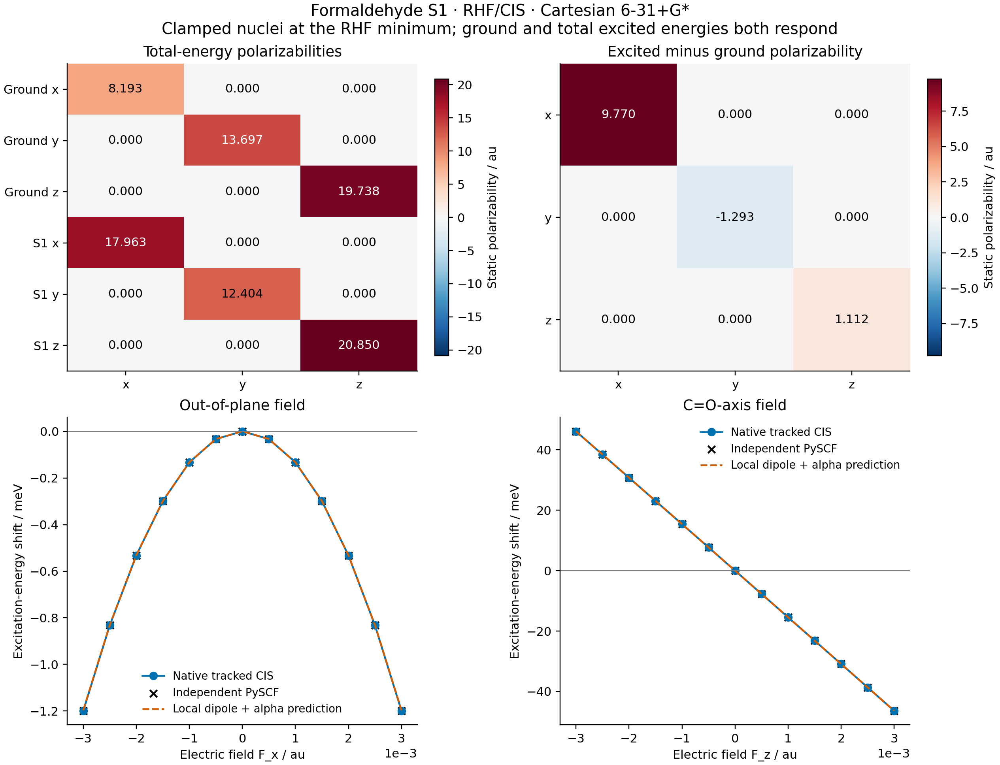

# X08 — excited-state polarizability and Stark response



This example differentiates the **total** S1 energy `E1=E_RHF+omega_CIS`
with respect to a static electric field at the fixed, independently validated
RHF minimum from [X10](../X10_formaldehyde_cis_emission/README.md). It uses
real singlet RHF/CIS, Cartesian 6-31+G*, full native integrals, implicit HF
orbital relaxation and shared isolated-root CIS response. The ground-state
dipole/polarizability are computed at the same geometry for comparison.

## Definitions and scope

The one-electron Hamiltonian is `h(F)=h(0)+sum_a F_a r_a`, and the nuclear
field energy is `-F dot sum_A Z_A R_A`. Thus

`mu_s = -dE_s/dF`, `alpha_s = -d²E_s/dF²`,

`E_s(F) = E_s(0) - mu_s dot F - (1/2) F.T alpha_s F + O(F³)`.

The helper forms the three excited-energy Hessian columns as JVPs of the
same field gradient. It does not differentiate a fitted curve or add a new
response solver. The ground reference reuses the existing stationary dipole
identity and its field derivative. Electron response is relaxed, while the
nuclei are clamped. Nuclear relaxation, vibrational polarizability, solvent
response and dynamic-frequency effects are outside this calculation.

The excitation Stark shift uses differences of the two total-energy responses:
`delta_omega(F) = -delta_mu dot F - (1/2) F.T delta_alpha F + O(F³)`.
Reporting alpha from omega alone as the total excited polarizability would
omit the ground contribution; both tensors and their difference are retained.
An excited stationary branch need not have a positive polarizability, so no
positivity gate is imposed. The computed S1 tensor happens to be positive
here, while its y change relative to the ground state is negative.

All units are atomic: energy Eh, dipole e Bohr, field Eh/(e Bohr), and static
polarizability `e² Bohr²/Eh` (conventionally quoted as Bohr³). The molecular
plane is yz and the C=O direction is z.

## Settings and native results

The 42-AO, 8-occupied-orbital system retains six dense CIS roots, with S1
selected and checked under every field. The 272-dimensional shared response
uses explicit direct solves, `max_dense=512`, `rtol=1e-11`. RHF seed
thresholds are energy `1e-12`, density `1e-11`, and orbital gradient `1e-11`,
with 180 cycles allowed. The implicit molecular workflow uses gradient
tolerance `1e-11`, at most 300 iterations, and linear response tolerance
`1e-10`, maximum 100 iterations and restart 40. No convergence or state
matching tolerance was relaxed to obtain the result.

Zero-field energies are `E0=-113.87115683621803 Eh` and
`E1=-113.69778674054412 Eh`; `omega=0.173370095673913 Eh`.

| Quantity | RHF ground | Total CIS S1 | S1 minus ground |
| --- | ---: | ---: | ---: |
| mu_z / e Bohr | -1.134209683049 | -0.567393660465 | 0.566816022584 |
| alpha_xx / au | 8.192935685 | 17.962602986 | 9.769667301 |
| alpha_yy / au | 13.697021246 | 12.403895682 | -1.293125564 |
| alpha_zz / au | 19.738116213 | 20.850449970 | 1.112333757 |

The x/y dipoles and tensor off-diagonal elements vanish to numerical precision
at this planar C2v geometry. The raw tensor asymmetry is `1.44e-14`; no
symmetrization was applied to the reported AD tensors. This small internal
asymmetry is a consistency check, not a claim of external accuracy at that
many digits.

## Independent finite-field gates

The field directions are x, y, z, three normalized pair sums, and one seeded
random unit direction (seed 108). Steps are `1e-3`, `3e-4`, and `1e-4` au.
Both ground and total excited energies are reconverged at every field.
The first six directions reconstruct the complete symmetric tensor;
the seventh is an additional directional check. Native finite-energy
differences and the independent PySCF calculation use the same prescribed
steps. The final-step gates are `2e-6` for dipoles and `2e-4` for alpha.

The independent reference uses fresh PySCF RHF, public `get_ab`, and SciPy
dense CIS roots. It independently assembles both electronic and nuclear
field terms. The baseline transition operator agrees in the AO metric,
and every field is matched to that anchor, requiring overlap >=0.85,
runner-up margin >=0.2 and retained-root gap >=`1e-4` Eh.

| Independent comparison | Maximum error | Gate |
| --- | ---: | ---: |
| Baseline total energies / Eh | 5.68e-14 | 2e-8 |
| Directional dipoles / au | 2.51e-7 | 2e-6 |
| Directional polarizabilities / au | 6.81e-5 | 2e-4 |
| Reconstructed full alpha tensors / au | 7.25e-5 | 2e-4 |
| Total energies on displayed curves / Eh | 4.27e-13 | 2e-8 |

Native final-step finite-energy errors are `2.49e-7` for mu and `2.62e-5`
for alpha. The reference alpha-direction errors over the three steps are
`2.45e-3`, `2.18e-4`, and `6.81e-5` au. Subtracting large total energies
limits the finest-step oracle precision; in particular, its nominally zero
off-diagonal tensor entries contain about `7e-5` au noise. The full steps
and unsymmetrized native tensors are preserved instead of treating those
finite-difference values as an exact analytic reference.

The prerequisite tilted, shifted H2/6-31G* test at a nonzero field changed
from **1 failed** (missing interface) to **1 passed in 45.21 s**. It compares
the full alpha tensor to independent mixed finite-energy differences, native
dipole differences, and symmetry, including nuclear field energy. The
formal comparison independently validates a larger molecule and six roots.

The x and z curves use 13 fields from -0.003 to +0.003 au. The figure plots
the excitation-energy shift and the local prediction from delta_mu and
delta_alpha; raw ground and total excited energies are also saved. These
are static electronic Stark curves, not an optical line shape or an
experimental field calibration.

## Files and provenance

- [gradscf.json](gradscf.json), [pyscf.json](pyscf.json): native tensors,
  reference tensors, every field step, state identities, curves and hashes.
- [electric_tensors.csv](electric_tensors.csv),
  [stark_curves.csv](stark_curves.csv): full physical values and local
  quadratic predictions.
- [stark_polarizability.png](stark_polarizability.png) and
  [stark_polarizability.pdf](stark_polarizability.pdf): tensor changes and
  source-backed Stark curves.
- [validation/](validation/): prerequisite red/green, native, reference and
  rendering logs.

All calculations/rendering ran on `jy_gpu_1` (hostname `c20`), CPU float64,
Python 3.11.15, JAX 0.10.0, PySCF 2.13.0, with OMP/BLAS settings of 2.
JAX has separate thread pools; an exclusive two-core allocation is not
claimed. The native workflow took **412.78 s**, peak RSS **3,650,068 KiB**;
the independent workflow took **56.00 s**. The native workflow includes
AD derivatives in addition to finite-field checks, so these timings do not
establish a portable performance comparison. Compilation-cache reuse was disabled.

The frozen snapshot is
`/home/yjiao/gradscf_checks/ad-showcase-excited-stark-20261015`.
Executed Python source-tree SHA256:
`57f56cf8ae9a5d158998fcb59dcba13294d5ec1586940b17d5628b811ad360df`.
The input X10 minimum record SHA256 is
`0a33ef395c89dbb6f52a7fb9bb216f603c1829d35e9f1e49d18222e1d33da28b`.
Executed-script hashes precede the later measured-output comments. This
snapshot remains separate from subsequent shared stationary/spectral changes.

```bash
export CUDA_VISIBLE_DEVICES= JAX_PLATFORMS=cpu JAX_ENABLE_X64=1
export JAX_ENABLE_COMPILATION_CACHE=false OMP_NUM_THREADS=2 OPENBLAS_NUM_THREADS=2
PYTHONPATH=src timeout 1200 /home/yjiao/opt/miniconda3/envs/jax_scf/bin/python examples/tdscf/formaldehyde_cis_stark.py
PYTHONPATH=src timeout 900 /home/yjiao/opt/miniconda3/envs/jax_scf/bin/python examples/tdscf/compare_formaldehyde_cis_stark.py
timeout 300 /home/yjiao/opt/miniconda3/envs/jax_scf/bin/python examples/tdscf/plot_formaldehyde_cis_stark.py
```

The delivered component covers one isolated RHF/CIS singlet, geometry and
basis. TDDFT/EOM, near-crossing response, basis convergence and nuclear or
dynamic-frequency contributions require separate gates.
