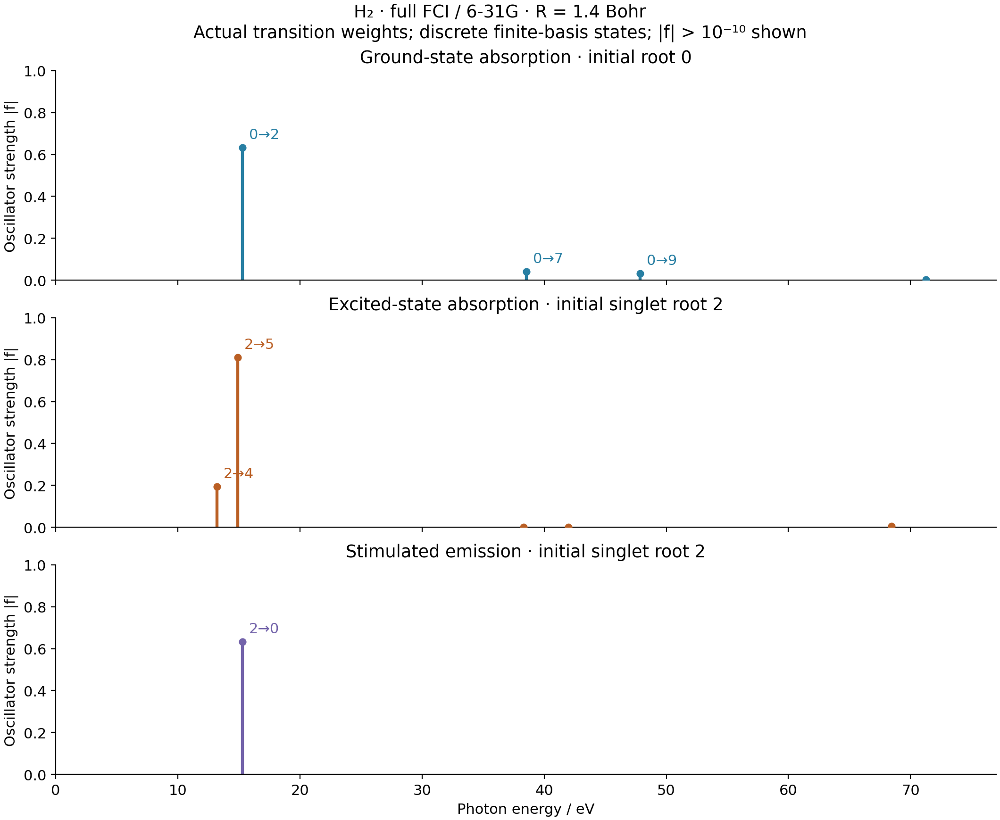
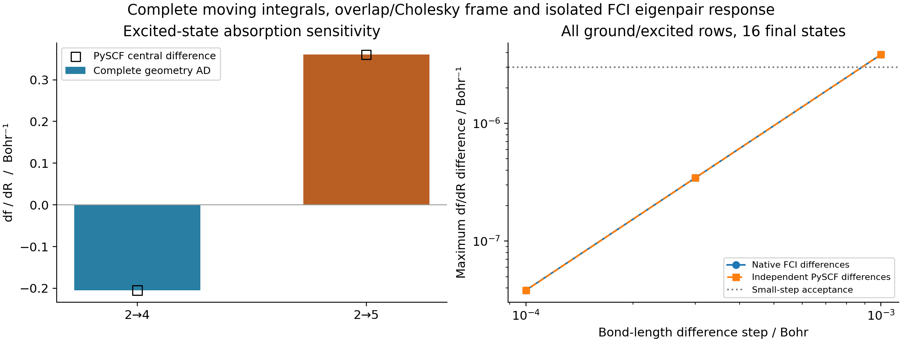

# X09: H2 full-FCI excited-state absorption and geometry response

The native AD calculation, independent PySCF comparison and weighted spectra
passed on **2026-10-16**. This is a small, complete active-space example, not
a production TDDFT/EOM excited-state-absorption implementation.

H2 is centered at `(0,0,±0.7)` bohr. Both electrons and all four spatial
6-31G orbitals are active: `(Nalpha,Nbeta)=(1,1)`, 16 determinants and 16
computed states. No HF calculation or frozen-orbital approximation is used.
The axes below show actual oscillator strengths, with upward absorption and
downward stimulated emission separated.



## State selection and physical weights

Root numbers are zero-based positions in the complete fixed-Ms spectrum,
which contains singlets and triplets. A forward inventory confirmed that
all 16 roots are isolated: the smallest gap is **0.0449523181 Hartree**.
The lowest bright excited singlet is root 2, with ungerade inversion parity.
The example then fixes this state identity for the local derivative check.

| Transition | Meaning | Signed oscillator strength | df/dR / bohr^-1 |
| --- | --- | ---: | ---: |
| 0 to 2 | Ground-state absorption | 0.632020758177 | Saved in JSON/CSV |
| 2 to 4 | Excited-state absorption, singlet to singlet | 0.193430408197 | -0.204756783205 |
| 2 to 5 | Excited-state absorption, singlet to singlet | 0.809989157124 | 0.360304876963 |
| 2 to 0 | Downward stimulated emission | -0.632020758177 | Saved in JSON/CSV |

The initial excited-state energy is `-0.589346651817535` Hartree and the
ground-state energy is `-1.151679031474511` Hartree, including nuclear
repulsion. Triplet and same-parity dipole-forbidden transitions are computed
and retained in the data; their signed strengths are below `1e-12` in this
case. The figure displays only `|f| > 1e-10`, with one common vertical scale.
The tabular export retains all 32 transitions from the two initial states.

In atomic units,

```
mu_ij = <i|sum_A Z_A R_A - sum_e r_e|j>
f_ij  = (2/3) (E_j-E_i) sum_a |mu_ij,a|^2.
```

Downward transitions have negative signed `f_ij`; their panel shows the
positive magnitude at a positive emitted-photon energy. The electronic
dipole has its negative electron-charge sign. The nuclear term multiplies
the state overlap and vanishes between distinct orthogonal states.

These oscillator-strength plots do not include excited-state populations,
pump/probe dynamics, line shapes, laser factors or continuum cross sections.
High-energy roots are discrete states of this finite Gaussian basis. No
experimental transition assignment or basis-converged spectrum is claimed.

## Complete metric and eigenpair response

The native integral plan moves the two basis centers and nuclei together.
It recomputes overlap, kinetic, nuclear-attraction, Coulomb and position
integrals. With `S=L L.T`, the orbital frame is `X=L^(-T)` so that `X.T S X=I`.
Both `S` and `X` participate in JAX AD; no integral or metric Taylor model is
substituted for the actual moving problem.

The existing `fci.solve_fci` calls the shared bounded dense Hermitian solver;
`EigenResponseConfig(target="eigenpairs")` supplies the coefficient response.
Transition moments use `fci.trans_rdm1`. The four-orbital Hamiltonian and
response use a dense capacity limit of 32, eigen tolerance `1e-12`, and
direct response tolerances `rtol=1e-10`, `atol=1e-12`. The spectral gap policy
remains `gap_atol=gap_rtol=1e-8`; each sampled point additionally requires an
actual minimum gap above `1e-4` Hartree.

`R` is the bond length. A change `dR` moves the atoms by `±dR/2`; derivatives
are per bohr of bond length. AD computes the full two-by-sixteen array of
signed-strength derivatives. Central differences validate it rather than
constructing it.

| Bond-length step / bohr | Native FD maximum df/dR error | Independent PySCF FD maximum error |
| ---: | ---: | ---: |
| 1e-3 | 3.829621e-6 | 3.829620e-6 |
| 3e-4 | 3.446142e-7 | 3.446220e-7 |
| 1e-4 | 3.837019e-8 | 3.825625e-8 |



The largest native eigen residual is `2.009e-15`. All six displaced
calculations retain the expected self-matching roots, spin values and open
gaps. Their minimum physical wavefunction overlap is `0.999999561224`.
The existing `NativeRHF.cross_overlap` method supplies only native cross-AO
overlaps; its SCF routine is never called. For one alpha and one beta
electron, the CI overlap is the product of the two single-particle overlaps,
contracted with the two CI coefficient matrices. The separate PySCF check
uses `gto.intor_cross` and obtains the same minimum overlap.

A fixed random orthogonal rotation of all four orbitals (seed 83) changes
neither the full-CI spectrum nor physical strengths. Measured maximum strength
and derivative differences are `3.442e-15` and `6.772e-15`, respectively.
This checks full orbital-frame invariance without introducing a reference
HF solution.

## Independent reference and finite-space closure

The separate reference imports PySCF, NumPy and SciPy, with no GradSCF
solver or integral implementation. It builds its own AO integrals,
Cholesky frame and full-FCI states at every bond length. Native CI vectors
are used only for sign alignment of the central transition RDMs, never as
input to the reference eigensolver.

| Central comparison | Maximum absolute difference |
| --- | ---: |
| Total energies / Hartree | 4.219e-15 |
| Cholesky orbital frame | 8.882e-16 |
| S squared | 1.998e-15 |
| State-to-state one-particle RDM | 8.061e-15 |
| Transition dipoles / atomic units | 1.454e-14 |
| Signed oscillator strengths | 7.216e-15 |

The largest independently recomputed PySCF CI residual is `6.386e-15`.
The reference performs seven full-FCI calculations: the central geometry
and two displacements for each of three steps.

Completeness is checked within the finite 16-state Hilbert space, using
the directly assembled many-electron dipole and Hamiltonian operators:

```
sum_j f_ij = (1/3) sum_a <i|[mu_a,[H,mu_a]]|i>.
```

| Initial state | Complete signed sum | Double-commutator value |
| --- | ---: | ---: |
| Ground root 0 | 0.705658047037638 | 0.705658047037636 |
| Excited root 2 | 0.377782587614648 | 0.377782587614653 |

The downward term is included in the excited-state sum. This is a finite
Hilbert-space self-consistency check. **It does not assert the continuum
TRK value `Ne=2` for this finite basis.** Isolated roots and one local bond
coordinate are validated; crossings, degenerate individual-state response,
nonadiabatic couplings and general TDDFT/EOM ESA remain outside this example.

## Reproduction and provenance

From the repository root:

```sh
export CUDA_VISIBLE_DEVICES=
export JAX_PLATFORMS=cpu
export JAX_ENABLE_X64=1
export JAX_ENABLE_COMPILATION_CACHE=false
export OMP_NUM_THREADS=2
export OPENBLAS_NUM_THREADS=2
export PYTHONPATH=src

python examples/fci/h2_excited_absorption.py
python examples/fci/compare_h2_excited_absorption_pyscf.py
python examples/fci/plot_h2_excited_absorption.py
```

All numerical calculations and rendering ran on `jy_gpu_1` / `c20`, CPU
float64, using `/home/yjiao/opt/miniconda3/envs/jax_scf/bin/python`.
The native calculation and all its internal checks took **9.847 seconds**,
including compilation; the independent seven-point reference took **0.155
seconds**. The scopes differ and these are not controlled speed comparisons.
The main and reference/plot jobs were limited to 1200 and 600 seconds.

The frozen source is
`/home/yjiao/gradscf_checks/ad-showcase-fci-esa-20261015`, copied from the
stable integration snapshot before this case. It includes the final shared
Hermitian-response fixes. Its 484 Python-module/native-library hashes were
rechecked unchanged after the calculation. The repository base is
`8f8c93d25fcc150aace9ad5c6a8e070c4f2937af`, with uncommitted source changes;
this is not described as a pristine commit export. The manifest is not a
complete environment image or basis-data archive. The full remote snapshot
is retained. No core solver, vendor source or alternate solver was added
for this example.
The executed-example hashes describe the source before measured tail comments.

The scientific data were not rerun for the review's PDF font-type change;
only the figures/CSVs were regenerated. Raw logs, the preliminary state
inventory and the previous plot hash remain under ignored
`artifacts/ad_showcase/development/X09_fci_esa/`.

Data: [native AD](gradscf.json), [independent PySCF](pyscf.json),
[source hashes](source_hashes.sha256), [executed examples](example_sources.sha256).

Figures: [weighted transitions PNG](excited_absorption.png) /
[PDF](excited_absorption.pdf), [geometry response PNG](geometry_response.png) /
[PDF](geometry_response.pdf).

Tables: [all states](states.csv), [all transitions and derivatives](transitions.csv),
[derivative checks](derivative_checks.csv).
