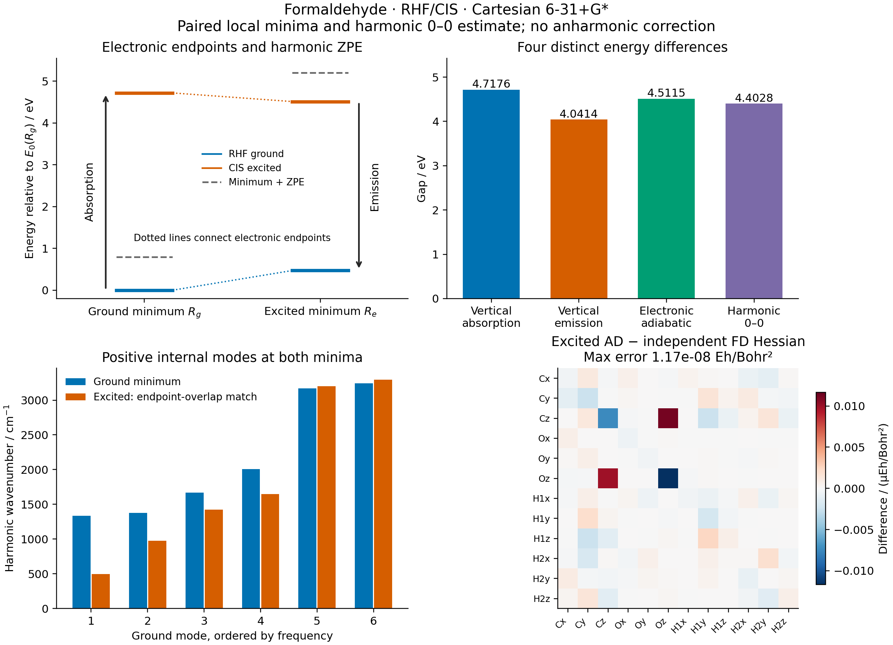

# X10: formaldehyde CIS Hessians, emission and harmonic 0-0 energy

Measured on **2026-10-15**, on `jy_gpu_1` (`c20`), CPU float64. A complete
Cartesian AD Hessian at the [X03](../X03_formaldehyde_cis_optimization/README.md)
S1 minimum passes independently reconverged gradient differences and a separate
PySCF reference. A same-level RHF ground minimum and Hessian complete the four
electronic energy endpoints and their harmonic zero-point corrections.



## Energies and their definitions

All calculations use neutral closed-shell formaldehyde, RHF/singlet CIS,
Cartesian 6-31+G*, 42 AOs, eight occupied orbitals and six singlet CIS roots.
`E1(R) = E0(R) + omega_CIS(R)`. Ground and excited minima are denoted `Rg` and
`Re`; the latter retains X03's independently validated geometry. The ground
optimization starts from the same planar geometry as X02 and uses SciPy BFGS
with all 12 Cartesian coordinates, `gtol=3e-8`, and at most 100 iterations.
It converges in **8 iterations / 10 objective calls**.

| Electronic endpoint | Energy / Hartree |
| --- | ---: |
| E0(Rg) | -113.871156836218 |
| E1(Rg) | -113.697786740544 |
| E0(Re) | -113.853881915695 |
| E1(Re) | -113.705362557861 |

| Observable | Definition | Hartree | eV |
| --- | --- | ---: | ---: |
| Vertical absorption | E1(Rg) - E0(Rg) | 0.173370095674 | 4.717640637 |
| Vertical emission | E1(Re) - E0(Re) | 0.148519357834 | 4.041417611 |
| Electronic adiabatic gap | E1(Re) - E0(Rg) | 0.165794278357 | 4.511492146 |
| Harmonic 0-0 estimate | Adiabatic gap + ZPE1 - ZPE0 | 0.161801659989 | 4.402847465 |

The ground and excited harmonic zero-point energies are **0.029148154595** and
**0.025155536228 Hartree**, respectively. Excited-state relaxation lowers the
electronic energy by 0.206148491 eV; ground-state reorganization costs
0.470074535 eV. Their sum equals the vertical Stokes shift, **0.676223026 eV**.
The script checks this identity explicitly. Vertical energies receive no
zero-point correction. Inspect the full-precision [gap table](gaps.csv) and
[four-endpoint native record](emission.json).

These are one pair of local minima within the stated finite-basis model.
The 0-0 value is a harmonic estimate, without anharmonicity, thermal corrections
or vibronic intensities. No experimental agreement, global-minimum search,
basis convergence, or DFT/TDDFT excited-state Hessian is claimed.

## Complete Hessians and independent validation

`CISGeometry.total_hessian_vector` takes a JVP of the existing relaxed total
excited-state gradient. Native moving AO integrals, implicit RHF orbital
response, the shared AO-to-MO transformation, `ci.solve_cis`, and the shared
Hermitian spectral rule supply the entire derivative chain. The 12 Cartesian
basis directions assemble the complete excited Hessian; displaced gradients
only validate it. This is separate from X03's archived finite-gradient chart
curvature, which remains a finite-difference result.

The RHF ground optimization and analytic Hessian-vector products reuse
`NativeRHF`. The initial SCF energy, density and orbital-gradient tolerances
are `1e-12 Hartree`, `1e-11`, and `1e-10`. The CIS geometry adapter uses implicit
HF tolerance `1e-10`, at most 100 restart cycles and restart size 40; the ground
`NativeRHF.response` retains its existing implicit defaults (`1e-9`, 20 restart
cycles, restart size 40). CIS Ritz residual tolerance is `1e-10 Hartree`.

| Check | Ground minimum | Excited minimum |
| --- | ---: | ---: |
| Max Cartesian gradient / (Hartree/Bohr) | 2.260e-8 | 5.877e-8 |
| Raw Hessian asymmetry / (Hartree/Bohr^2) | 3.329e-11 | 1.900e-13 |
| Raw translation residual / (Hartree/Bohr^2) | 3.265e-11 | 1.858e-12 |
| Rotation covariance error / (Hartree/Bohr) | 6.166e-12 | 4.254e-12 |
| Max independent Hessian difference / (Hartree/Bohr^2) | 1.786e-8 | 1.166e-8 |
| Max independent frequency difference / cm^-1 | 2.405e-5 | 1.583e-5 |

Rigid-motion checks precede projection. At a finite residual gradient `g`,
rotation covariance requires `H (R cross axis) = g cross axis`, rather than
an exactly zero rotational Hessian action. Raw rotation residuals are
`2.261e-8` and `5.877e-8 Hartree/Bohr`, consistent with the respective gradients.
The covariance errors in the table retain that distinction. The raw Hessian
symmetry and independent Hessian gates are both `2e-6 Hartree/Bohr^2`.

Three normalized random excited-state directions use seed 1010. Maximum
HVP-minus-FD errors across the three directions are:

| Central-difference step / Bohr | Excited max error / (Hartree/Bohr^2) |
| ---: | ---: |
| 1e-3 | 1.003e-7 |
| 3e-4 | 8.965e-9 |
| 1e-4 | 2.307e-9 |

The ground check uses seed 2010 and the same three steps, with errors
`9.944e-8`, `8.047e-9`, and `4.543e-8 Hartree/Bohr^2`; its smallest step shows
the numerical difference floor. Both smaller steps must pass the unchanged
`2e-6 Hartree/Bohr^2` gate.

The independent excited reference uses PySCF's public `get_ab`, SciPy dense
CIS eigenvectors and PySCF analytic CIS gradients. It evaluates all 12 Cartesian
directions at `3e-4` and `1e-4 Bohr`, for **49 independently converged points**.
Hessian differences decrease from `1.044e-7` to `1.166e-8 Hartree/Bohr^2`.
The [reference helper](../../../examples/tdscf/pyscf_cis_reference.py) retains
X03's scoped Krylov cutoff and actual CPHF Z-residual check: tolerance `1e-13`,
`lindep=1e-26`, at most 100 cycles, and true residual norm below `1e-10 Hartree`.
The largest measured Z residual is `2.245e-11 Hartree`. Library functions are
restored after each gradient call. No GradSCF electronic arrays or solver are
used by this molecular reference.

The independent ground reference uses PySCF's analytic RHF gradient and
Hessian at the native minimum, then separately computes the CIS absorption
root. The maximum electronic-gap difference is `1.847e-13 Hartree`; the harmonic
0-0 difference is `1.801e-11 Hartree`. Inspect [excited reference](excited_pyscf.json)
and [paired-minimum reference](emission_pyscf.json), including their acceptance
thresholds and input hashes.

## State and mode identity

All displaced excited-state points are matched to the final fixed anchor using
X02's normalized absolute cross-geometry transition-density overlap. The
minimum observed overlap is **0.999999590**, with a minimum gap of
**0.167475 Hartree**. Ten accepted continuation steps connect the ground and
excited geometries; their minimum overlap is **0.999029192** and minimum gap
**0.154721 Hartree**. Every point selects S1. The existing overlap, margin and
gap rejection thresholds remain 0.85, 0.20 and `1e-4 Hartree`. This diagnostic
is not a many-electron wavefunction overlap.

`normal_modes` uses masses `[12, 15.99491461957, 1.00782503223, 1.00782503223]`
amu for C, O, H1 and H2. After the raw checks it removes six rigid motions
from the mass-weighted Hessian. Both minima have six positive internal modes.
Mode vectors are compared after a mass-weighted proper rigid alignment of the
endpoint geometries. SciPy assignment maximizes squared mass-weighted
displacement overlaps. The following endpoint matches have absolute overlaps
0.981-0.994 and no ambiguity flags under the documented 0.75 overlap / 0.10
margin diagnostic. This is an endpoint character comparison, not continuous
mode tracking through crossings.

| Ground frequency / cm^-1 | Matched excited frequency / cm^-1 | Shift / cm^-1 |
| ---: | ---: | ---: |
| 1333.097 | 496.965 | -836.132 |
| 1374.392 | 978.069 | -396.324 |
| 1668.370 | 1425.803 | -242.567 |
| 2007.925 | 1646.351 | -361.574 |
| 3168.186 | 3200.164 | +31.978 |
| 3242.591 | 3294.653 | +52.062 |

See [modes.csv](modes.csv), [overlap/assignment record](mode_assignment.json),
and [tracking summary](validation_summary.json).

## Response configuration and retained failure evidence

The first formaldehyde attempt used the legacy multiroot GMRES response.
Although all six Ritz roots were converged and isolated, responses for five
unselected roots failed their true-residual gates. In the composed second
derivative, their NaNs propagated to the native integral derivative guard.
The guard correctly rejected the nonfinite derivative buffer. It was not
disabled or relaxed.

Layered checks found finite relaxed AO-to-MO first tangents, finite pure-CIS
second derivatives, and a finite HF-only Hessian-vector product. A controlled
full-chain diagnostic then recorded the failure: S1's response passed, whereas
other roots had residuals up to `2.268e-3` with relative tolerance `1e-10`.
Replacing only the CIS response solve by the existing shared direct solver
gave first-column CIS residuals between `9.97e-17` and `3.17e-16` and a finite
full Hessian-vector product. These are diagnostic first-column residuals,
not a maximum over the subsequent production run.

The public `solve_cis(..., response=EigenResponseConfig(...))` now passes the
existing response policy through to the shared eigensolver. X10 explicitly
uses direct response of dimension **272**, bounded by `max_dense=512`, with
`rtol=1e-10` and `atol=0`. All true-residual checks remain active; no global
SCF/CI default or physical matrix is changed. Explicit response and nondefault
legacy AD controls conflict deliberately, and this individual-root result type
rejects subspace requests. No matrix or solver is copied into the example.

Retained evidence includes the [original failure](validation/x10-excited-native.txt),
[layered checks](validation/x10-source-diagnostic.txt),
[failed true residuals](validation/x10-linear-residuals.txt), and
[direct control](validation/x10-direct-control.txt).

The narrow test gates are:

- [Shared spectral regressions](validation/spectral-lazy-regression.txt): 62 passed,
  covering higher response and existing shared/first-order contracts.
- [New CIS-policy red run](validation/cis-response-policy-red.txt): 8 failed on
  the old signature; [focused green run](validation/cis-response-policy-green.txt):
  15 passed in 89.95 s, including policy/capacity/legacy checks, H2 fixed-MO
  Hessians, full relaxed H2 geometry HVPs with default/direct response, and tracking.
- [Existing CI/CIS(D) regressions](validation/cis-response-legacy-green.txt):
  32 passed in 169.35 s.

The H2 fixed-MO oracle independently builds PySCF's CIS matrix and rotates it
into the same virtual frame before applying the same one-electron perturbation.
The molecular HVP oracle independently reconverges PySCF analytic gradients.
These checks do not establish higher response for general CI, UCIS, CIS(D),
non-Hermitian RPA, or DFT excited-state geometry workflows.

## Reproduce and inspect

Use the built native CPU backend and the validated X02/X03 input records.
From the repository root on `jy_gpu_1`, with
`/home/yjiao/opt/miniconda3/envs/jax_scf/bin/python`:

```sh
export CUDA_VISIBLE_DEVICES=
export JAX_PLATFORMS=cpu JAX_ENABLE_X64=1 JAX_ENABLE_COMPILATION_CACHE=false
export OMP_NUM_THREADS=2 OPENBLAS_NUM_THREADS=2 PYTHONPATH=src
timeout 900 python -m pytest -q tests/test_cis_response_policy.py tests/test_cis_geometry_higher_response.py tests/test_excited_geometry_tracking.py
timeout 7200 python examples/tdscf/formaldehyde_cis_hessian.py
timeout 900 python examples/tdscf/compare_formaldehyde_cis_hessian.py
timeout 7200 python examples/tdscf/formaldehyde_cis_emission.py
timeout 600 python examples/tdscf/compare_formaldehyde_cis_emission.py
timeout 300 python examples/tdscf/plot_formaldehyde_cis_emission.py
```

The native excited Hessian/validation stage takes **597.66 s**, with peak RSS
**4,102,004 KiB**. The ground-minimum/Hessian/energy stage takes **244.08 s**,
with peak RSS **2,209,692 KiB**. Independent references take **58.23 s** and
**5.52 s**. First-call timings include JAX compilation. Hardware is Intel Xeon
Platinum 8457C; Python 3.11.15, JAX 0.10.0, PySCF 2.13.0. All numerical
calculations and figures were generated remotely.

The isolated snapshot is
`/home/yjiao/gradscf_checks/ad-showcase-excited-hessian-20261015`, based on
`8f8c93d` plus the recorded shared spectral, CIS policy and workflow changes.
Both native stages have Python source-tree SHA-256
`5dc52b70f7b130ed5b58a22f0f8a2be693b8fc039232dbddff44f73ecaabcc86`.
Executed script hashes in the JSON precede subsequently added measured-output
comments. X01-X03's successful first-order snapshot remains separate and
unchanged. Hashes bind the X03 minimum, each native/reference pair and the
paired-minimum results to the exact excited Hessian used.

Full native records are [excited_ad.json](excited_ad.json) and
[emission.json](emission.json). Cartesian matrix order is C, O, H1, H2, each
with x, y, z components; CSV matrices are [excited](excited_hessian.csv) and
[ground](ground_hessian.csv). A [vector figure](energy_bookkeeping.pdf) is
provided for reuse.
