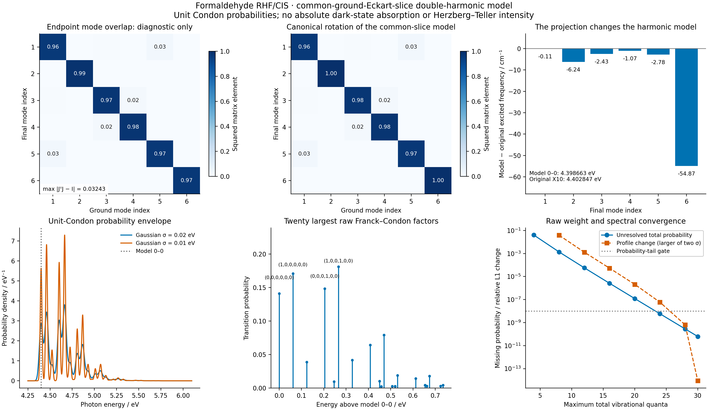

# X11 — Franck–Condon progression in a common ground Eckart slice

The formaldehyde RHF/CIS calculation passes the harmonic-overlap, molecular-frame,
cutoff, normalization and fixed-model AD checks. It deliberately uses a
**common-ground-Eckart-slice double-harmonic model**. This is an explicit
approximation to the two X10 surfaces: the largest excited frequency change is
**−54.8728 cm⁻¹**, and the model 0–0 energy is **4.398663 eV**, compared with
**4.402847 eV** from the original X10 modes. These are separate results.



[Model and validation JSON](gradscf.json) · [probability-density CSV](spectrum.csv)
· [PDF](franck_condon_model.pdf) ·
[calculation script](../../../examples/tdscf/formaldehyde_franck_condon.py) ·
[plot script](../../../examples/tdscf/plot_formaldehyde_franck_condon.py)

## Why the raw mode overlap is not treated as an orthogonal rotation

The inputs are the independently checked [X10 paired minima and complete AD
Hessians](../X10_formaldehyde_cis_emission/README.md): RHF/CIS singlet S1,
Cartesian 6-31+G*, C/O/H/H masses `[12,15.99491461957,1.00782503223,1.00782503223]`
amu. Atom correspondence is fixed by that record; no atom-permutation search
is performed. Both structures are centered at their mass centers. A proper
mass-weighted Kabsch rotation aligns the excited geometry with the ground
geometry and satisfies the equilibrium Eckart condition. Its determinant is
one, and the measured rotational condition residual is `8.65e-15 amu bohr²`.
Both six-mode bases are mass-orthonormal to `2.00e-15`.

Their raw overlap `J_raw=Le.T Lg` nevertheless has singular values
`[1,1,1,0.99994285,0.99656095,0.97712758]`, determinant `−0.97371154`, and
`max|J_raw.T J_raw−I|=0.03242808`. The two independently projected vibrational
spaces differ. This is not roundoff and is not repaired by QR or a polar
rotation. Axis-switching/nonorthogonality is a recognized issue in molecular
FC modeling; see [Sando and Spears, J. Phys. Chem. A 105, 5326–5333 (2001)](https://doi.org/10.1021/jp004230b).

## The model and its energy constants

Let `Q` denote the fixed ground vibrational coordinates, with common kinetic
operator `T=−(1/2)∇Q²`. Coordinates use `bohr sqrt(electron mass)`, frequencies
are oscillator energies in Hartree with `hbar=1`, and `Lg.T Lg=I` in the
mass-weighted Cartesian representation. Define

```
delta = sqrt(M) (Rg − Re_aligned)
De = Le diag(omega_e²) Le.T
Ke = Lg.T De Lg
b = Lg.T De delta
c = delta.T De delta / 2

Ve(Q) = E_e,min + c + b.T Q + Q.T Ke Q / 2
Qstar = −solve(Ke, b)
minimum_offset = c − b.T solve(Ke, b) / 2
```

`De` is reconstructed from the validated excited **vibrational** modes. The
original Hessian's rigid-motion and residual-gradient diagnostics remain in
X10. Its raw rotation residual is about `5.88e-8 Eh/bohr`, consistent with its
remaining gradient; it is not asserted to be exactly zero. The maximum
raw-versus-reconstructed mass-weighted matrix difference here is `5.91e-12`,
and the difference after projection into the ground space is `2.92e-13` in
the corresponding atomic units. Both raw and reconstructed projected
curvatures must be positive; the geometry must have six rigid motions.

The complete quadratic expression is retained, including `minimum_offset`.
For this particular aligned pair, the displacement outside the ground slice
is only `5.55e-14` in mass-weighted coordinates, the solved center differs from
the simple projected displacement by `8.52e-15`, and `minimum_offset` evaluates
to zero at stored precision. That does not justify dropping it for other data.

Diagonalizing `Ke=W diag(omega_model²) W.T` defines the model's canonical
coordinates `Qf=W.T(Q−Qstar)`. Thus `J_model=W.T`, `K=−W.T Qstar`, and
`|det J_model|=1`. This orthogonality follows from diagonalizing the common
model; it is not a correction of `J_raw` asserted to leave the molecule unchanged.
The approximation fixes a flat vibrational slice and omits curvilinear kinetic
terms, rotation–vibration coupling, anharmonicity and possible interwell motion.

| Quantity / Hartree | Common-slice model | Original X10 |
| --- | ---: | ---: |
| Vertical gap | 0.173924984177818 | 0.173370095673917 |
| Excited-surface reorganization | 0.008130705821289 | 0.007575817317388 |
| Harmonic 0–0 | 0.161647874701227 | 0.161801659989101 |

The model vertical value is `adiabatic_electronic_gap+c`; the measured X10
vertical gap is not inserted and then shifted a second time. The 0–0 adds
`minimum_offset` and the **model** zero-point difference. Projecting the excited
curvature changes the ZPE by `−1.53785288e-4 Eh`. The vertical/reorganization
comparison also exposes the finite-displacement harmonic extrapolation error
relative to directly computed electronic energies. The original X10 data are
preserved rather than overwritten.

## Normalized overlaps and checks

The harmonic convention is `Qf=J_model Qi+K`. Both oscillator wavefunctions
are normalized in the common mass-weighted measure. Transforming to
dimensionless oscillator coordinates introduces the frequency-dependent
Jacobian; it is included in the Gaussian prefactors. The orthogonal model
coordinate transformation has unit absolute Jacobian. `J_raw` is never passed
to the orthogonal-overlap routine, which rejects nonorthogonal inputs.

The implementation integrates the Gaussian vacuum product to form
`F(z)=C exp(r.T z+z.T R z/2)=sum_n amplitude_n z^n/sqrt(n!)`, then obtains
normalized coefficients with a total-quanta recurrence. No determinant factor
is guessed and no truncated probabilities are renormalized. Harmonic FC
recurrences are discussed by [Ruhoff and Ratner, Int. J. Quantum Chem. 77,
383–392 (2000)](https://doi.org/10.1002/%28SICI%291097-461X%282000%2977%3A1%3C383%3A%3AAID-QUA38%3E3.0.CO%3B2-0).
The [official AMS FC documentation](https://www.scm.com/doc/AMS/Utilities/FCF_module.html)
also states the probability-sum and equal-frequency displaced-oscillator
Poisson limits used here.

Eight focused tests passed in **14.51 s**, covering:

- Identical oscillators; displaced one-mode Poisson weights with a retained
  missing tail; unequal-frequency Gaussian 0–0 and parity limits.
- Independent direct 64×64 Gauss–Hermite integration of normalized two-mode
  wavefunctions, including the coordinate-scaling Jacobian.
- Mode-sign gauge invariance and explicit rejection of a nonorthogonal J.
- JAX displacement sensitivity of the 0–0 probability versus three FD steps.
- An independent two-mode oracle from the existing BSE quadratic
  `vibronic_hamiltonian` and shared Hermitian solver. Cutoff 14 initially missed
  low energies by `1.19e-5 Eh`; increasing to 24 passed the unchanged `2e-8`
  energy/probability gates and required at least a 100-fold energy improvement.

The actual molecular assembly additionally applies **independent proper
rotations and translations to the two original endpoint records**, rebuilding
the alignment and projected model. A second check changes signs and permutes
both sets of original modes/frequencies before rebuilding. It verifies the
covariance of `Ke`, `b` and the center, invariance of `c`, `minimum_offset`,
model frequencies/0–0, and the resulting low-occupation FC probabilities.
Largest errors across these checks are `1.09e-17` for b, `2.17e-19` for Ke,
`1.66e-13` for the center, `1.76e-16 Eh` for c, `1.74e-18 Eh` for the minimum
offset and `3.22e-15` for FC probabilities. The full model frequencies, and
therefore its harmonic line energies, are invariant within `6.94e-18 Eh`.

## Convergence, AD scope and interpretation

All six modes are retained. The largest calculation enumerates **1,947,792**
states through total occupation 30 without constructing a six-mode dense
Hamiltonian. The raw probability sums are:

| Maximum total quanta | Retained probability |
| ---: | ---: |
| 4 | 0.959761568662 |
| 8 | 0.998623137642 |
| 12 | 0.999942255372 |
| 16 | 0.999997388891 |
| 20 | 0.999999877682 |
| 24 | 0.999999994170 |
| 28 | 0.999999999719 |
| 30 | 0.999999999938 |

The N=30 probability deficit is `6.21e-11`; the first spectral energy moment
agrees with its independent Gaussian expectation value within `1.56e-11 Eh`.
Two Gaussian widths, sigma 0.02 and 0.01 eV, are checked. The last relative L1
profile changes in the displayed window are below `9e-15`; the independent
global weight/moment checks prevent that windowed criterion from hiding a
remote tail. Plot screening omits at most `1e-11` probability without rescaling.
The finite spectral window and its retained area are recorded separately.

`P00=0.141306938677539`. Scaling the fixed model displacement as `K -> s K`
gives `dP00/ds=-0.509618042788356` at `s=1`. Central-difference errors for
steps `0.001,0.0003,0.0001` are `1.86e-7,1.68e-8,1.86e-9`. Frequencies and
the model rotation are held fixed in this AD check. The higher-occupation
enumeration is host-side; this is not a derivative through SCF optimization,
mode eigenvectors, or the entire truncated spectrum.

The plotted quantity is a **unit-Condon probability density**, not an absolute
optical cross section or oscillator strength. Planar formaldehyde S1 is nearly
dark; a constant electronic dipole evaluated there cannot produce a bright
Condon absorption band. Transition-dipole derivatives and Herzberg–Teller
intensities belong to X12, not this calculation. One pair of local minima and
one basis do not establish experimental agreement or global/anharmonic accuracy.

## Reproduction and provenance

The final molecular run took **38.33 s**, with peak RSS **1,366,472 KiB**, on
`jy_gpu_1`/c20, Intel Xeon Platinum 8457C, CPU float64. Python 3.11.15, JAX
0.10.0, NumPy 2.4.4 and SciPy 1.17.1 were used. Numerical work and plotting
were remote; local checks were static syntax, file/link validation and visual QA.
The isolated snapshot is `/home/yjiao/gradscf_checks/ad-showcase-x11-20261015`.
Its Python source SHA256 is
`f5630d7d21019689822a63ce0867ef0e6abec33ee5d75aac16845e012389569f`.

```bash
export CUDA_VISIBLE_DEVICES= JAX_PLATFORMS=cpu JAX_ENABLE_X64=1
export JAX_ENABLE_COMPILATION_CACHE=false OMP_NUM_THREADS=2 OPENBLAS_NUM_THREADS=2
export PYTHONPATH=src
PYTHON=/home/yjiao/opt/miniconda3/envs/jax_scf/bin/python
timeout 900 "$PYTHON" -m pytest -q tests/test_franck_condon.py
timeout 1800 "$PYTHON" examples/tdscf/formaldehyde_franck_condon.py
timeout 300 "$PYTHON" examples/tdscf/plot_formaldehyde_franck_condon.py
```

All final commands exited zero. Source/test/script and X10 input hashes,
red/green logs and artifact checks are retained in this result directory.
The complete raw `franck_condon_states.npz` remains in the remote result folder:
**34,714,158 bytes**, SHA256
`cb91e20f8259e764befb8abb84cf7b3a8a8bf5cbc8a623d3c5c68aa121a474ae`.
It contains every retained occupation, signed amplitude and photon energy;
it is not included in the compact local bundle. The script rebuilds it.
The JSON, CSV and figures suffice to inspect the reported model and checks.
