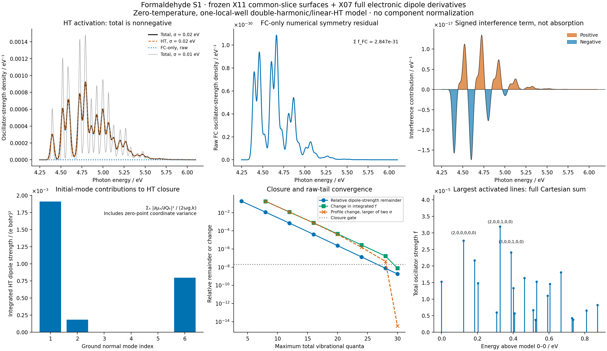

# X12 — linear Herzberg–Teller activation of formaldehyde S1

The frozen X11 harmonic surfaces and the independently checked X07 electronic
transition-dipole derivatives give a converged **single-local-well,
zero-temperature, double-harmonic/linear-dipole model**. All three Cartesian
dipole components are included. The raw total oscillator strength is
**3.43056481e-4**, whereas the constant-dipole contribution is **2.84667334e-31**,
a numerical symmetry residual at the planar ground minimum. No physical
enhancement ratio is inferred from that near-zero denominator.



[Results and validation](gradscf.json) · [spectrum CSV](spectrum.csv) ·
[PDF](herzberg_teller_activation.pdf) ·
[calculation](../../../examples/tdscf/formaldehyde_herzberg_teller.py) ·
[plot](../../../examples/tdscf/plot_formaldehyde_herzberg_teller.py) ·
[shared overlap helper](../../../src/gradscf_tools/franck_condon.py)

## Inputs, phase and units

The molecular inputs are RHF/CIS singlet S1 with Cartesian 6-31+G*, using the
C/O/H/H ordering and isotope masses of [X10](../X10_formaldehyde_cis_emission/README.md).
The potential is exactly the frozen [X11 common-ground-Eckart-slice model](../X11_formaldehyde_franck_condon/README.md).
Its orthogonal rotation comes from diagonalizing the excited curvature in
the common ground vibrational slice. It is not an orthogonalization of the
raw overlap between different vibrational subspaces. The inherited largest
frequency change is **−54.8728 cm⁻¹**; the model 0–0 is **4.398663 eV**, versus
**4.402847 eV** from the original X10 modes. X12 retains the complete quadratic
constant and minimum offset and does not modify either earlier record.

The electronic dipole and its signed Cartesian Jacobian come from
[X07](../X07_formaldehyde_oscillator_response/README.md), at the same ground
minimum and in the same electronic-state phase. That derivative includes
relaxed HF orbitals, CIS eigenpair response and moving AO dipole integrals;
it is not a frozen-orbital derivative. X07 independently rebuilt PySCF at
three displacements along every internal mode, with maximum moment/strength
derivative error `1.023e-6` against its `2e-6` gate. These are reused electronic
data, not a new electronic response calculation in X12.

Input hashes bind both records to the same X10 geometry, masses and modes.
The geometry difference is zero. X07 labels its mode coordinate as
`Q_amu` in `bohr sqrt(amu)` and stores vectors normalized by the amu mass
metric. The overlap helper instead uses `Q_me` in `bohr sqrt(electron mass)`:

```
Q_me = sqrt(1822.8884862827601) Q_amu
V_me = V_amu / sqrt(1822.8884862827601)
D_me = dmu/dQ_me = D_amu / sqrt(1822.8884862827601)
```

This conversion is applied once. Independently contracting the original
Cartesian dipole Jacobian with the X10 `V_me` reproduces `D_me` within
`8.68e-19`; the converted mode vectors agree within `1.74e-18`. The harmonic
surfaces carry no electronic-state phase. Reversing the electronic phase
must reverse both the dipole and its derivative together.

## Coordinate insertion and intensity decomposition

Use the X11 convention `Qf=J Qg+K`, with positive oscillator frequencies in
Hartree and the common kinetic energy `−(1/2)∇Qg²`. The local transition dipole
is `mu(Qg)=mu0+D Qg`, where `D` has three Cartesian rows. The constant and
linear terms are the Condon and Herzberg–Teller terms of the transition-moment
Taylor expansion; see [Baiardi, Bloino and Barone, J. Chem. Theory Comput. 9,
4097–4115 (2013)](https://doi.org/10.1021/ct400450k).

The existing normalized Gaussian generator is reused:

```
F(z) = sum_n S_n z^n/sqrt(n!)
A = diag(omega_g) + J.T diag(omega_f) J
l = -J.T diag(omega_f) K
mean = solve(A, l)
L = sqrt(2) solve(A, J.T diag(sqrt(omega_f)))
```

Inserting `Qg` under the product-Gaussian integral yields `(mean+L z) F(z)`.
Here `mean` is the product-Gaussian mean in initial coordinates, not the
excited potential's minimum `Qstar`. Thus

```
Q_n,k = <n_f|Qg,k|0_g>
      = mean_k S_n + sum_j L_kj sqrt(n_j) S_(n-e_j)
M_FC,n = mu0 S_n
M_HT,n = D Q_n
M_n = M_FC,n + M_HT,n

I_FC,n = |M_FC,n|²
I_HT,n = |M_HT,n|²
I_interference,n = 2 M_FC,n . M_HT,n
I_total,n = |M_n|² >= 0
```

All norms/dot products sum x, y and z. Each component uses the **same positive
model photon energy**, `E_n=E00_model+sum_j n_j omega_f,j`, and
`f_n=(2/3) E_n I_n` in atomic units. There is no extra factor of one third.
The signed interference contribution can be negative; it is not an absorption
spectrum by itself. Components, finite windows and occupation cutoffs are
never independently normalized.

## Closure, independent checks and measured result

Completeness of the final oscillator states gives a dipole-strength sum rule:

```
sum_n M_n M_n.T = mu0 mu0.T + D diag(1/(2 omega_g)) D.T
sum_n |M_n|² = |mu0|² + sum_k |D[:,k]|²/(2 omega_g,k)
sum_n S_n Q_n = 0
sum_n Q_n Q_n.T = diag(1/(2 omega_g))
```

This is **not** an oscillator-strength sum of one: the oscillator strengths
also contain the state-dependent photon energies. The unweighted interference
sum tends to zero; its energy-weighted oscillator-strength sum need not.

| N=30 raw quantity | FC-only | HT | Signed interference | Total |
| --- | ---: | ---: | ---: | ---: |
| Dipole strength / `(e bohr)²` | 2.50027387e-30 | 0.002894210398601 | −2.07939415e-27 | 0.002894210398601 |
| Oscillator strength | 2.84667334e-31 | 3.43056481e-4 | 8.81150275e-20 | 3.43056481e-4 |

The exact model dipole-strength closure is `0.00289421040382505 (e bohr)²`.
Its raw N=30 remainder is `5.2244e-12`, or **1.8051e-9 relative**. The maximum
dimensionless coordinate-covariance closure error is `2.6629e-9`; the
dimensionless mean-coordinate closure error is `5.3775e-11`. The full 3×3
polarization tensor is checked as well as its trace. The integrated HT
contributions from ground modes 1, 2 and 6 are `0.00191207`, `0.000183405`
and `0.000798737 (e bohr)²`. These include zero-point coordinate variances;
they are not assignments of individual spectral-band oscillator strengths.

The existing eight FC tests and eight new HT tests passed: **16 passed in
13.55 s**. Before adding the new helper API, the eight new tests failed as
expected; both logs are retained. The HT tests cover constant-dipole reduction
to FC, the identical-oscillator one-quantum coordinate rule, independent
64×64 Gauss–Hermite integration of normalized two-dimensional wavefunctions,
coordinate and dipole closure, electronic phase, mode gauge, spatial rotation,
and a nonzero-dipole example with genuinely signed interference.

The actual molecular assembly separately rebuilds the model after original
ground/excited mode signs and permutations, and after independent proper
rotations/translations of both endpoint records. The electronic Cartesian
dipole/Jacobian are transformed with the ground frame, then contracted with
the transformed modes. Through total occupation six, maximum component
strength and polarization-tensor errors are `5.05e-18` and `4.86e-18 (e bohr)²`;
line energies agree within `5.56e-17 Eh`. This checks the combination of
original data, alignment, harmonic model and electronic response, beyond
an isolated Gaussian-coordinate identity.

| Maximum total quanta | Relative dipole-strength remainder | Raw total oscillator strength |
| ---: | ---: | ---: |
| 4 | 1.81730e-1 | 2.77480748e-4 |
| 8 | 1.14601e-2 | 3.38735121e-4 |
| 12 | 7.04255e-4 | 3.42778363e-4 |
| 16 | 4.14454e-5 | 3.43039333e-4 |
| 20 | 2.38157e-6 | 3.43055451e-4 |
| 24 | 1.35388e-7 | 3.43056420e-4 |
| 28 | 7.63162e-9 | 3.43056478e-4 |
| 30 | 1.80512e-9 | 3.43056481e-4 |

There are **1,947,792** retained states. Their ordering and signed FC amplitudes
are checked against the hash-bound X11 raw file. The final relative change
in total oscillator strength is `7.95e-9`; relative L1 profile changes for
Gaussian sigma `0.02/0.01 eV` are below `3.4e-15`. Absolute-L1 screening of
the four components keeps their union, so cancellation cannot hide omitted
interference. At most `3.42e-16` total oscillator strength is omitted from
the plot. The finite displayed window contains `0.0003429857165` at sigma
0.02 eV, separately from the global sum. Global closure therefore remains
an independent gate when the windowed profile has converged.

The strongest retained line is at **4.725857 eV**, with model occupations
`(2,0,0,1,0,0)` and `f=3.18681e-5`. The FC-only and interference panels expose
their actual numerical residual scales; they do not resolve a physical small
Condon feature at this symmetry point. The synthetic nonzero-dipole oracle
tests the interference formula where that term is meaningful.

## Scope and reproduction

The AD input is the validated full electronic transition-dipole derivative
at Rg. The subsequent spectrum uses the declared double-harmonic potential
and linear dipole model, including the squared linear HT amplitude. It does
not establish that the dipole remains linear over the whole zero-point
wavefunction; the initial coordinate RMS values are recorded in the JSON.
The host occupation recurrence is not a differentiable full-spectrum API.
This is one local well: there is no anharmonic, tunneling, global parity,
finite-temperature, rotation–vibration or experimental-spectrum claim.

The molecular run took **63.83 s**, with peak RSS **1,674,600 KiB**, on
`jy_gpu_1`/c20, Intel Xeon Platinum 8457C, CPU float64. The environment used
Python 3.11.15, JAX 0.10.0, NumPy 2.4.4 and SciPy 1.17.1. The separate frozen
snapshot is `/home/yjiao/gradscf_checks/ad-showcase-x12-20261016`; its Python
source SHA256 is
`1da8d8ca5202f761c9390d241d64a708c6d95bd2a424fe8de43dd054e7cc11e5`.
Numerical work and plotting were remote; local checks were static and visual.

```bash
export CUDA_VISIBLE_DEVICES= JAX_PLATFORMS=cpu JAX_ENABLE_X64=1
export JAX_ENABLE_COMPILATION_CACHE=false OMP_NUM_THREADS=2 OPENBLAS_NUM_THREADS=2
export PYTHONPATH=src
PYTHON=/home/yjiao/opt/miniconda3/envs/jax_scf/bin/python
timeout 900 "$PYTHON" -m pytest -q tests/test_franck_condon.py tests/test_herzberg_teller.py
timeout 1800 "$PYTHON" examples/tdscf/formaldehyde_herzberg_teller.py
timeout 300 "$PYTHON" examples/tdscf/plot_formaldehyde_herzberg_teller.py
```

All final commands exited zero. The source/input hashes and logs are retained
in [source_manifest.json](source_manifest.json) and
[verification_manifest.json](verification_manifest.json). The complete raw
`herzberg_teller_lines.npz` is **75,557,041 bytes** and remains in that remote
snapshot's result directory, with SHA256
`81aa93fc1b0045e2fad80d19f8df11cc2968ab25e0ba2471ce8a6295e7bdb9cf`.
It contains photon energies and all four raw oscillator-strength
arrays in the exact hash-bound X11 occupation order. Neither large raw NPZ is
included in the compact local bundle. Reproduction requires the frozen X07,
X10 and X11 inputs; the X11 script can rebuild its raw overlap file.
