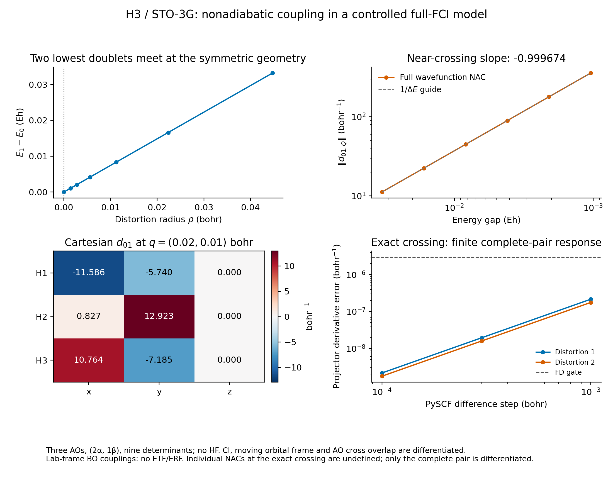

# X13: full-wavefunction FCI nonadiabatic coupling near an H3 crossing

This validated component computes a **lab-frame electronic wavefunction
derivative coupling**, including CI coefficients, the moving orbital frame and
AO cross overlap. Six nondegenerate geometries pass independent PySCF
wavefunction-overlap differences. At the exact crossing, individual-state
NACs are explicitly undefined; only the complete isolated two-state subspace
is differentiated. The example uses the existing FCI Hamiltonian and shared
spectral response, with no HF calculation or new eigensolver.



[PDF](h3_nonadiabatic_coupling.pdf), [native data](native.json),
[independent reference](pyscf.json) and [gap/coupling CSV](gap_coupling.csv)
are retained. The figure shows actual finite-basis observations; its inverse-gap
line is a guide, and no value is assigned to an individual NAC at zero gap.

## Model and observable

Neutral H3 has three STO-3G spatial AOs, two alpha electrons and one beta
electron: all nine determinants in the fixed `M_s=1/2` sector are active.
The rank-two pair consists of two doublet spatial states in this fixed
`(N_alpha,N_beta)=(2,1)` sector, each represented by its `M_s=+1/2` component.
The `M_s=-1/2` spin partners are not computed and are not counted as part of
the validated rank-two subspace.
The reference equilateral triangle has side `a=1.8 bohr` and coordinates
`(0,a/sqrt(3),0)`, `(-a/2,-a/(2sqrt(3)),0)`, `(a/2,-a/(2sqrt(3)),0)`.
Two normalized, orthogonal Cartesian distortions are obtained from the
traceless in-plane stretch and shear of these coordinates. Their coefficients
`q1,q2` have units of bohr; exact vectors are in `native.json`.

At every geometry the native AO overlap, kinetic, nuclear-attraction and full
ERI tensors are rebuilt. `C = L^-T`, where `S = L L.T`, gives a moving
orthonormal orbital frame. The shared AO-to-MO transformation and `solve_fci`
then produce the two lowest states. The independent nine-state
[native](preflight/h3_inventory_native.json) and
[PySCF](preflight/h3_inventory_pyscf.json) inventories confirm that both are
doublets (`S^2=0.75`). At the equilateral point their splitting is
`4.44e-16 Eh`; the next state is a quartet (`S^2=3.75`), separated by
`0.430373 Eh`. Over the preflight distortions the external pair gap stays
above `0.414 Eh`; all nine energies agree with PySCF to `4.45e-15 Eh`.

The defined NAC is

\[
d_{IJ,A\alpha}(R)=\left.\frac{\partial}{\partial R'_{A\alpha}}
\langle\Psi_I(R)|\Psi_J(R')\rangle\right|_{R'=R}.
\]

The left state is held fixed for this derivative. With
`S_lr = C_left.T @ S_AO(left,right) @ C_right`, the real many-electron overlap
is a contraction of both CI tensors with the alpha and beta determinant
minors of `S_lr`. This is now the small public
[`fci.overlap`](../../../src/gradscf/fci/overlap.py) operation, using the existing
occupation-string ordering. Cross-matrix and both coefficient dependencies
remain live. The independent reference uses the public
[PySCF overlap implementation](https://pyscf.org/_modules/pyscf/fci/addons.html#overlap)
and `gto.intor_cross`; it recomputes its own integrals, Cholesky frame and FCI
states. Native states enter the reference only to select the same real phases.

This minimal basis is a controlled response example, not a reproduction of
the accurate H3 potential surfaces or coupling fit in
[Abrol et al., JCP 115, 4640 (2001)](https://authors.library.caltech.edu/records/6xq97-71z45).
There is no claim of basis convergence, reactive dynamics or a Berry-phase
calculation around a closed loop.

## Measured response and independent checks

| q1 / bohr | q2 / bohr | Gap / Eh | Two-mode NAC norm / bohr^-1 |
| ---: | ---: | ---: | ---: |
| 0.04000 | 0.020000 | 0.0332000448 | 11.2333 |
| 0.02000 | 0.010000 | 0.0166114850 | 22.4130 |
| 0.01000 | 0.005000 | 0.00830877472 | 44.7734 |
| 0.00500 | 0.002500 | 0.00415516690 | 89.4946 |
| 0.00250 | 0.001250 | 0.00207778106 | 178.937 |
| 0.00125 | 0.000625 | 0.00103894028 | 357.823 |

The log-log slope of coupling norm versus gap over the closest four points
is `-0.999674`, consistent with the local inverse-gap behavior. The largest
eigenpair residual is `2.74e-15 Eh`. Neighboring accepted geometries are
tracked by full wavefunction overlap; the minimum diagonal overlap is
`0.999879`. Tracking signs are discrete local conventions and are not
differentiated. Signed coupling components depend on those phases; norms and
the stated covariance checks do not.

Independent differences use three steps, `rho * (1e-2,3e-3,1e-3)`, where
`rho=norm(q)`. Both internal directions are checked at all six points; all
nine Cartesian components are checked at points 1 and 5. The fixed NAC
acceptance criteria are `atol=1e-5 bohr^-1`, `rtol=2e-5`. At the smallest
steps the maximum internal-direction absolute error is `1.16e-4 bohr^-1`
for the large near-crossing coupling; maximum error divided by
`1+abs(d)` is `7.18e-7`. Cartesian maxima at the two checked points are
`1.61e-6` and `2.51e-5 bohr^-1`, with maximum scaled error `2.38e-7`.
The complete step sequences and root-overlap checks are saved, rather than
presenting a large coupling's relative precision as a tiny absolute error.

The NAC matrix is antisymmetric to `5.52e-10 bohr^-1`, and its largest
diagonal entry is `2.31e-14 bohr^-1`. A geometry-dependent real orbital rotation
changes the complete NAC by at most `2.17e-12 bohr^-1`, confirming cancellation
between CI-frame and orbital-overlap response. The initial single-point
[smoke test](checks/h3_nac_smoke.json) found a Frobenius norm difference
`0.604568 bohr^-1` between the full two-state NAC tensor and its CI-only
partial. The omitted AO/frame response is numerically significant.

Rigid translation and rotation are tested as **covariances and electronic
generator relations**, not forced zero sums. At `q=(0.02,0.01)`, the summed
translation coupling is approximately `(0.004834,-0.002396,0) bohr^-1`, and
the rigid z-rotation contraction is `-0.535163`. PySCF's independent
`int1e_ipovlp` matrix elements agree with the rigid contractions to
`4.41e-13` and `1.28e-13`, respectively, over both checked geometries.
All AOs are s functions, so moving their centers under rigid rotation gives
the complete orbital rotation generator for this model. No electron
translation or rotation factor (ETF/ERF) is introduced; these modify the
coupling convention and must not be silently imposed on this lab-frame
observable. See the primary discussion by
[Athavale et al.](https://arxiv.org/abs/2308.14621).

## Exact crossing: complete pair, not numbered-state NACs

At the crossing the shared solver uses `target="subspace"`. It exposes the
fixed-`M_s=+1/2` pair energy trace and a rank-two projector, with the derivative controlled by the
external gap. The physical projector is compressed into the fixed
nine-determinant anchor space as `T @ P_right @ T.T`, where `T` contains
many-electron cross overlaps. Away from the anchor `T` need not be orthogonal,
so this compression need not be idempotent. It is not the full projector in
the infinite electronic Hilbert space.

Both distortion directions have finite AD response. Independent PySCF
projector differences at `h=1e-4 bohr` differ by at most
`2.17e-9 bohr^-1`; pair-energy-trace derivative errors are below
`2.82e-9 Eh/bohr`. The original difference gate is `3e-6`. The compressed
projector response is invariant under the tested geometry-dependent orbital
gauge to `7.04e-15`. The JSON stores `individual_nac: null` at the crossing.

## API and implementation boundaries retained

The overlap interface requires real coefficients and one shared `FCISpace`.
With a supplied orbital cross matrix it explicitly permits at most three
occupied orbitals per spin, with workspace checks before minor construction.
`orbital_overlap=None` is the same-frame coefficient inner product and has
no such occupation restriction. A supplied numerical identity is still a
dynamic orbital map; it is not silently converted to the same-frame shortcut.

The installed JAX 0.10.0 determinant probe found that the first derivative of
`det(diag(0,1,1,1))` along the identity is returned as zero although its
cofactor derivative is one; a five-dimensional case has the same failure.
The [raw diagnostic](preflight/determinant_jvp_probe.json) is retained.
The one-to-three-dimensional singular-minor JVP/VJP tests pass. No JAX source,
inverse-based determinant rule or arbitrary regularization was added.

A separate nested-JIT failure was isolated to the **FCI wrapper's captured
boolean validity guard**, not the raw shared subspace solver or AO cross
overlap. Plain matrices pass; a captured boolean guard fails; an explicit
floating 0/1 guard and the otherwise identical FCI operator pass. The
[causal diagnostic](checks/fci_guard_nested_jit_probe.json) includes complete
stacks and source hashes. The minimal FCI fix makes that closed value an
inexact leaf that `closure_convert` can carry. Forward NaNs and final boolean
convergence/derivative validity gates are unchanged. No eigenvalue, DIIS or
response algorithm was copied or rewritten.

The overlap API had a real missing-feature red test, followed by 18 passing
tests. The wrapper regression had four real red tests, followed by **29
passing tests in 127.20 s**: four nested-JIT eigenpair/subspace/invalid-input
cases, the 18 overlap tests, and seven existing FCI response tests. The
[final actual-H3 nested-JIT probe](checks/subspace_nested_jit_probe.json)
also passes for both the direct pair and its cross-overlap compression.
These are first-response checks for the recorded compositions, not a claim
that arbitrary higher-order or user-constructed operator closures are supported.

## Sources, execution and artifacts

All numerical tests, calculations and rendering ran on `jy_gpu_1`, CPU
float64, with `OMP_NUM_THREADS=2`, `OPENBLAS_NUM_THREADS=2`, and compilation
cache disabled. JAX owns additional thread pools; these settings are not an
exclusive two-core allocation. Final native/reference runs took 20.34/0.97 s
in this shared-node workflow, without implying a controlled performance ratio.
Per-stage limits were 120--600 seconds; no CPU affinity was changed.

The final snapshot is `ad-showcase-h3-nac-20261016`, with Python-source-tree
SHA256 `6502174e3de905383418b17f91130b987067a2ea0f1c02fc0c9ce335100ae9a5`.
The previously successful single-layer path is frozen separately in
`ad-showcase-h3-nac-single-jit-20261016`, source hash
`a9dd3aa620253823e7e93a4b215584096757992db9735a25594f71364848cd3b`.
[Provenance](provenance.json) identifies commands, hashes and both boundaries;
[the old data](single_jit_before_guardfix/) and [failed attempts](failures/)
remain distinct. The final source contains the small FCI wrapper fix; the
earlier single-layer success is not relabeled as a successful old nested path.

Run from the repository root with the stated environment:

```sh
python examples/fci/h3_nonadiabatic_coupling.py
python examples/fci/compare_h3_nac_pyscf.py
python examples/fci/plot_h3_nac.py
python -m pytest -q tests/fci/test_overlap.py tests/fci/test_nested_response.py tests/fci/test_response.py
```

The [native model](../../../examples/fci/h3_nac_model.py),
[ordinary main script](../../../examples/fci/h3_nonadiabatic_coupling.py),
[independent reference](../../../examples/fci/compare_h3_nac_pyscf.py), and
[plotter](../../../examples/fci/plot_h3_nac.py) are separate. Exact executed
source copies, raw checks and forward inventories accompany the JSON/CSV and
PNG/PDF artifacts. Larger bases, complex or differing orbital spaces,
production TDDFT/EOM NACs, ETF/ERF dynamics, and globally tracked crossing
networks remain outside this component's validated boundary.
