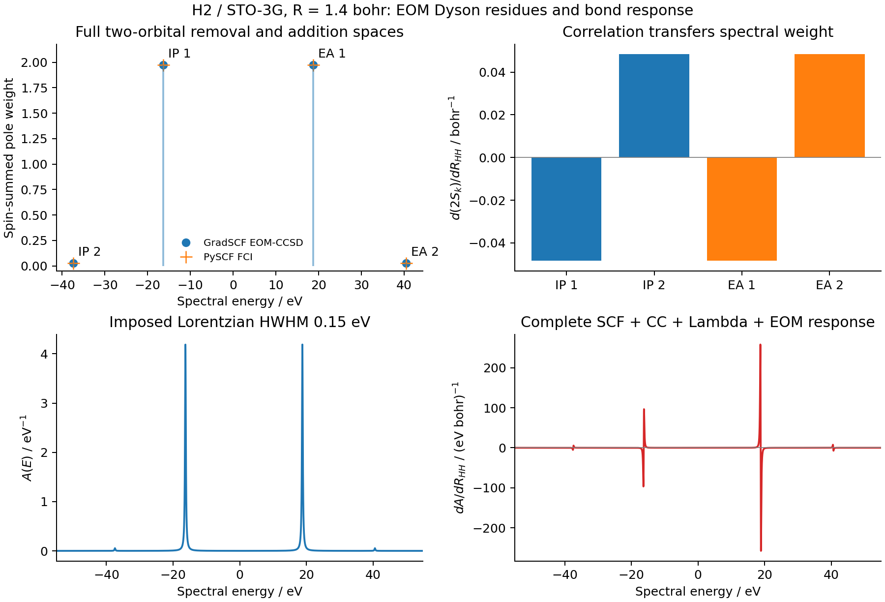

# X14: H2 EOM-IP/EA Dyson residues and bond response

This example differentiates charged-state energies and spectral weights through
moving native AO integrals, the AO metric, relaxed RHF orbitals, CCSD amplitudes,
ground-state Lambda, and both EOM eigenvectors. The system is H2 at a bond length
of 1.4 bohr in Cartesian STO-3G, with two spatial orbitals and two electrons.
The derivative coordinate increases the bond length by moving each nucleus by
half the displacement in opposite directions.

CCSD and both charged EOM spaces are complete in this particular small space.
Independent PySCF FCI therefore checks the complete spectrum and residues. This
does not make EA-CCSD exact for H2 in a larger orbital basis, where additional
three-particle/two-hole configurations can exist.



## Observable and response

The ground states are `exp(T)|Phi>` and `<Phi|(1+Lambda)exp(-T)`. For an IP
root, the projected similarity-transformed annihilation endpoint is `b_p` and
the corresponding creation/Lambda endpoint is `c_p`. With `A r_k = omega_k r_k`,
`A.T l_k = omega_k l_k`, and `l_k.T r_k = 1`, the two Dyson coefficients are

```
D_left[p,k]  = c_p @ r_k
D_right[p,k] = l_k @ b_p
S[k]        = sum_p D_left[p,k] * D_right[p,k]
```

EA uses the corresponding creation/annihilation endpoints. The implementation
absorbs the upstream particle Green-function minus sign into its ket endpoint.
The full residue is the outer product of the two coefficient columns. It is
invariant under reciprocal left/right rescaling; either individual squared
norm is a different quantity. The pure contractions are adapted from the
four endpoint routines in [PySCF MomGFCCSD](https://pyscf.org/_modules/pyscf/cc/momgfccsd.html),
with [Apache source attribution](../../../src/gradscf/cc/NOTICE.md).
The underlying biorthogonal Green-function formulation is described by
[Backhouse and Booth, JCTC 2022](https://doi.org/10.1021/acs.jctc.2c00670).

The numerical eigensolver stays unchanged. Opt-in pair response uses the shared
implicit-root and checked linear solvers for

```
F_right(r, omega) = [A r - omega*r, (r.T@r - 1)/2] = 0
F_left(l) = (A.T - omega*I) l + r*(r.T@l - 1) = 0
```

The right response has dimension `n+1` per root and the left response dimension
`n`. Their direct capacity is bounded per root, not by the joint root count.
The isolated-real-root, residual, gap and conditioning checks remain in force.
Ground Lambda uses the existing transposed CC residual Jacobian. The weight
derivative includes both endpoint derivatives and both eigenvector derivatives.

`EOMConfig(vector_response=True)` enables this path. `EOMResult.sector` and
`vector_response` are static pytree metadata, while the existing NamedTuple
and `_replace` interface remains available. `cc.dyson_orbitals(ground, lambda_result,
eom_result)` infers the sector; incompatible or missing sector metadata is
rejected. The eager facade is `eom.dyson()`. Forward-only results retain valid
forward properties but deliberately reject their incomplete derivatives.

## Measured values

Energies are `E(N-1)-E(N)` for IP and `E(N+1)-E(N)` for EA. The usual electron
affinity is the negative of the EA value. The table uses one spin channel.

| State | Energy / Eh | d energy / d bond / Eh bohr^-1 | Weight | d weight / d bond / bohr^-1 |
| --- | ---: | ---: | ---: | ---: |
| IP1 | 0.598764596067 | -0.195676302117 | 0.987295204908 | -0.024160241500 |
| IP2 | 1.375959358529 | -0.847922908991 | 0.012704795092 | 0.024160241500 |
| EA1 | 0.690829386828 | -0.522798046336 | 0.987295204908 | -0.024160241500 |
| EA2 | 1.490925411647 | -1.171474761025 | 0.012704795092 | 0.024160241500 |

The maximum energy/weight discrepancy from independent FCI is `9.992e-16`.
At displacement `1e-5` bohr, the maximum discrepancy between AD and native
reconverged finite differences is `1.830e-10`; the independent FCI difference is
`1.608e-10`. The native error reaches `1.164e-10` at `3e-5` bohr before the small
step noise floor. The scalar JVP/VJP check differs by `1.110e-16`.

CC and Lambda residuals are `1.086e-14` and `8.356e-17`. Maximum left/right EOM
residuals are below `3e-16`; the smallest charged gaps are `0.7772` and `0.8001`
Eh. Each one-spin sector's weights sum to one and its weight derivatives sum
to zero. The unit tests also check full residue matrices against FCI and the
combined removal/addition zeroth moment against the identity.

## Spectrum and finite differences

The figure places removal poles at `-IP` and addition poles at the EA eigenvalue.
It multiplies the one-spin weights by two and applies a fixed Lorentzian HWHM
of 0.15 eV. This is a one-particle spectral trace, without continuum
photoionization matrix elements or vibrational broadening.

The total integrated weight over the whole real line is four. On the stored
`[-80,80]` eV grid the analytic area is `3.994966604392`; missing Lorentzian
tails contribute `0.005033395608`. No normalization removes those tails.
The grid/analytic area and area-response errors are `1.694e-11` and `5.749e-12`.

The narrower spectral profile requires smaller finite-difference displacements
than its pole energies and weights. Errors at `1e-3`, `3e-4`, `1e-4`, `3e-5`,
and `1e-5` bohr are respectively `2.772`, `0.2512`, `0.02792`, `0.002513`, and
`0.0002792` per eV bohr. The final point passes the unchanged `1e-3` gate.
The original failed three-step spectral check remains in the raw artifacts.

## Reproduction and provenance

Run these ordinary scripts from the repository root; none constructs a CLI:

```sh
python examples/cc/h2_dyson_response.py
python examples/cc/compare_h2_dyson_fci.py
python examples/cc/plot_h2_dyson_response.py
```

The independent comparison imports only PySCF/NumPy, not GradSCF. The plot
consumes stored values and reconverged displaced results. Files include
[native data](gradscf.json), [FCI data](pyscf_fci.json), [spectral checks](spectrum_checks.json),
[the CSV](spectrum.csv), [PDF figure](dyson_response.pdf), and [runtime/source hashes](runtime.json).

The measured snapshot is
`jy_gpu_1:/home/yjiao/gradscf_checks/ad-showcase-eom-dyson-native-20261016`.
The source-tree hash is
`94008e9b36cba7a8dd61645abce3b4da83e7cf7965bb62304edda8ad8e35ddd0`.
All 84 relevant native C++/FFI/backend files plus the shared library were checked
against the frozen G08 build before calculation. The native library SHA-256 is
`8176ca97f9758ba3810b727c5a2e90572ac4f8f205e4a16e0d7a7177221b1829`.
An earlier attempt with X13's older library failed the actual stale-ABI guard
before SCF. That failure is retained, and the guard was not bypassed.

CPU: Intel Xeon Platinum 8457C; Python 3.11.15, JAX/jaxlib 0.10.0, NumPy 2.4.4,
SciPy 1.17.1 and PySCF 2.13.0. OMP/OpenBLAS settings were two; they do not limit
all JAX thread pools. Whole-program wall time was 121.17 s, with maximum RSS
2,849,436 KiB. Cold forward, cold JVP and one warm JVP took 18.407, 20.561 and
0.002236 s. These are one small-system measurement on a shared CPU node,
including compilation where stated, not a scaling benchmark.

Focused remote stages recorded 38 shared non-Hermitian solver tests, 10 Dyson
endpoint/FCI/response tests, and three subsequent static-sector contract checks.
The latter include an equal-dimension EE result incorrectly passed as IP.
Counts describe separate stages, not a sum of unique tests. Raw red/green logs,
resource files, source archives and the initial spectral/ABI failures are kept
under `artifacts/ad_showcase/development/X14_eom_dyson` and in the two remote snapshots.
The existing 27-case EOM regression recorded 26 passes and one stale-library
setup failure in the original snapshot (970.14 s). The same failing CO
degeneracy case then passed with the matching G08 library in the native snapshot
(one pass, 26 deselected, 97.89 s). This is validation across two recorded runs,
not a claim that the original full command exited successfully.
The runtime hashes preserve the calculation scripts before adding measured
output comments and this documentation.

The molecular validation covers real restricted H2 and first bond derivatives.
It does not establish unrestricted, complex, degenerate-subspace Dyson response
or general higher molecular EOM derivatives. Signed residues are retained; the
convergence flags do not certify positivity for an arbitrary truncated CC model.
