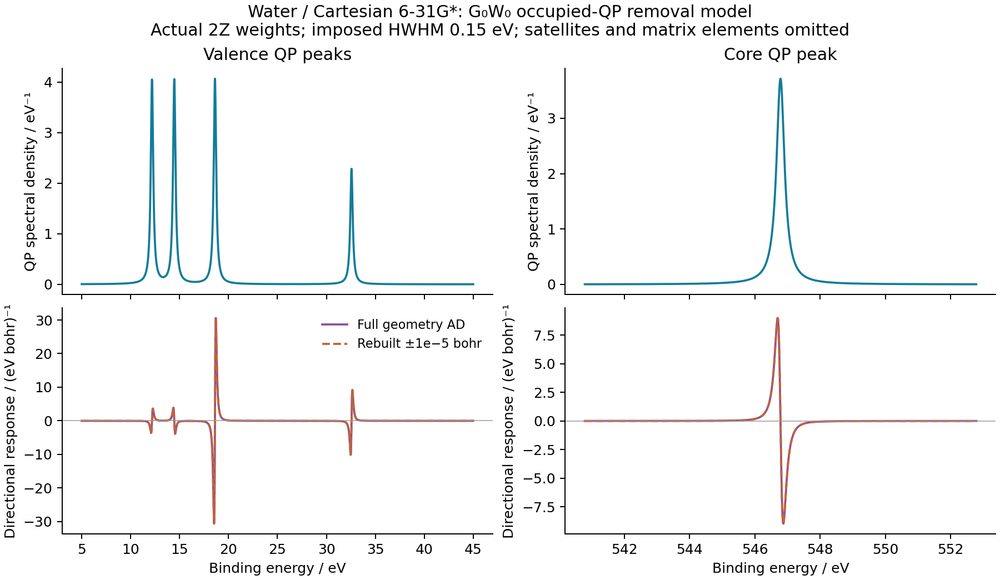

# Water occupied-QP removal spectrum and geometry sensitivity



The [ordinary example](../../../examples/gw/water_photoelectron_response.py)
composes the already verified native G0W0 geometry response with the existing
`gradscf.tools.spectra.lorentzian_spectrum`. The complete moving-integral,
relaxed-HF, G/W and local-root calculation is the
[water GW/BSE workflow](../X02_water_gw_bse_response/README.md). Its accepted
central and displaced QP data are read without re-solving or fitting them;
the input JSON hash is recorded in [response.json](response.json).

For binding energy E in eV, this explicitly defined QP-only model is

```
A_QP(E; R) = sum_{i occupied} 2 Z_i(R) L_eta(E + epsilon_i(R)),
L_eta(x) = eta / [pi (x^2 + eta^2)].
```

The QP energies are converted from Hartree to eV. The factor two represents
the two spin channels of this closed-shell reference. The numerical half-width
is fixed at `0.15 eV`; it is neither a calculated lifetime nor a vibrational
width. The geometry derivative includes both peak-position and residue
changes. This spectrum excludes satellites, removal weight in reference-virtual
orbitals and photoionization matrix elements. It is not a complete spectral
function, an EOM Dyson spectrum or a prediction of experimental intensities.

The five QP binding energies are `546.787137`, `32.563251`, `18.611438`,
`14.456528`, and `12.178484 eV`. The real-axis model area is `2 sum Z =
8.540629619965`. It is deliberately not rescaled to the RHF electron count 10;
their difference is not a computed satellite distribution.

The exact Lorentzian area in `[0,600] eV` is `8.518137821035`. Missing model
tails contribute `0.022491798930`. A 60,001-point grid and its 120,001-point
refinement check the area and the integral of its geometry derivative against
the analytic arctangent integral. The final errors are `4.02e-10` and
`2.22e-11 /bohr`, respectively.

The same normalized Cartesian direction and native reconverged geometry points
as X02 give the following complete spectral derivative check:

| Central step / bohr | Maximum AD–FD difference / (eV bohr)^-1 |
| --- | ---: |
| 1e-3 | 5.8536e-3 |
| 3e-4 | 5.2688e-4 |
| 1e-4 | 5.8559e-5 |
| 3e-5 | 5.3710e-6 |
| 1e-5 | 7.6632e-7 |

This verifies composition with the stored complete GW JVP; it is not a new
independent electronic solver comparison. The upstream MolGW comparison and
its graphical-grid residue limitations remain separately reported. The
direction is a normalized Cartesian displacement, not a normal mode.
[Valence](valence.csv) and [core](core.csv) tables retain the plotted spectrum,
AD tangent and independently reconverged finite-difference tangent. The
[PDF figure](photoelectron_response.pdf) is also available. All numerical
postprocessing and plotting ran on `jy_gpu_1` in CPU float64.
