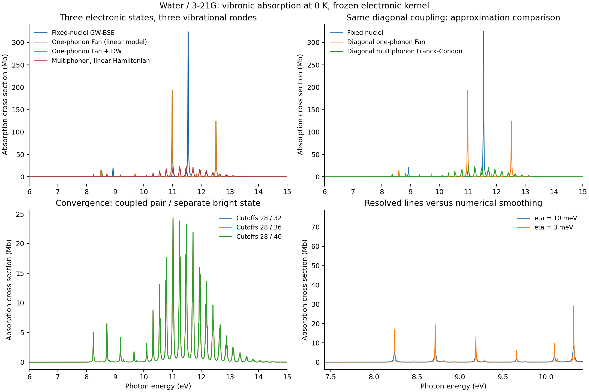

# X15: refreshed water electron-vibration baseline

The existing [water example](../../../examples/bse/water_ep_coupling.py) was
rerun on `jy_gpu_1` in `ad-showcase-bse-ep-20261016`, without changing its
physical model or convergence thresholds. The historical
[model description](../../gw_bse/water_bse_phonons/README.md) and historical
outputs remain separate. This directory contains the new calculation.

The model is native RHF/3-21G water, G0W0, and three singlet TDA-BSE states.
It uses the original QP initialization, not the separate 6-31G* main-peak
selector example. Ground-state geometry and harmonic modes are recomputed.
Linear vertices include the screened RHF density response and orbital-frame
transport. Quadratic vertices use the original reconverged Fock differences.
The GW correction and BSE kernel remain frozen in this specified model;
these vertices are not complete nuclear derivatives of GW/BSE.

## Measured results

| Quantity | New result |
| --- | --- |
| Harmonic frequencies / cm^-1 | 1799.2881713, 3812.3761608, 3945.8318650 |
| Three TDA-BSE energies / eV | 8.9263327801, 11.1390116905, 11.5445338880 |
| Final coupled-pair / separate-state cutoffs | 28 / 40 total quanta |
| Final sector dimensions | 8990 / 861 |
| Final spectral L1 increments, eta=10 / 3 meV | 8.6891e-5 / 5.5421e-4 |
| Coupled-pair increments, eta=10 / 3 meV | 2.4934e-4 / 8.6040e-4 |
| Maximum final eigenproblem residual / Eh | 4.22e-15 |
| Coupling-scale AD derivative / Mb | 152.67699523 |
| Coupling-scale central difference / Mb | 152.67687317 |

The coupling-scale probe holds electronic energies, dipoles and phonon
frequencies fixed and uses the existing finite cutoff of four total quanta.
It tests the shared optical resolvent's derivative; it is not a derivative
of the converged-cutoff or fully relaxed nuclear calculation. The original
`rtol=2e-5`, `atol=2e-7` derivative gate passes. The three independent-mode
Franck-Condon weight sums are 1.0, 0.9999999999999998 and
0.9999999999999992; no missing weight was renormalized away.

The first two bright/dark states retain their off-diagonal antisymmetric-mode
coupling. A checked symmetry decomposition separates the remaining bright
state; it is not an oscillator-strength cutoff. The linear multiphonon
Hamiltonian and one-phonon Fan self-energy are different approximations.
Fan+DW adds a quadratic static average; it is not a fully quadratic
multiphonon Hamiltonian.

## Reproducibility and limits

The calculation body took `347.889 s`; total process wall time was
`356.87 s`, with peak RSS `9,263,848 KiB = 8.83 GiB`. CPU float64,
OMP threads 2 and BLAS threads 1 were used. These settings do not cap every
JAX worker pool or establish an exclusive-core benchmark.

The related regression group had 35 numerical passes and one missing
cross-file fixture import. Uploading the existing fixture allowed that one
remaining test to pass in 93.28 s; the initial import failure is retained.
No numerical threshold or production implementation was changed for this
rerun. Commands, source/runtime hashes and actual execution copies are shared
with the [temperature extension](../X15_water_bse_temperature/README.md).

This is a zero-temperature Condon model in a small basis and three-state
electronic subspace. Rotations, dissociation, thermal initial-state FC sums,
Herzberg-Teller moments and basis/electronic-state convergence are not
established. The supplied widths are plotting resolution, not computed
lifetimes. The 0 K multiphonon output must not be relabelled as a finite-T
multiphonon spectrum; the separate temperature extension evaluates the
one-phonon approximation.
