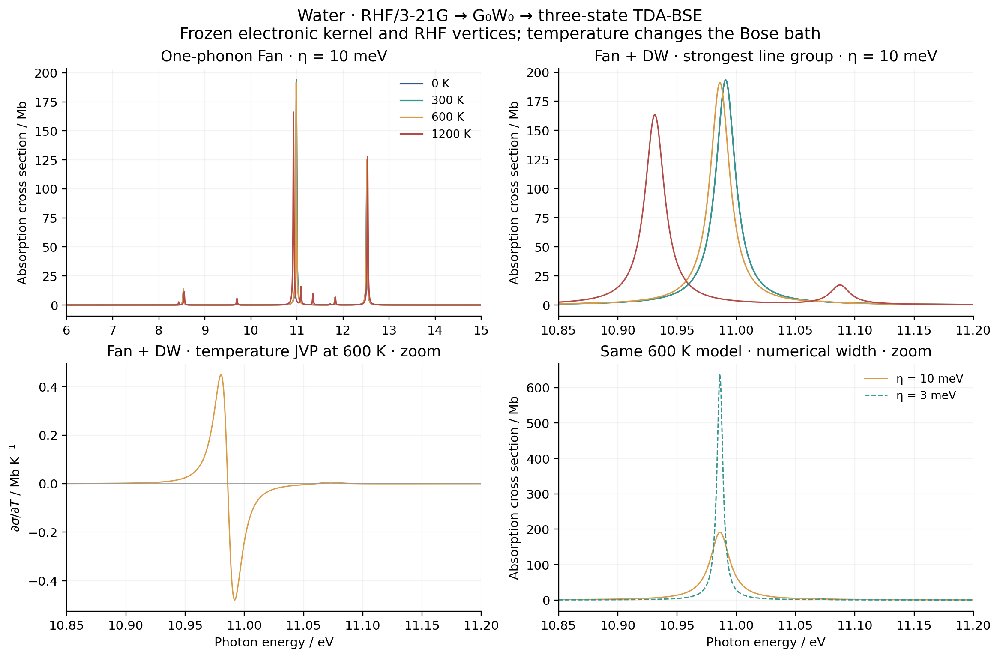

# X15: one-phonon thermal absorption and temperature response

This example uses the newly [refreshed water baseline](../X15_water_bse_baseline/README.md).
RHF/3-21G vertices, three TDA-BSE electronic states, dipoles, geometry and
mode frequencies stay fixed. Temperature changes only the Bose bath.
It is a controlled temperature derivative of that model, not thermal SCF
or a fully relaxed nuclear GW/BSE derivative.

Run these ordinary scripts on `jy_gpu_1` after `water_ep_coupling.py`:

```sh
PYTHONPATH=src python examples/bse/water_ep_temperature.py
python examples/bse/compare_water_ep_temperature.py
python examples/bse/plot_water_ep_temperature.py
```

Native electronic/response calculations, the independent reference and
plotting are separate. No new core solver or self-energy formula is introduced.

## Model and independent check

The dimensionless oscillator coordinate is Q_nu=b_nu+b_nu^dagger, so the
stored G_nu and Lambda_nu are in Hartree. At low exciton population,

\[
\Sigma(z)=\sum_\nu G_\nu\left[
\frac{n_\nu+1}{z-H_X-\omega_\nu}
+\frac{n_\nu}{z-H_X+\omega_\nu}\right]G_\nu^\dagger,
\qquad n_\nu=(e^{\beta\omega_\nu}-1)^{-1}.
\]

The optional static DW shift is Delta(T)=sum_nu Lambda_nu(n_nu+1/2).
The internal propagator uses the bare H_X; it is not iterated to a dressed
exciton self-consistency. Both retarded optical time orderings are retained
by the existing `bse.ep_coupling` interface. The reported orientationally
averaged cross section is 4*pi*omega*Im Tr(alpha)/(3c), converted to Mb.

The independent SciPy oracle constructs a 21-dimensional Hermitian matrix.
Its central block is H_X+Delta, and for each mode it has auxiliary blocks
H_X+omega_nu and H_X-omega_nu coupled by sqrt(n_nu+1)G_nu and sqrt(n_nu)G_nu.
Eliminating these blocks by a Schur complement gives exactly the specified
rational self-energy. Its central projected eigenvectors provide the pole
weights and optical moments independently of the production complex solve.
This is an independent linear-algebra oracle on the same saved vertices,
not a second electronic-structure code or a multiphonon approximation.

## Results and convergence

All native and independent checks pass at 0, 300, 600 and 1200 K. The lowest
mode's Bose occupations are 0, 0.0001788311, 0.01355280 and 0.13075554.
The nominal 0 K calculation uses finite beta=1e8 Eh^-1, for which the
occupations underflow exactly to zero. A separate 1 K evaluation recovers
the same spectrum with maximum difference zero. Zero coupling recovers
the bare three-state optical sum within `1.14e-13 Mb`.

The grid spans 4-18 eV with 28,001 points; widths are 10 and 3 meV.
The largest final integrated-spectrum change between 14,001 and 28,001
points is `5.04e-5`, below the predeclared `2e-3` gate. The independent
all-frequency cross-section error is at most `1.005e-9 Mb`.
Raw dipole-strength closure errors are at most `3.34e-16`.
The full central spectral trace has weight three, the electronic-subspace
dimension. Its 4-18 eV window contains about 2.99714; the omitted tails
remain explicitly reported (0.002857-0.002864), and no curve is normalized
to hide them. This is not a ten-electron TRK completeness claim.

At 600 K, AD differentiates the whole Fan+DW cross section with respect to
temperature. The step-convergence record is:

| Central temperature step / K | Maximum AD-FD error / Mb K^-1 | Maximum scaled error |
| --- | ---: | ---: |
| 10 | 1.63636e-3 | 1005.96 |
| 3 | 1.47459e-4 | 90.76 |
| 1 | 1.63861e-5 | 10.09 |
| 0.3 | 1.47476e-6 | 0.9078 |
| 0.1 | 1.63842e-7 | 0.1009 |
| 0.03 | 1.47508e-8 | 0.00908 |

The elementwise scale remains `2e-7 + 2e-4*abs(d sigma/dT)` and the
acceptance limit is one. The initial three-step run failed at 1 K and is
preserved. Smaller steps establish the expected quadratic decrease without
changing the width, derivative algorithm or error threshold.



The complete temperature calculation took `21.228 s`. For the same
600 K Fan+DW spectrum, cold/warm forward calls took `1.242/0.418 s`, and
cold/warm temperature JVPs took `1.472/0.772 s`. Process peak RSS was
`1,814,768 KiB = 1.73 GiB`. The final independent oracle took `0.817 s`.
These are shared-node CPU measurements, not exclusive-core performance.

## Provenance and physical limits

The frozen snapshot is `ad-showcase-bse-ep-20261016` on `jy_gpu_1`.
Its Python source-tree hash is
`c9fe0d27165c35e731042e04d7c9c11f7e54e03559bdb97d1b96609de2186d01`.
The [source/runtime manifest](source_manifest.json) records the native
library hash, exact software versions, environment and executed files.
The [native data](gradscf.json), [step sequence](temperature_fd.json),
[independent comparison](scipy.json) and `temperature.npz` preserve raw
observables. The [validation records](validation/) retain the initial failed
temperature step, final passes, process exits, timings and resource usage.
The complete job records also remain under the local ignored
`artifacts/ad_showcase/development/X15_water_ep/jobs/` directory.
The eight `sticks_*.csv` files contain raw auxiliary eigenvalues, central
trace weights, dipole strengths and oscillator strengths, including
zero-residue auxiliary states. An auxiliary eigenvalue with zero residue is
not a visible optical line. The executed scripts are in [executed](../../../artifacts/ad_showcase/provenance/X15_water_bse_temperature/executed);
public scripts subsequently gained measured-output comments only.
The final full-source archive SHA-256 is
`b4870e866a194a56a013d32b6b06f32bc31bef44db497c2317034469885adbb5`;
it is retained in the ignored local artifacts alongside the job records.

Thermal weights redistribute discrete one-phonon poles. The imposed eta is
not a calculated lifetime, and this model is not a thermal multiphonon
Franck-Condon sum. It omits electronic thermal SCF, mode relaxation,
Herzberg-Teller dipoles, rotations and dissociation. The three-state/basis
truncation remains explicit. A comparison of frozen and fully relaxed
first-order diagonal vertices is a [separate matched calculation](../X15_water_matched_vertices/README.md).
