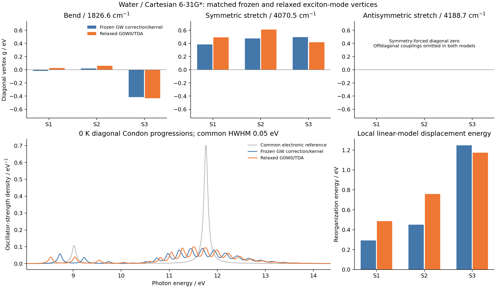
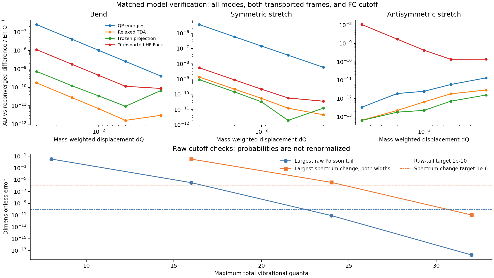

# X15: matched frozen and relaxed diagonal exciton-mode vertices

This calculation compares two local diagonal electron-vibration models at the
same water geometry, in the same Cartesian 6-31G* basis, with the same three
harmonic modes and the same three isolated singlet TDA states. Both use the
same purely electronic G0W0/TDA energies and Condon transition dipoles. Only
their diagonal exciton-mode vertices differ.



The ground geometry and mass-normalized modes are taken from the validated
[G05 RHF result](../G05_water_rhf_hessian/README.md). They are not taken from
the historical 3-21G water model. The current native RHF gradient maximum is
`4.288e-8 Eh/bohr`; all three current Hessian actions agree with the stored
G05 Hessian within `1.660e-13` in their directional units. Harmonic frequencies
are `1826.5534`, `4070.4599`, and `4188.7049 cm^-1` for bend, symmetric stretch,
and antisymmetric stretch.

All 19 QP/G orbitals and all `5 x 14` screening transitions are retained. The
optical operator has all 70 transitions; its lowest three states are selected.
The calculation uses 200 imaginary-frequency quadrature points, finite-eta
contour deformation with `eta=1e-5 Eh`, Newton QP roots at tolerance `1e-11 Eh`,
and the helper's symmetric AO-pair factorization threshold `1e-12`. Native
eta=0 largest-weight seeds are constructed at this optimized geometry, then
refined at finite eta and continued locally through every displacement. This
local branch definition does not prove a global finite-eta maximum-residue
selection. No external program supplies the electronic calculation.

## What is differentiated

Let the saved mode columns satisfy `V.T M V = I`, with M in electron masses.
The physical mass-weighted coordinate obeys `R = R0 + V_nu Q_nu` and has units
`bohr*sqrt(electron mass)`. For a harmonic oscillator,

```
Q_nu = (b_nu + b_nu^dagger) / sqrt(2*omega_nu)
g_relaxed[nu,s] = (d Omega_s / d Q_nu) / sqrt(2*omega_nu)
```

The relaxed slope is a JAX JVP of `MolecularGW.optical`. Its moving inputs
include native integrals and metric, self-consistent HF density/orbitals,
implicit QP roots, screening and the BSE kernel. The shared isolated Hermitian
spectral rule supplies the first TDA energy derivative. No finite difference
constructs the vertex.

The frozen model still includes self-consistent HF screening. It freezes the
GW correction, BSE kernel and base TDA amplitudes X0. The numerical HF engine
and QP calculation can use different MO gauges, so their frames are aligned
explicitly. With `O = C_HF.T @ S0 @ C_QP0`, the analytic HF-Fock slope is
transformed as `O.T @ dF_HF @ O`. Independently displaced HF calculations are
polar-transported directly into `C_QP0` using `NativeRHF.transport`. The
baseline `F0` is the transported **HF Fock matrix**, never the diagonal of the
quasiparticle energies. Orthogonality, occupied/virtual matching, density
agreement and the base Fock operator are checked.

Using the existing `ep_coupling.project_couplings`, define

```
Delta A_frozen = X0^dagger [Delta F_electron - Delta F_hole] X0
Omega_frozen_s(R) = Omega0_s + diagonal(Delta A_frozen)_s
g_frozen[nu,s] = diagonal(X0^dagger [dF_e - dF_h] X0)_s / sqrt(2*omega_nu)
```

Both comparisons retain only these diagonal elements. The frozen projected
offdiagonal matrix is not rediagonalized, and the relaxed model is not given
extra offdiagonal terms. This prevents state-mixing or basis changes from
being mixed into a vertex-only comparison.

## Measured vertices

The common vertical excitation energies are approximately
`[0.33144466, 0.41165548, 0.43231143] Eh`. Values below are g in eV; each pair
is frozen / relaxed.

| Mode | State S1 | State S2 | State S3 |
| --- | ---: | ---: | ---: |
| Bend | -0.01624966 / 0.02678584 | 0.01985486 / 0.06067346 | -0.41447012 / -0.43273250 |
| Symmetric stretch | 0.38347600 / 0.49418136 | 0.47570864 / 0.61186359 | 0.49679502 / 0.41781136 |
| Antisymmetric stretch | below 1.2e-12 | below 1.2e-12 | below 1.2e-12 |

Mode signs follow the saved G05 eigenvectors; reversing a mode reverses both
models' g and displacement coordinates. The odd antisymmetric stretch has
zero diagonal first-energy derivatives at this C2v geometry for isolated
states. This does not remove that mode from a general vibronic problem: its
frozen projected offdiagonal slope has norm `0.003832 Eh/Q`, which is discarded
here. Full relaxed offdiagonal vertices and quadratic vertices are not computed.

## Independent reconverged differences



For each mode, displacements `dQ = 0.05, 0.02, 0.01, 0.005, 0.002` are
recomputed with positive and negative signs. The relaxed comparison repeats
the full HF/GW/BSE calculation. The frozen comparison repeats HF and direct
transport into `C_QP0`, then evaluates its explicitly frozen scalar model.
QP convergence/coverage, BSE convergence/stability, MO identity and
transition-density root matching are checked for each displaced point.

At the smallest displacement, maximum errors over all modes/states are:

| Quantity | Maximum AD/FD difference |
| --- | ---: |
| Relaxed TDA slope | 4.558e-12 Eh/Q |
| Frozen projected slope | 6.701e-11 Eh/Q |
| Directly transported HF Fock vs rotated analytic slope | 1.391e-10 Eh/Q |
| All 19 QP slopes | 5.831e-9 Eh/Q |

The complete step table retains the small-step noise floor, including the
symmetry-forced zero derivatives. These are independent finite differences
of each named approximation, not an external GW nuclear-gradient benchmark.

## Local diagonal 0 K spectra

For either set of g, the common-frequency excited harmonic model is

```
H_s = Omega0_s + sum_nu [omega_nu b_nu^dagger b_nu
                       + g_nu,s (b_nu + b_nu^dagger)]
lambda_s = sum_nu g_nu,s^2 / omega_nu
E_s,n = Omega0_s - lambda_s + sum_nu n_nu omega_nu
```

The minimum of this linearized surface is
`Q_eq = -sqrt(2)*g/omega^(3/2)`. The existing harmonic-overlap helper instead
uses `Q_final = Q_initial + K`, so its input is **K = -Q_eq**, with the positive
sign `K = +sqrt(2)*g/omega^(3/2)`. Signed one-quantum amplitudes are checked
against `g/omega` times the vacuum amplitude, so the sign convention is tested
as well as the squared weights.

The common `ground_state_overlaps(omega, omega, I, K)` implementation provides
all FC amplitudes. There is no additional recursion or EP eigensolver in these
examples. The independent reference uses the closed Poisson weights with
`S_nu = (g_nu/omega_nu)^2`. The shift `-lambda` arises from this linear
oscillator Hamiltonian; no extra Fan or Debye-Waller shift is added to it.
The displacements and lambda are properties of the local model, not separately
optimized GW/BSE excited-state geometries.

| State | Frozen lambda / Eh | Relaxed lambda / Eh | Frozen 0-0 / Eh | Relaxed 0-0 / Eh |
| --- | ---: | ---: | ---: | ---: |
| S1 | 0.01075103447 | 0.01789972431 | 0.32069362807 | 0.31354493823 |
| S2 | 0.01654261970 | 0.02785881272 | 0.39511285965 | 0.38379666664 |
| S3 | 0.04584832360 | 0.04309872097 | 0.38646310207 | 0.38921270471 |

Raw FC probabilities are never renormalized after truncation. Maximum total
quanta 8/16/24/32 give largest analytic Poisson tails
`0.03316 / 3.271e-6 / 8.579e-12 / 1.832e-18`. At the final cutoff, the largest
relative spectrum change is `1.101e-11`, checked at both common Lorentzian
HWHM values, 0.05 and 0.025 eV. Numerical FC sums agree with the independent
Poisson probabilities within their float64 checks; tiny residual normalization
defects are retained rather than removed.

The zero-coupling limit returns the electronic sticks. The finite-cutoff
energy-weighted probability is also checked, ensuring convergence to each
selected electronic oscillator strength when the actual vibronic line energy
is used in `f = (2/3) E |mu|^2 P`. This closure concerns the three selected
states, not the total molecular TRK sum. Numerical finite-window areas on
`[0,25] eV` differ from exact Lorentzian integrals by at most `9.592e-12`.
The omitted Lorentzian tails remain reported in the data.

The plot shows oscillator-strength density. Vibronic redistribution differs
between the two vertex models while the display widths are identical. It does
not predict a lifetime, a continuum photoabsorption cross section, thermal
multiphonon effects, non-Condon dipole response or a complete nonadiabatic
exciton-phonon matrix. The FC enumeration is host-side postprocessing, not a
claim of a differentiable full FC spectrum API.

## Reproduce and inspect

Run from the repository root with the matching native CPU library:

```sh
python examples/bse/water_mode_vertices.py
python examples/bse/compare_water_mode_vertices.py
python examples/bse/water_diagonal_vibronic.py
python examples/bse/plot_water_mode_vertices.py
```

These are ordinary scripts with no CLI. The FC stage requires a completed
successful FD record and verifies input hashes. The plot consumes saved data.
Key files are [vertices](gradscf.json), [arrays](vertices.npz),
[all finite differences](finite_differences.json), [FC checks](diagonal_vibronic.json),
[spectral arrays](diagonal_vibronic.npz), [spectra CSV](diagonal_spectra.csv),
[vertex CSV](vertices.csv), [figure PDF](matched_vertices.pdf),
[verification PDF](validation.pdf), and [runtime/source hashes](runtime.json).

All numerical work ran on `jy_gpu_1`, using the isolated snapshot
`/home/yjiao/gradscf_checks/ad-showcase-water-mode-vertices-20261016`.
Its source-tree hash is
`94008e9b36cba7a8dd61645abce3b4da83e7cf7965bb62304edda8ad8e35ddd0`;
the 85 native source/binary checks match G08, including library SHA
`8176ca97f9758ba3810b727c5a2e90572ac4f8f205e4a16e0d7a7177221b1829`.
No src module was changed for this comparison. X14 EOM and the separate
temperature workflows were left unchanged.

CPU: Intel Xeon Platinum 8457C; Python 3.11.15, JAX/jaxlib 0.10.0, NumPy 2.4.4,
SciPy 1.17.1 and PySCF 2.13.0. Whole-program wall times and peak RSS were
99.68 s / 3,607,136 KiB for vertices, 49.54 s / 1,846,596 KiB for FD, and
6.78 s / 904,888 KiB for FC. First/warm relaxed mode JVPs took 21.675 s and
0.667-0.684 s; the frozen helper additionally computes an HF Hessian action,
so those timings are not like-for-like performance comparisons. OMP/BLAS
settings were two and do not cap every JAX thread pool; this shared-node
small-system measurement is not a scaling benchmark.

One earlier transform composition, an outer JVP/JIT around an already-jitted
full GW/BSE map, failed with a DynamicJaxprTracer constant-handler error.
A reduced 30-line diagnostic reproduces it. The demonstrated calculation
uses the verified raw observable -> JVP -> outer JIT composition. The failed
source, tracebacks and reduced probe are retained under
`artifacts/ad_showcase/development/X15_matched_vertices`; no core fix or general nested-JIT
support is claimed. Source archives and runtime hashes preserve calculation
versions before measured output comments and documentation were added.
