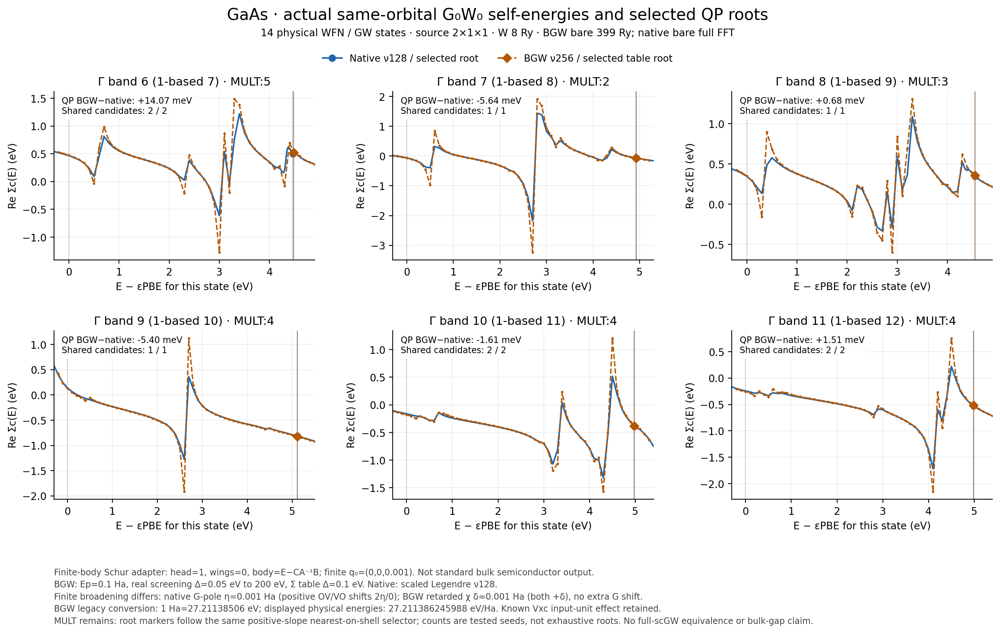

# GaAs native / BerkeleyGW G0W0: executed finite-body comparison

The figure and tables contain actual calculations on 2026-10-18. They compare
the same exported 14 Gaussian Bloch orbitals, with all 14 internal G/W bands
retained. The original BerkeleyGW installation is unchanged; its separately
recorded finite-space guard patch permits the final-band boundary without
inventing an extra state. This is a controlled finite-model diagnostic,
not a bulk GaAs benchmark or a BerkeleyGW full-Dyson scGW comparison.

- [Vector PDF](gaas_native_bgw_sigma.pdf), [compact six-state CSV](selected_gamma_comparison.csv).
- [Actual curve arrays](correlation_curves.npz), [comparison and provenance](comparison.json).
- [Numerical curve certificate](curve_certificate.json), [full summary](native_bgw_final_summary.json).
- The raw-output archive contains actual spectra, exchange/Vxc, Eqp0/Eqp1, MULT flags, input files, hashes, resource records and independent Schur tests; it is retained separately under the [source-checkout packaging policy](../PACKAGING.md).
- [Sampling resources](sampling_resource.json), [render resources](render_resource.json), [file hashes](data_manifest.json).

The [packaging note](../PACKAGING.md) distinguishes the selected Git files
from the unchanged manifests of the original executed/archive evidence.

The reusable sampling and plotting functions are in
[`examples/pbc/band_structures/berkeleygw_gaas.py`](../../../examples/pbc/band_structures/berkeleygw_gaas.py).
They call the SRC correlation kernel and read saved results. This data
directory contains no physics implementation.

## Fixed model and explicitly different controls

Zincblende GaAs, a=5.6533 Angstrom, GTH-SZV/GTH-PBE, PBE, 18 electrons,
original orbital FFT 21³, source k mesh 2×1×1, scalar/no SOC, zero temperature.
The PBE energy is -78.28410986996047 Ha. Exported WFN/WFNq orbitals are
preserved with exact zero padding onto BGW kinetic spheres. The selected
Gamma bands are **6–11 zero-based / 7–12 one-based**; all internal G/W bands
remain present.

Native uses `exxdiv=None`, Madelung=0, eta=0.001 Ha, W cutoff 8 Ry, and its
full-FFT bare exchange. BGW uses W cutoff 8 Ry, bare cutoff 399 Ry, retarded-chi
broadening 0.027211386245988 eV, imaginary grid N=256 with Ep=0.1 Ha, real screening spacing
0.05 eV to 200 eV, and a Sigma evaluation table ±20 eV with 0.1-eV spacing.
The native scaled-Legendre grid uses N=128 with its own default x0=0.5 Ha.
These grids are separately checked; equal point counts are not equivalent.
BGW CD method 2 forces its high real cutoff equal to the low cutoff, so both
are kept at 200 eV to include the fourteenth reference orbital near 135 eV.

**Finite broadening is not matched in these archived runs.** Source inspection
establishes that BGW real-frequency chi uses resonant/antiresonant shifts
+i delta / +i delta, delta approximately 0.001 Ha, and its CD residue samples
this retarded table on the real axis without an additional G-pole eta. Its
imaginary integral likewise uses the real E−epsilon_m denominator. Native
uses a time-ordered response at a complex G pole: positive-frequency OV/VO
shifts are +2i eta / 0, negative-frequency shifts 0 / -2i eta. The nominal
0.001-Ha numbers therefore implement different finite-eta equations.
Changing only BGW broadening to 2 eta would not match both terms. A separate
explicit comparison protocol or controlled eta→0 check is required; this
archive does not certify it. Exact installed-source locations, hashes and
the complex-matrix R/A convention are recorded in [finite_eta_protocol.json](finite_eta_protocol.json).

The **body Schur adapter** is applied to a new eps0mat copy only. From
the original inverse dielectric blocks [[A,B],[C,E]], it writes head=1,
wings=0, body=E−CA⁻¹B independently for retarded/advanced channels.
The actual fine file has 4256 frequency entries and a 113×113 matrix.
An independent inversion of the original sampled dielectric body agrees
with the written matrix to relative Frobenius error 8.785e-16.
The original eps0mat and the nonzero-q epsmat remain hash-identical.
This matches removal of head feedback in the finite body model; finite
q0=(0,0,0.001) remains. It is not ordinary BGW semiconductor output.

Installed BGW defines 1 Ha=27.21138506 eV (twice its legacy RYD), whereas
reported physical eV here use 27.211386245988 eV/Ha. With the explicit build
conversion, selected reference energies agree within 1.837e-11 Ha without
loosening the 1e-8-Ha reference gate. The previously exported Vxc used the
modern conversion; its actual-input and physical-Vxc equations are recorded
separately. Their maximum selected-root difference is 4.309e-7 eV, a known
unit-convention effect, not a fitted shift.

## Selected states: on-shell components and shared selected roots

The following differences use native−BGW for Sigma and exchange, BGW−native
for QP energies. Energies are measured in the same physical eV convention.

| Band (0 / 1 based) | Re Sigma_c(KS) difference / meV | Exchange difference / meV | Selected QP difference / meV | Original BGW flag |
|---|---:|---:|---:|---|
| 6 / 7 | -6.229 | 9.420 | 14.072 | MULT:5 |
| 7 / 8 | -5.043 | 9.098 | -5.643 | MULT:2 |
| 8 / 9 | -5.614 | 10.079 | 0.681 | MULT:3 |
| 9 / 10 | 13.070 | 0.472 | -5.401 | MULT:4 |
| 10 / 11 | 16.098 | 2.368 | -1.613 | MULT:4 |
| 11 / 12 | 15.239 | 2.230 | 1.510 | MULT:4 |

The shared SRC selector uses positive-slope, nearest-on-shell candidates.
BGW uses piecewise-linear Re Sigma in its actual evaluated table, with NaN
outside it. Tested candidate counts on each side are [2,1,1,1,2,2]; they are
not exhaustive mathematical root counts. Original MULT flags do not disappear.
Raw Eqp1 is archived and is not substituted for a unique nonlinear root.

The largest **on-shell** correlation difference is 16.098 meV, and the largest
selected QP difference is 14.072 meV. These are not full-frequency bounds:
over actual native curve samples versus the piecewise BGW table in the
plotted window, max |Delta Re Sigma_c(E)| is **1.064227 eV**, at zero-based
band 7, E=10.7056973 eV (E−epsilon_PBE=2.7 eV). The curves vary rapidly
there. Mathematical Sigma or W poles have **not been independently isolated**;
their distances from this point are **not determined**. The neighboring
actual samples are retained in `pole_neighborhood.json`. Differences in
FFT product closure, finite q0, broadening, frequency grids and interpolation
can interact in this region; no unique cause is assigned.

The maximum own-equation residuals are 7.364e-15 eV (native) and 1.511e-15 eV
(BGW table). Re-evaluating the actual native curve at the saved native roots
reproduces the same maximum residual. Cross-equation residuals remain
20.870 meV for native F evaluated at the BGW root and 42.803 meV for BGW's
table F at the native root. Small own residuals certify numerical roots of
their equations, not equivalence of the two frequency-dependent models.

Within this selected window only, occupied band 7 lies above band 8.
The local Gamma window gaps are native 0.310559908 eV and BGW 0.310801144 eV,
using bands 7 and 9 after reordering. Lower occupied states were not all
selected with the shared native selector in this bounded comparison, so
these values are not a complete Gamma gap or a bulk fundamental gap.

## Verification and resources

- Actual Epsilon and Sigma executions completed with exit 0. All saved
  spectra are finite, the exact Gamma Coulomb head is zero, and no plotted
  or selected-root evaluation extrapolates the Sigma table.
- Native N=64→128 changes the six on-shell correlations by at most 2.553e-8 eV;
  BGW N=128→256 at Ep=0.1 Ha changes them by at most 0.100 meV on the coarser
  real grid. The earlier N=16/Ep=1 Ha result is a separate frequency protocol.
- Removing head Schur feedback reduces the coarse-real-grid maximum
  on-shell difference from 108.340 to 19.968 meV. Changing only the real
  spacing 0.25→0.05 eV then gives 16.098 meV. This does not certify a
  globally converged frequency-dependent self-energy.
- Six independent export tests passed remotely, including actual GaAs
  integration and BGW sphere/normalization checks. Seven parser/unit tests
  and two independent complex Schur-copy tests passed in the focused
  9-test remote run; its RED/GREEN records are in the raw archive.
- Original WFN/WFNq/Vxc/Sigma-input hashes are identical across the paired
  cases. Each Schur pair preserves the original eps0mat and nonzero-q
  epsmat. The raw archive's 92 file hashes and compressed archive hash were
  checked after download.
- All numerical work and rendering ran on c20, Xeon Platinum 8457C, only
  CPU64–79. Every command had a monitored 600-s / 16-GiB bound. Native used
  BLAS1; BGW used 16 MKL threads. Fine-real Epsilon took 27.02 s (2.92 GiB),
  raw Sigma 15.68 s (3.91 GiB), and the native/root comparison 65.31 s
  (2.14 GiB). The actual six-state curve sampling plus first rendering took
  44.01 s (1.95 GiB); final saved-data rendering took 2.31 s (0.26 GiB).

The archive SHA256 is
`60909590f5b54756c41f79754f52063f76774dbf8445841b56433a1fa26ba089`.
All raw wavefunctions and large dielectric matrices remain in the remote
job directories named in `comparison.json`; their hashes are retained here.
