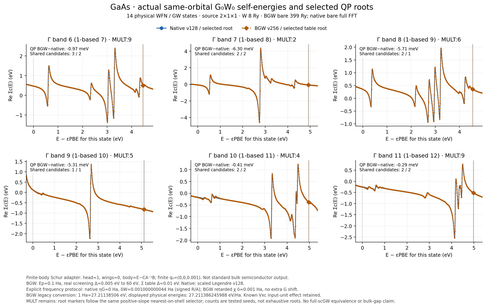

# Executed GaAs comparison with explicit frequency broadening

The [source-checkout packaging note](../PACKAGING.md) explains the four raw
`spectrum.dat` tables retained separately from this Git bundle. The final
sampled curves and small raw inputs/summaries remain included. Original
execution/archive manifests are unchanged and are not checkout-completeness
lists.

The selected six Gamma states now use an explicit native frequency
prescription matching the inspected BGW CD broadening definitions:
eta_G=0 and delta_W=0.001000000043584257 Ha. The final selected real QP
energies differ by at most **6.304 meV**. This is a finite-model, selected-state
comparison. It does not establish full-frequency or bulk GaAs agreement:
the maximum correlation difference in the actual plotted sample window is
**0.269054 eV**, and the wide satellite region remains sensitive to grids.

- [Final PDF](real0005_cut60_eval001/gaas_native_bgw_sigma.pdf), [six-state CSV](real0005_cut60_eval001/selected_gamma_comparison.csv).
- [Actual curves](real0005_cut60_eval001/correlation_curves.npz), [comparison/provenance](real0005_cut60_eval001/comparison.json), [scope-specific certificate](real0005_cut60_eval001/protocol_certificate.json).
- [Controlled changes and full hashes](control_manifest.json), [exact range-invariance result](range_control.json), [W spacing data](w_refinement_4_cases.json), [active residue bound](active_residue_frequency_bound.json).
- [JIT source text/SHA audit](source_specialization_qa.json), [download checks](download_verification.json), [file manifest](data_manifest.json).

The [earlier unmatched-eta directory](../gaas_berkeleygw_20261018/README.md)
and its raw outputs remain separate. The [matched coarse-table baseline](real005_cut200/gaas_native_bgw_sigma.pdf)
also remains unchanged. This directory contains data and documentation;
sampling and rendering use the public
[`berkeleygw_gaas.py` example](../../../examples/pbc/band_structures/berkeleygw_gaas.py).

## Fixed physics inputs and remaining finite-model differences

All cases retain the same **14 physical WFN states and all 14 internal G/W
bands**, 18 electrons, PBE/GTH-SZV/GTH-PBE, source mesh 2×1×1, original
orbital FFT 21³, and the same native orbitals exported to BGW by zero padding.
The six output bands are 6–11 zero-based, or 7–12 one-based. W vertices use
an 8-Ry sphere; BGW bare exchange uses 399 Ry, whereas native bare exchange
uses its full FFT products. No Madelung constant or fitted shift is applied.
Native exchange minus BGW exchange is up to 10.079 meV for these states.

The new eps0mat copy removes head Schur feedback using body=E−CA⁻¹B,
head=1 and wings=0. The original eps0mat and nonzero-q epsmat remain
unchanged. Its independent full-body inverse certificate is approximately
8.785e-16 at the certified sample frequencies. Finite q0=(0,0,0.001) remains.
This is a declared finite-body adapter, **not standard BGW bulk semiconductor
output**. Full OV/VO versus folded CV response, finite q0, and FFT product
closure differences are still retained.

Native uses 128-point scaled Legendre integration; BGW uses its separate
256-point rational imaginary grid with Ep=0.1 Ha. Installed BGW's legacy
conversion is 27.21138506 eV/Ha, while physical display uses
27.211386245988 eV/Ha. The strict reference-energy gate is unchanged:
the measured mismatch is 1.837e-11 Ha. The previously exported Vxc input-unit
effect is retained separately, not fitted away.

## Controlled changes

The native physical source fingerprints are **N0=fcccebf7933e…** and
**N1=f021849276ae…**. The entire file difference is one JIT decorator:
k changes from static to dynamic specialization. Pure text reconstruction
recovers the exact N0 SHA; formulas, parameters, data and comments are
unchanged. Query/qp/frequency source hashes are identical. Saved native
exchange, Vref, on-shell correlation and selected root energies are also
identical. Each row below has its actual full source, WFN, epsilon and Sigma
input hashes in `control_manifest.json`; the table does not label the source
files byte-identical.

| Case | W spacing / cutoff (eV) | Sigma evaluation step (eV) | Native data / source | Actual controlled observation |
|---|---:|---:|---|---|
| Matched baseline | 0.05 / 200 | 0.1 | Saved overview 0.1, near-root 0.01 / fcccebf7933e | Plotted-sample max correlation difference 2.461957 eV; old band-7 2.7-eV point improves from unmatched 1.064227 to 0.136225 eV, but a different point becomes worse. |
| Range only | 0.05 / 60 | 0.1 | Same saved native samples / fcccebf7933e | All 2406 printed complex total/Cor/residue/integral values and all six shared-selector roots **exactly identical** to the 200-eV case. |
| W spacing | 0.01 / 60 | 0.1 | Same saved native samples / fcccebf7933e | Fixed-sample max difference 0.597711 eV; full ±20-eV BGW table max real change from 0.05 spacing is 24.644571 eV. |
| W spacing | 0.005 / 60 | 0.1 | Same saved native samples / fcccebf7933e | Fixed-sample max difference 0.598317 eV; full ±20-eV max real change from 0.01 spacing remains 1.195590 eV. |
| Sigma table only | 0.005 / 60 | 0.01 | Actual overview 0.01, near-root 0.005 / f021849276ae | Every one of the original 401 points/state is **exactly unchanged** in the new 4001-point/state table. Band-6 shared table root moves −19.148 meV; the final maximum selected QP difference is 6.304 meV. |

The final plot has denser native samples than the earlier diagnostic plots.
Its 0.269054-eV maximum and the earlier maxima therefore have explicitly
different plotting sample sets; they are not an unqualified convergence
bound. The exact common-point tests and shared-root displacement isolate
the Sigma table interpolation change without this ambiguity. In the full
±20-eV BGW table, new dense points differ from the old linear interpolant
by as much as 68.179853 eV in a satellite region. This is an interpolation
diagnostic, not a native-versus-BGW bound over that full interval.

The 60-eV real-W range is justified only for this selected output window.
Across every actual table energy and both source-k internal sets, active
empty-particle/occupied-hole residues require at most 23.59533993 eV;
adding a 0.01-eV output/rounding margin gives 23.60534 eV. The fourteenth
internal empty state reaches 140.512 eV and is still included in chi and
every imaginary-axis sum. No complete W-spectrum or output-band-14 range
claim follows. Threshold inequalities, endpoint conventions and Ef are
recorded in the bound certificate.

## Final scope-specific differences

These values concern the actual sampled final curves; native was not
evaluated over the whole ±20-eV BGW table.

| Quantity | Maximum absolute difference |
|---|---:|
| Re Sigma_c at the six KS energies | 16.008 meV |
| Re Sigma_c within ±0.10 eV of either selected root | 16.027 meV |
| Re Sigma_c within ±0.25 eV of either selected root | 146.813 meV |
| Re Sigma_c over the actual plotted native sample window | 269.054 meV |
| Selected real QP energies | 6.304 meV |
| Native F evaluated at BGW's selected table root | 8.825 meV |
| BGW table F evaluated at native's selected root | 8.720 meV |

Own-equation residuals are at most 3.682e-15 eV (native) and 3.022e-15 eV
(BGW table); re-evaluating the native curve at its stored roots reproduces
the same residual. Those small values certify roots of the evaluated
equations, not equivalence of the models. Original BGW flags are
`MULT:[9,2,6,5,4,9]`. Shared tested-candidate counts are native
`[3,2,2,1,2,2]` and BGW `[2,2,1,1,2,2]`; they are not exhaustive root counts.
Raw Eqp1 is retained, not promoted to a unique QP branch. No complete Gamma
gap, bulk fundamental gap or full-Dyson scGW equivalence is claimed here.

## Checks and execution

The fixed-width BGW output at iw≥1000 joins adjacent I4 band/iw fields.
Two independent fixtures reproduced the old parser failure; the minimal
format3000 reader then passed the 11-test parser/Schur run in 0.86 s.
The actual 24,006 dense spectral records are finite and strictly ordered
within each state. No comparison or selected root extrapolates the table.
Source screening-eta fixtures passed 48 tests in 70.22 s; the separate JIT
cross-k/root tests passed 45 in 80.34 s. Their stdout/resource evidence is
in `tests/`, with the parser RED/GREEN proof.

The final comparison and refinement commands used c20, Xeon Platinum 8457C, CPU80–95 only, with a
600-s and 16-GiB monitored limit per command. BGW used 16 MKL threads;
native used BLAS1, CPU float64/complex128. The finest W Epsilon took 63.23 s
(8.08 GiB), coarse-output Sigma 28.17 s (10.78 GiB), dense-output Sigma
41.81 s (10.78 GiB), and actual native comparison/curves/rendering 105.55 s
(2.41 GiB). All physics programs exited 0. The first dense-output summary
failed on the format boundary and was retained; after the parser fix,
summary and native postprocessing succeeded without rerunning Sigma.

Large WFN/dielectric files remain remote at the paths in `comparison.json`,
with verified unchanged hashes. Only small raw outputs, inputs, certificates,
resource records and final figures were downloaded. CPU80–95 was explicitly
released before the final SFTP downloads and local text/hash/visual QA.
