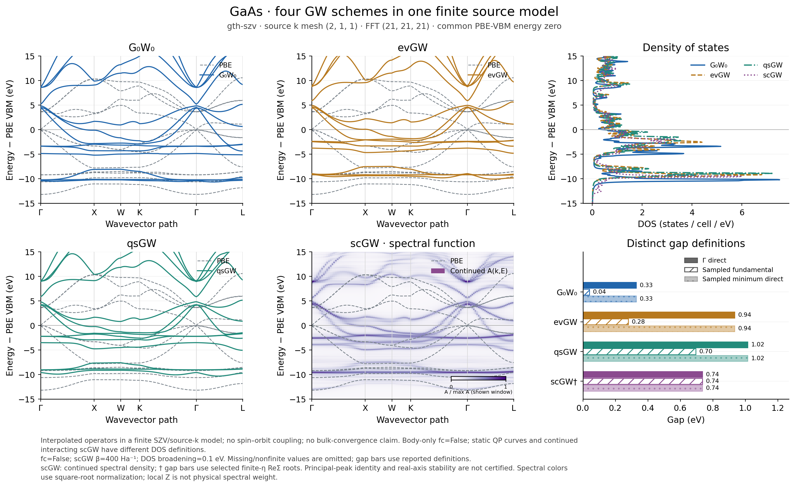

# GaAs: four native GW methods in a common finite model

**Additional validation, 2026-10-19:** the `21^3` Gaussian AO Fourier grid
is under resolution for this example. The same physical query point in two
reciprocal representatives differs by up to about 0.45 eV in the PBE
spectrum. The figures below must therefore be treated as underresolved
diagnostics, in addition to the continuation limitations already listed.
The original data are retained; this is not evidence of physical band
discontinuities. The [continuity check](reciprocal_continuity_check_20261019.json)
separates a smooth unwrapped path from the failed reciprocal-image check.
The [resolved FFT61 reference and replacement runs](../gaas_four_gw_fft61_20261019/README.md)
are recorded separately; no numerical files below have been overwritten.

These calculations use GradSCF throughout. BerkeleyGW is an independent
external reference, not a runtime dependency or a required API convention.



The [PDF figure](gaas_four_gw.pdf), [gap table](gaps.csv) and
[comparison metadata](comparison.json) use the same numerical inputs.
The superseded FFT21 comparison arrays and full scGW source state are
retained separately under the [source-checkout packaging policy](../PACKAGING.md).
The unchanged hash/provenance manifests describe the original execution
bundle. Energies below are in eV.

| Method | Gamma direct gap | Change from PBE at Gamma | Uniform-BZ sampled gap |
| --- | ---: | ---: | ---: |
| PBE | 0.067747 | 0 | 0.067747 |
| G0W0 | 0.327895 | +0.260148 | 0.040305 |
| evGW | 0.935279 | +0.867532 | 0.279494 |
| qsGW, mode A | 1.015062 | +0.947315 | 0.695764 |
| scGW continuation diagnostic | 0.736493 | +0.668747 | 0.736493 |

Gamma/direct and sampled fundamental gaps are distinct observables. The
small apparent indirect gaps in the anisotropic interpolated model do not
establish an indirect gap for bulk GaAs. The scGW row additionally has the
continuation limitations quantified below.

## Inputs and interpretation

The fixed zincblende structure has a lattice constant of 5.6533 Angstrom.
All four methods use PBE/GTH-SZV/GTH-PBE, 18 valence electrons, all 14 spatial
orbitals, a `(2,1,1)` source mesh and a `21^3` FFT. Bare Hartree/exchange use
the complete finite FFT interaction; correlation uses a separate 16 Ry
dielectric cutoff. `fc=False` and `exxdiv=None` define the body-only model.
Spin-orbit coupling is absent. This is a method demonstration, not a
converged bulk GaAs band-gap prediction.

- G0W0 solves diagonal QP equations with the reference G/W.
- evGW updates every eigenvalue in both G and W, keeping reference orbitals
  and density fixed. Complete reference-degenerate blocks are trace-averaged.
- qsGW uses a full complex Hermitian mode-A effective Hamiltonian, updating
  orbitals, density, Hartree/exchange and screening.
- scGW solves the full frequency-dependent matrix Dyson problem on both
  Matsubara branches. It uses beta = 400 Ha^-1, 1024 positive and 1024
  negative fermionic frequencies and 8192 Gauss-Legendre time nodes. Its
  finite temperature is explicit; zero-temperature convergence is not claimed.

The three contour-deformation methods use 64 mapped Gauss-Legendre nodes
and the declared legacy finite-eta residue convention, eta = 0.001 Ha.
Their imaginary-contour kernel uses static subtraction and zero G
broadening. Matsubara scGW has no imaginary-axis eta.

The figures interpolate source operators through a common Bloch AO
convention onto a 121-point Gamma-X-W-K-Gamma-L path and a separate `4^3`
uniform DOS mesh. These are interpolated results, not 185 new direct GW
calculations. Increasing drawing density does not increase source resolution.

All curves share a PBE-VBM zero. The DOS width is 0.1 eV. Static QP DOS
counts one state per band and spin; scGW DOS is the interacting spectral
trace and includes satellite weight. The energy axis retains all finite-basis
QP inputs; the band panels show the interval [-15,15] eV. Finite-window DOS
integrals are reported without renormalization.

## scGW spectral limitations

The scGW lines and gap entries are selected finite-eta roots of the real-part
matrix Dyson equation. They are not certified principal spectral peaks.
Local Z is an inverse residual slope, not a physical normalized pole weight.

The original scGW state passes its unmixed matrix/tail residual and electron
number checks. Increasing the linked frequency/time grids from 512/4096 to
1024/8192 changes the first 128 positive-frequency self-energy values by
8.545e-5 in relative Frobenius norm. Each state uses its own self-consistent
chemical potential, so this is a raw SC-solution difference at common
relative iomega nodes, not a fixed-absolute-z error.

The continued measure passes selected imaginary-axis training/holdout,
first-moment, PSD and source electron-count checks. Those checks do not
establish real-axis stability. The source Gamma gap changes from
0.736493399 eV to 0.735489882 eV when rank tolerance changes from 1e-12 to
5e-13 at fixed 2.01 Ha input range, and to 0.690691816 eV when the range
changes to 1.51 Ha at fixed rank tolerance. The corresponding sampled
spectral-trace changes are 27.3% and 49.3%. At the baseline controls, the
512-to-1024 refinement changes this selected-root gap by 67.2 meV.
Deep selected satellite roots are substantially more sensitive.

The scGW gap therefore remains a continuation diagnostic. The complete
original Matsubara arrays are retained; the explicitly selected continuation
range does not modify the source calculation. See `sc1024_stability.json`
for the measured controls rather than interpreting one successful fit as a
real-axis convergence certificate.

The main scGW panel displays the continued A(k,E) directly, with a
square-root color normalization relative to the maximum in the displayed
window. This changes the color scale only. The
[unfiltered selected-root figure](gaas_four_gw_selected_roots.pdf) retains
the original root jumps for inspection; no root arrays are smoothed or
replaced with static Fock eigenvalues.

## Independent reference and larger source grid

The separate [BerkeleyGW comparison](../gaas_berkeleygw_matched_eta_20261018/README.md)
uses the same native orbitals but its own explicitly matched finite-body,
8 Ry screening and frequency protocol. It is not the 16 Ry four-method run
here. The selected Gamma QP comparison reaches 6.304 meV maximum difference
under a common root-selection rule; full-frequency differences remain
larger. That result does not validate evGW/qsGW or full-Dyson scGW, and is
not standard semiconductor-head BerkeleyGW output.

`source_grid_gaps_8k.json` separately records the completed `(2,2,2)`
G0W0/evGW/qsGW checks. No eight-point scGW result is substituted or mixed
with the two-point source model in the four-method figure.

## Reproduction and evidence

The readable public examples are
[gaas_self_consistent_gw.py](../../../examples/pbc/band_structures/gaas_self_consistent_gw.py)
and [gaas_gw_spectra.py](../../../examples/pbc/band_structures/gaas_gw_spectra.py).
Their algorithms are provided by `src/gradscf`; this directory contains
data and documentation only.

Numerical work and rendering run only on `jy_gpu_1` (c20, Intel Xeon
Platinum 8457C), CPU JAX float64. Per-job CPU affinity, wall time and peak
RSS are recorded separately. CD calls share a process and JIT caches;
scGW uses a separate process. These times are not matched warm benchmarks.
The final focused regression gate contains 20 periodic self-consistency
tests and 12 shifted-linear-solver tests; it is not a full-suite result.
The final contraction change additionally passes all nine spectral and
continued-root checks, giving 41 targeted test cases across these groups.

The fresh three-method CD workflow completed in 78.32 s with 2.73 GiB
monitored peak RSS. The separate full scGW solve took 1960.98 s with
43.87 GiB monitored peak RSS. Per-method timers and resource records are
retained rather than combining these into a warm performance comparison.

An internal spectral contraction now uses `numpy.einsum(..., optimize=True)`.
For actual SC1024 matrices of shape `(378,14,14)` and 10001 frequencies,
three-repeat medians are 1.53 s for the original contraction and 0.090 s
for the optimized one, with maximum difference 3.56e-15 Ha. This is a
single-contraction benchmark, not a 17-fold complete GW speedup. The saved
figure was produced with the original, numerically equivalent contraction;
the optimized path has separate spectral/continued-root regression checks.

To reproduce the demonstrated controls without a command-line interface:

```bash
python examples/pbc/band_structures/gaas_self_consistent_gw.py
python examples/pbc/band_structures/gaas_gw_spectra.py
```

The first script saves the four source states; the second reads them and
writes the figure, arrays and numerical definitions under
`artifacts/gaas_gw_comparison`. The examples do not launch BerkeleyGW.
