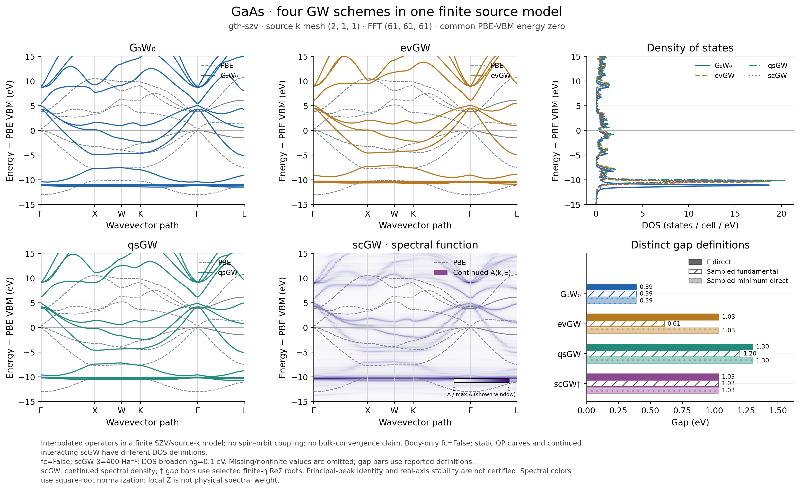

# GaAs with a resolved Gaussian AO Fourier grid

The [source-checkout packaging note](../PACKAGING.md) explains the separately
retained full scGW checkpoints and historical arrays. The original execution
hash/provenance manifests remain unchanged and can name those omitted files.

The earlier FFT21 demonstration failed an additional reciprocal-image
validation. This case uses FFT61 and retains the original finite source
mesh `(2,1,1)`, GTH-SZV/GTH-PBE, all 14 Cartesian orbitals and 18 valence
electrons, PBE reference, W cutoff 16 Ry, `fc=False`, `exxdiv=None`, and no
spin-orbit coupling. It is not a bulk-convergence benchmark.

## Resolved cause and correction

The native Bloch AO implementation truncates analytic Gaussian Fourier
coefficients to the explicit FFT box. At FFT21, the tight Ga 3d tails are
not negligible at its boundary. Shifting k by a reciprocal vector changes
which tail coefficients the finite box excludes. An independent entering-
minus-leaving-slab calculation reproduces the resulting S/T discrepancy
to roundoff; the Bloch phase sign itself is correct.

For an AO Fourier coefficient `g_mu`, the finite representation has the form

```math
\chi_{\mu k}^{\mathcal G}(r) \propto
\sum_{G\in\mathcal G}\widetilde g_\mu(G+k)\,e^{i(G+k)\cdot r}.
```

In the infinite sum, changing `k` to `k+G0` just relabels reciprocal indices.
In a finite box it replaces `G` by the translated set `G+G0`; the two answers
differ by the entering and leaving boundary coefficients. A tight primitive
has a more slowly decaying Fourier Gaussian, proportional to
`exp(-|G+k|^2/(4 alpha))`, so a grid adequate for Si need not resolve the
Ga 3d functions. Wrapping k or adding drawing points cannot remove this
truncation error. The comparison below holds the chosen physical k pair
and the basis fixed while changing only the FFT resolution.

| FFT mesh | k/k+G max S difference | k/k+G max T difference / Ha | T error versus independent PySCF / Ha |
| --- | ---: | ---: | ---: |
| 21 cubed | 5.40148e-4 | 1.97514e-2 | 4.00928e-1 |
| 41 cubed | 4.21730e-9 | 6.12302e-7 | 2.34025e-6 |
| 61 cubed | 4.44089e-16 | 3.55271e-15 | 1.59872e-14 |

The example now checks equivalent W-point band energies before building GW
and rejects errors above 1e-6 Ha. This is a sampled reference-quality gate,
not a proof of arbitrary basis/grid convergence. Its regression fails on
the original workflow and passes after the gate was added, with real SCF
and query calculations. The plotted path also retains its original
continuous reciprocal coordinates instead of changing representatives
mid-path. Interpolation handles its own periodic source weights.

`cell.precision` controls Ewald lattice sums in the current implementation;
it does not select or certify the explicitly supplied AO FFT mesh. The
public examples state this distinction. The existing model working-memory
budget is set to 16 GiB for FFT61; the allocation guard remains enabled.

## Independent reference and final comparison

A matched PySCF 2.13.0 PBE calculation uses its default initial guess,
the same mesh/source/basis/pseudopotential and no energy alignment shift.
All 28 native KS energies agree within 5.1561e-11 Ha, total energies within
1.8474e-11 Ha and spin-summed densities within 1.0391e-8. Three additional
reciprocal-image query pairs agree with PySCF within 1.6640e-10 Ha.
Native reciprocity errors for those pairs are at most 1.6245e-12 Ha.
This validates the specified PBE reference, not the GW approximation.



The [PDF](gaas_four_gw.pdf), [arrays](comparison.npz),
[metadata](comparison.json), [gap table](gaps.csv) and
[saved-array QA](final_saved_qa.json) use the same four new source states.

| Method | Gamma gap / eV | Uniform-BZ sampled gap / eV | Maximum forward equation residual / Ha | GW seconds |
| --- | ---: | ---: | ---: | ---: |
| PBE | 0.283860679 | 0.283860679 | — | — |
| G0W0 | 0.388477790 | 0.388477790 | 3.5444e-14 | 12.084 |
| evGW | 1.033671314 | 0.606994808 | 4.3498e-7 | 18.234 |
| qsGW, mode A | 1.299711663 | 1.200526646 | 6.2540e-7 | 21.959 |
| scGW selected-root diagnostic | 1.031019250 | 1.031019250 | 4.1947e-7 | 1575.828 |

Each CD calculation has 28/28 computed and converged states; G0W0 and evGW
also have finite positive local slopes and accepted numerical branches.
Gamma gaps are not substituted for dense-BZ sampled gaps. CD timers share
a process/JIT cache and are not matched warm performance benchmarks.

The main plot uses 121 physical path points and a separate `4^3` DOS mesh.
The scGW spectral map/DOS are finite and nonnegative, and its complete
continued electron count is 17.9999844523. The maximum train/holdout/M1
errors are 2.35e-7, 3.30e-7 and 1.46e-14. The excluded-frequency relative
error remains visible (maximum 0.0034376).

Selected-QP certification now covers 2604/2604 entries. The frequency-cluster
precision correction below resolves the previous rejection of bands 6/7
(zero-based) at the four repeated Gamma samples. The former main outputs
are retained in [their diagnostic snapshot](validation/before_qp_precision/README.md).
All 2596 previously certified energies, Z values and candidate counts are
byte-identical after the correction. All eight source input files and 17
compared arrays, including the poles, residues, retarded A/DOS, PBE/static
bands and plotting/query axes, are also byte-identical. The
[old/new QA](final_saved_qa.json) records maximum differences of zero.

The scGW Gamma, sampled fundamental and minimum direct selected-root gaps
are all 1.031019249993078 eV, a change of +0.7471585714 eV from PBE. These
are finite-eta ReSigma root diagnostics, not certified principal-peak or
spectral-onset gaps. The main scGW band panel continues to display A(k,E).
No root stopping tolerance, spectral data or physical source state was
changed to obtain complete coverage.

Final postprocessing took 383.581 seconds with a 7.53 GiB peak RSS and exit
code 0. Its [manifest](postprocessing_manifest.json) and
[resource record](postprocessing_resource.json) preserve source hashes and
commands; source and output SHA checks and NPZ CRC checks passed.

Both independent cold-start scGW calculations converged in 16 maps with
zero reported electron-count error. No coarse-FFT state was used as an
initial guess or replacement. Both use beta=400 Ha^-1, Gauss time integration
with an oversampling factor of four, and complete signed Matsubara data.

| Positive frequencies | Time nodes | Residual / Ha | Wall seconds | Peak RSS / GiB | CPU affinity |
| --- | ---: | ---: | ---: | ---: | --- |
| 512 | 4096 | 4.13775e-7 | 774.459 | 22.597 | 32--63 |
| 1024 | 8192 | 4.19475e-7 | 1638.770 | 39.028 | 64--95 |

After SRC source-frame alignment, the common lowest 128 positive-frequency
Sigma matrices differ by at most 5.70062e-6 Ha (relative norm 9.37423e-5).
The Fock maximum difference is 1.95863e-5 Ha and the chemical-potential
change is -2.89027e-5 Ha. Each Sigma is sampled at its own `mu+i omega`;
this is not an error at fixed absolute complex energy. Nt also changes when
nw doubles. The [raw refinement report](matsubara_refinement.json) records
these distinctions; two meshes do not establish a fully converged spectrum.

## Time-reversal constraint on the spectral measure

A further test found that the initial unconstrained realization preserved
reciprocal equivalence and k continuity while breaking a different physical
symmetry. The original source F, M1 and Sigma obey spinless time reversal
within about 1e-14 relative error. In a common AO frame, its fitted residues
nevertheless violated this relation by 0.439 and 0.320 in relative norm,
with real-axis Sigma symmetry residuals of order 0.3--0.4. The
[saved-array diagnosis](validation/unconstrained_time_reversal.json)
separates source, realization and query transport; no new SCF or fit was
used to locate the failure. Small imaginary-axis errors alone had not exposed it.

The public continuation now accepts `model=model`. The shared k-point
utility finds each partner `bar(k)=-k` modulo reciprocal vectors. Source
coefficients determine a unitary sewing matrix from

```math
C_k U_k = C_{\bar k}^*, \qquad U_k U_{\bar k}^*=I.
```

The source subspaces, unitary/involution identities and the original full
signed-frequency data are checked before fitting. In the MO frame, the
same-frequency relation is

```math
\Sigma_k(z)=U_k\Sigma_{\bar k}(z)^{\mathsf T}U_k^\dagger.
```

It is a transpose at the same z, not complex conjugation of Sigma at z.
For Hermitian residues the transpose equals complex conjugation, so the
final common-pole measure is replaced by

```math
R'_{k\ell}=\tfrac12\left(R_{k\ell}
 +U_k R_{\bar k\ell}^* U_k^\dagger\right).
```

This is a convex average of PSD matrices and preserves an already symmetric
M1. For exactly symmetric input data its paired Frobenius error cannot
increase. All train/holdout, M1 and PSD certificates are still recomputed
against the original data, and the nonlinear electron count is checked
separately. Raw symmetry breaking is rejected rather than averaged away.
Physical complex residues at non-TRIM points remain allowed. The generic
`model=None` realization is unchanged; the SC solver itself is unchanged.

Seventeen focused remote tests passed, including complex MO phases,
non-TRIM partners, retained physical imaginary residues, rejection of three
kinds of raw symmetry breaking, unchanged input arrays and an empty bath.
The [regression log](validation/spectral_regression.stdout) and
[resource record](validation/spectral_regression_resource.json) record
10.99 seconds of pytest time on CPU0--15; the full suite was not run.

## Initial unconstrained continuity diagnostic

The initial fresh 512-frequency state was continued once without the model
symmetry constraint, with rank tolerance 1e-12,
cutoff 2.01 Ha and the unchanged 1e-4 train/holdout tolerance. The two held-out
relative errors are 3.192e-7 and 1.981e-7; the largest relative first-moment
error is 1.487e-14. The complete auxiliary spectrum gives 17.999994924
electrons/cell against the target 18 (allowed error 1e-3). These are integral
and imaginary-axis checks, not a real-axis accuracy certificate.

For this same measure, query pairs at `s-h` and `s+h` are evaluated around
five fixed points on the original 121-point path. Only h changes; the fit,
energy window and broadening remain fixed. The table gives
`||A(s+h)-A(s-h)||_2 / max(||A(s+h)||_2, ||A(s-h)||_2)` with eta=0.1 eV,
using an energy step of 0.05 eV in the declared [-15,15] eV window.

| Path location | h0 | h0/2 | h0/4 | h0/8 |
| --- | ---: | ---: | ---: | ---: |
| Strong variation on Gamma--X | 0.460708 | 0.285648 | 0.155222 | 0.079643 |
| X | 0.049157 | 0.025334 | 0.012881 | 0.006497 |
| W | 0.085646 | 0.042089 | 0.020753 | 0.010294 |
| K--Gamma | 0.201688 | 0.113047 | 0.058577 | 0.029573 |
| L, continued terminal tangent | 0.008031 | 0.004119 | 0.002086 | 0.001050 |

Across all 80 queries, independently evaluating the wrapped and unwrapped
representatives gives maximum relative differences of 3.186e-12 in Tr G
and 3.038e-12 in A. The maximum PBE energy difference is 1.622e-11 eV.
The all-pole reconstruction of Tr G agrees with the direct SRC Dyson
spectral trace within 9.086e-12 states/eV. The decreasing h differences and
restored reciprocal equivalence support continuity of this one finite-model
spectral measure. They do not test rank/window stability, frequency
convergence or unique analytic continuation. Selected individual real-part
Dyson roots can still change identity and are not used as the main spectral
band image.

The [continuity report](sc512_k_continuity.json),
[sample arrays](sc512_k_continuity_samples.npz),
[fixed measure](sc512_k_continuity_measure.npz) and
[resource record](sc512_k_continuity_resource.json) preserve this check.
It took 191.52 seconds on CPU0--15 with an 8.12 GiB peak RSS and exit code 0.
The [provenance](sc512_k_continuity_provenance.json) distinguishes captured
input hashes from source hashes recorded during post-run archiving.

## Corrected symmetry and continuity replay

The [new replay](validation/time_reversal_replay.json) uses the same fine512
source state and the same 80 saved query bands with the model-aware
continuation. No SCF, GW iteration or query-band calculation was repeated.
It took 42.77 seconds with a 378 MiB peak RSS and exit code 0. The largest
held-out error is 3.056e-7, the M1 error is at most 1.523e-14, and the complete
spectral electron count is 17.999994924279. Residue time-reversal residuals
are 1.44e-15 and 1.89e-15.

The L pairs are specifically `k_plus=-k_minus+(1,1,1)`, so their spectra
must agree even at finite h in this nonmagnetic model. Their four relative
spectral differences are now 6.22e-13, 1.04e-13, 2.23e-13 and 1.01e-13,
replacing the nonzero L row above. The same-z query-Sigma symmetry residual
is at most 7.12e-15 (absolute maximum 4.19e-14 Ha). The other four h sequences
remain decreasing, and the reciprocal-image spectral error over all queries
is at most 2.913e-12. This separates a real physical symmetry check from
merely meeting at a common point as h tends to zero.

The constrained and unconstrained 80-point spectra differ by 0.027523 in
relative norm; the correction has a measurable effect. It does not select a
unique continuation or establish rank/window stability. The
[fixed measure](validation/time_reversal_measure.npz),
[sample arrays](validation/time_reversal_samples.npz) and
[resource record](validation/time_reversal_replay_resource.json) preserve
the corrected calculation.

## Frequency-cluster precision correction

The earlier eight uncertified Gamma entries were traced to the matrix
frequency-cluster guard, not to failure of the scalar root solve. The
[saved-matrix diagnosis](validation/qp_precision_diagnosis.json) reproduces
the main Gamma raw roots within 6.22e-15 Ha. Bands 6/7 each had one accepted
scalar candidate, positive Z values 0.9066888083/0.9066873869, finite H' and
actual residuals about 4.3e-14 Ha. At each candidate frequency, their
Hermitian eigenvalue gap is 5.5382e-9 Ha, well above numerical precision.
Nevertheless, the old `max(ftol,xtol)=1e-8 Ha` cluster rule merged them and
then rejected their small but non-scalar projected frequency response.
The earlier single-Gamma control instead used root tolerances 1e-9 Ha;
this explained its different mask, without proving a different physical gap.

The corrected guard uses the measured eigensolve error, a floating-point
matrix scale and twice the actual Newton correction to distinguish local
crossings. Its derivative uniformity scale uses only the candidate cluster,
so an unrelated state's large H' cannot relax the check. Scalar root
tolerances, seeds, positive-slope requirements and the continued self-energy
are unchanged. Finite negative Z diagnostics remain visible while those
branches remain ineligible. The full
[local criterion and limitations](../../../src/gradscf/gw/QP_SOLVERS.md#frequency-clusters-in-the-periodic-matrix-equation)
are documented with the shared QP contract. This is not a global nonlinear
root-isolation theorem, or a claim that the tiny splitting is physical GaAs
symmetry breaking.

The final source passed [26 core tests](validation/qp_precision_green.stdout)
in 69.45 seconds and [52 caller regressions](validation/qp_callers_green.stdout)
in 127.98 seconds. The groups share the three negative-Z/continuation tests.
Analytic cases cover resolved avoided crossings, complex MO rotations,
genuine crossings, finite-residual curved crossings and an unrelated third
state with a large derivative. No true-crossing gate or scalar residual
tolerance was relaxed. The [Gamma replay](validation/qp_precision_gamma_recheck.json)
then certifies 14/14 roots under the original default root settings, with
maximum matrix residual 5.37e-12 Ha and unchanged root energies. The final
full-path replay also certifies 2604/2604 entries and leaves all previously
certified roots and retarded spectra byte-identical. No new source GW
iteration was needed.

## Remaining continuation sensitivity

The fresh 1024-frequency state was checked at Gamma with the same new
symmetry constraint, root eta=0.001 Ha and spectral eta=0.1 eV. Only rank or
the selected frequency range changes. The spectral comparison uses absolute
energies `mu+[-15,15] eV`, with a 0.05 eV step, independent of any plot zero.

| Rank tolerance | Maximum fitted frequency / Ha | Selected Gamma gap / eV | Change / meV | Relative spectral-trace change |
| --- | ---: | ---: | ---: | ---: |
| 1e-12 | 2.01 | 1.0310192501 | 0 | 0 |
| 5e-13 | 2.01 | 1.0439486638 | +12.929414 | 0.0334204 |
| 1e-12 | 1.51 | 1.0321761807 | +1.156931 | 0.0605764 |

All three endpoint calculations have 14/14 certified selected Gamma roots,
true root residuals at most 1.17115e-13 Ha, held-out errors at most 3.30347e-7,
M1 errors at most 1.46930e-14 and electron-count errors at most 5.30734e-5.
Nevertheless, the largest shift among all 14 selected roots is 3.30326 eV
or 3.06540 eV. These shifts and the spectral differences preclude a claim of
fully stable real-axis bands, even though the Gamma frontier gap is less
sensitive. Passing at Gamma does not certify roots elsewhere on the path.

The [control report](validation/gamma_continuation_controls.json),
[baseline measure](validation/gamma_baseline.npz),
[rank control](validation/gamma_rank5e13.npz),
[window control](validation/gamma_cutoff151.npz) and
[resource record](validation/gamma_continuation_resource.json) retain the
original and final certificates. The group took 82.154 seconds, peaked at
6.641 GiB and exited 0 on CPU32--47. A valid interacting spectral function
does not require a unique ReSigma root for every reference orbital. In the
public example, uncertified roots stay NaN and each gap is reported only
when its own sample has complete certified roots; unavailable gaps and
their changes are null. No failed root is replaced by a static Fock level.

The initial postprocessing stopped at an all-query QP gate after 415.923
seconds; that [failure record](validation/initial_all_roots_gate_resource.json)
is retained. The updated output policy separates a causal fitted
spectrum from incomplete quasiparticle assignments. Five additional
[focused tests](validation/root_coverage_regression.stdout) passed in
1.21 seconds: DOS-only and Gamma-only ambiguity remain independent, raw
candidates/masks and missing values are preserved, and the three static
source methods retain their strict coverage checks. This changes no root
solver criterion or continuation tolerance.

All numerical work is on jy_gpu_1/c20 (Intel Xeon Platinum 8457C) in CPU
float64/complex128 mode, with explicit disjoint CPU affinities and at most
96 logical CPUs for this project. The [environment record](environment.json)
lists Python 3.11.15, JAX/JAXlib 0.10.0, NumPy 2.4.4, SciPy 1.17.1, ASE
3.29.0 and PySCF 2.13.0. Reported workflow wall times include setup and JIT
and are not matched warm performance benchmarks.
No executable code is stored here; algorithms are in src and public example
orchestration is under examples/pbc/band_structures.
