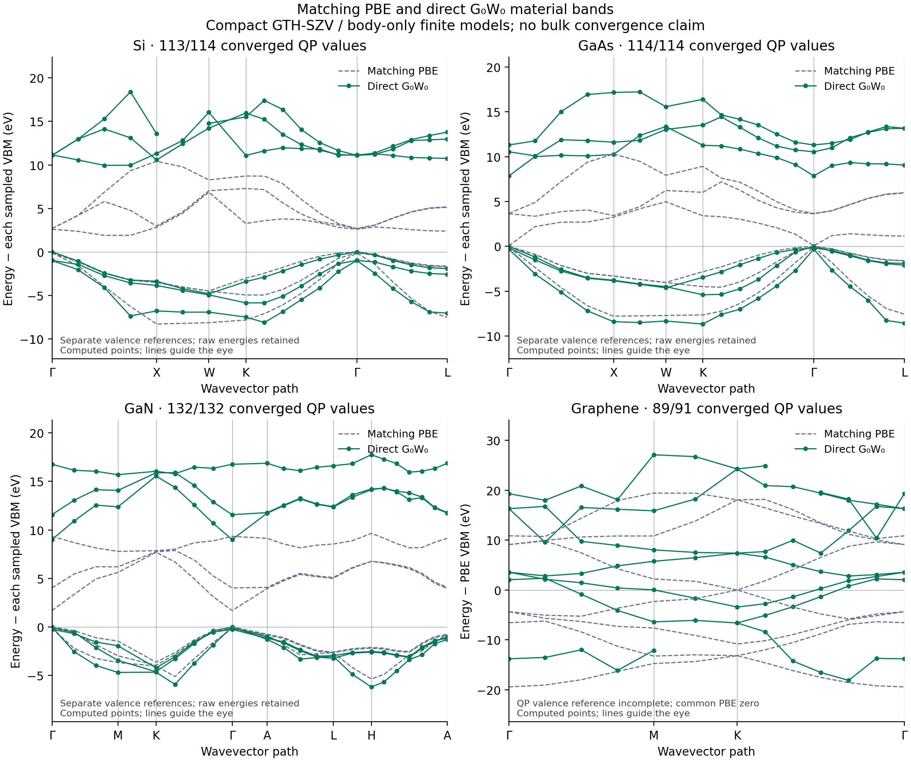

# Direct native G0W0 material bands

The newer [61-point material paths](dense61/README.md) provide denser direct
sampling and updated figures. They retain failed masks and diagnose the
remaining accepted-root jumps; the coarse records below remain available.

These results evaluate actual quasiparticle points for diamond Si,
zincblende GaAs, wurtzite GaN and monolayer graphene. The public example is
[gw_bands.py](../../../examples/pbc/band_structures/gw_bands.py); SCF,
screening, self-energy and QP roots come from `src/gradscf`. The matching
PBE bands in each panel use the same compact model as its GW calculation.
The earlier DZVP DFT gallery is a different numerical protocol.

| Material | Direct k points | Accepted/requested QPs | Band figure |
|---|---:|---:|---|
| Si | 19 | 113/114 | [PNG](silicon/bands.png) / [PDF](silicon/bands.pdf) |
| GaAs | 19 | 114/114 | [PNG](gaas/bands.png) / [PDF](gaas/bands.pdf) |
| GaN | 22 | 132/132 | [PNG](gan/bands.png) / [PDF](gan/bands.pdf) |
| Graphene | 13 | 89/91 | [PNG](graphene/bands.png) / [PDF](graphene/bands.pdf) |

The full k paths have been evaluated; Si and graphene retain one and two
failed QPs respectively. Their curves preserve those gaps. The
[delivery metadata](delivery.json) lists every failed cell and its actual
residual, measured timings and file hashes. The root tolerance is 1e-9 Ha;
small residuals establish numerical convergence within this finite model,
not its material accuracy or a globally unique quasiparticle branch.

## Model and interpretation

All cases use PBE, GTH-SZV, GTH-PBE pseudopotentials, float64/complex128,
16 imaginary frequencies, real-axis eta = 0.001 Ha and `fc=False`.
Si/GaAs use FFT `(21,21,21)` and source k mesh `(2,1,1)`; GaN uses
`(21,21,33)` and `(2,1,1)`. Graphene uses FFT `(25,25,97)`, source mesh
`(2,2,1)`, 12 Angstrom cell height, zero electronic temperature and the
two-dimensional finite-part boundary with `exxdiv=None`.

The output window is six frontier bands for each bulk material and seven
bands for graphene. The extra graphene sigma band completes a K-point
doublet. Internal G retains every band and W includes all occupied-to-virtual
and virtual-to-occupied channels. A partially selected KS degenerate cluster
is rejected. The complete cluster solves the projected, frequency-dependent
Hermitian Dyson matrix, rather than treating its arbitrary KS basis columns
as independent states.

Static-pole subtraction evaluates Wc(0), removes it from the numerical
contour terms and restores `(1/2-f)*Wc(0)` analytically. In this declared
protocol the imaginary-axis Green denominator uses zero eta; signed eta
is retained in the real-frequency screened action. This finite-eta convention
differs from the earlier default query. The public API still uses the old
protocol unless subtraction or band-touching treatment is requested.

Graphene's numerical KS contact at K is classified with `gap_tol=1e-5 Ha`;
its raw KS splitting is about 0.198 meV. No energies are changed to open
a gap. Complete shifted frontier clusters receive uniform T=0 ensemble
occupations preserving electron count. The screening source has integer
occupations and a positive sampled gap because this coarse source mesh
does not sample K. This is a finite-q demonstration, without finite-temperature
metallic, intraband/Drude or long-wavelength graphene screening.

These compact basis, anisotropic k meshes, FFT grids and frequency grids
are **not converged material predictions**. Body-only QP gaps and their
sampled valence alignment must not be presented as experimental gaps.
Non-Gamma GW is eager forward only; these examples make no GW AD claim.

## Saved arrays and figures

Each material directory contains `bands.npz`, `scf_reference.npz`,
`native.json` and PNG/PDF figures. `computed_mask & converged_mask` identifies
accepted QPs. Failed candidates remain in the raw arrays and do not enter
the displayed GW curves. Connecting adjacent accepted samples is a visual
guide; no interpolation or scissor correction supplies a QP.

Bulk panels align PBE and GW to their own sampled valence maxima, with raw
absolute energies retained. A panel with incomplete accepted occupied QPs
uses the common PBE zero and labels that choice. For these continuous paths,
figure distances are reconstructed from the saved unwrapped fractional
points and reciprocal lattice: ASE can otherwise assign duplicate distances
to consecutive special points in a very sparse path. The saved original
path arrays and energies are preserved.

Si/GaAs records include a separate narrow retry phase. Original accepted
cells and all unpatched arrays remain bitwise unchanged. Their
`original_budget.json` and `refinement_budget.json` distinguish full-path
and retry resources. The inherited peak RSS in a refined `native.json`
belongs to the original path; the retry peak comes from its separate budget.
The source hashes in executed records are preserved: the three bulk paths
used the static-subtraction implementation `d294e39a`, while the final
graphene driver uses `fd8062ef`, which adds one bounded shared AD-hybrid
retry for a failed scalar secant root. This changes root recovery, not the
Hamiltonian, screening channels or contour model.

Reported full-path GW times include compilation and cache release between
points. Retry times cover only the separate failed-root phase, with its
fresh SCF preparation recorded separately. These are demonstration runtimes,
not warm-cache throughput or a scaling benchmark.

| Material | Full-path GW (s) | Separate retry GW (s) | Original / retry peak RSS (GiB) |
|---|---:|---:|---:|
| Si | 600.50 | 40.11 | 3.64 / 3.22 |
| GaAs | 707.53 | 45.01 | 4.27 / 3.81 |
| GaN | 1523.11 | -- | 6.17 / -- |
| Graphene | 713.24 | -- | 6.60 / -- |

The retained failures are Si point 5/band 6 (`-0.1006676075 Ha`), graphene
point 5/band 0 (`-0.1469153718 Ha`) and graphene point 8/band 6
(`-0.1989148266 Ha`). Point and band indices are zero-based. The largest
accepted residual across the four cases is `1.24e-12 Ha`. Graphene's missing
occupied-band value prevents the complete-occupied-window alignment check;
that panel therefore explicitly uses the common PBE reference.

## Verification and resource bounds

All numerical calculations, tests and plotting run on `jy_gpu_1` (c20,
Intel Xeon Platinum 8457C, JAX 0.10.0 / CPU). Each material job uses a
disjoint 16-CPU affinity; aggregate project use stays within 64 logical CPUs.
Full paths are limited to 6600 seconds and 16 GiB; retries/tests to 600
seconds and 16 GiB. Native backend and source fingerprints are checked
before calculations. No local numerical test or calculation is used.

The final query regression covers complex degenerate-frame covariance,
Dyson residuals, neutral band touching, both sides of the imaginary contour,
static-subtraction normalization/endpoints and failed-scalar recovery:
**67 passed in 81.61 seconds**. A separate momentum-boundary regression
records **17 passed in 18.69 seconds**. These are focused gates rather than
a complete repository test run. Source fingerprints, measured budgets and
final accepted/failed counts are retained in the accompanying metadata.

For external numerical reproduction, use the public example with the saved
geometry/model and a new case name. Check masks and QP residuals before
interpreting any band. No global quasiparticle branch or spectral-weight
uniqueness is established by a small Dyson residual alone.
