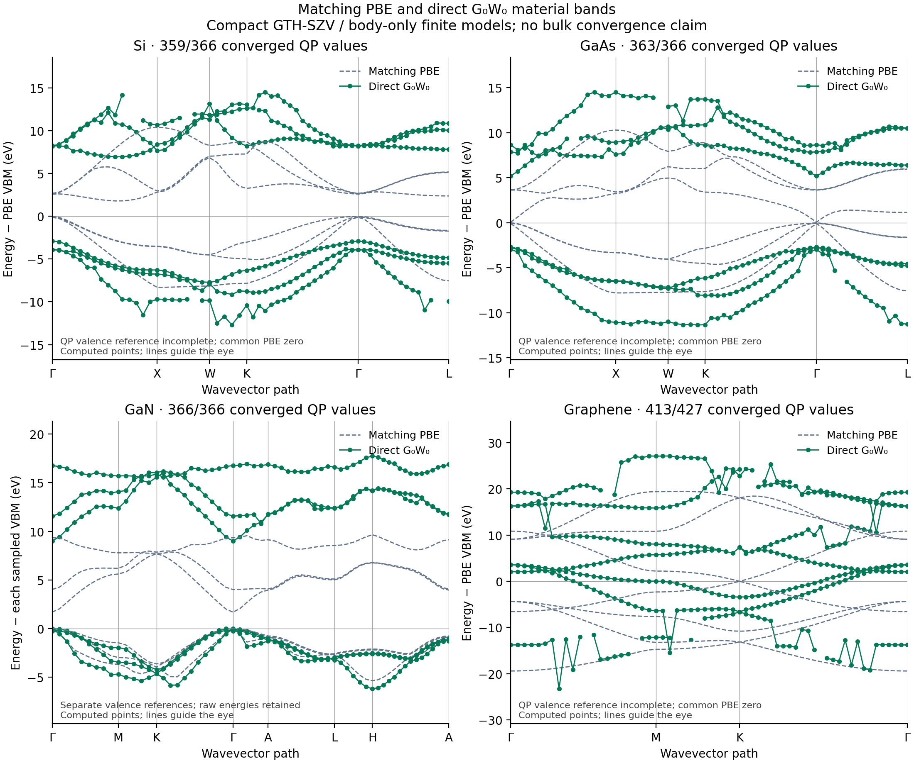

# Direct material GW bands: 61 points per path

The query paths increase from 19/19/22/13 to **61 actual k points each**
for Si/GaAs/GaN/graphene. Each QP uses the public
[GW example](../../../../examples/pbc/band_structures/gw_bands.py) and SRC.
The SCF source k mesh, FFT, basis, pseudopotential, frequency quadrature and
self-energy protocol match the [compact model](../README.md). Only band-path
sampling changes; this is not a material convergence study.

| Material | Converged / requested QPs | Largest accepted adjacent correction change (eV) | Individual figure |
|---|---:|---:|---|
| Si | 359/366 | 2.73812 | [PNG](silicon/bands.png) / [PDF](silicon/bands.pdf) |
| GaAs | 363/366 | 2.08842 | [PNG](gaas/bands.png) / [PDF](gaas/bands.pdf) |
| GaN | 366/366 | 1.01929 | [PNG](gan/bands.png) / [PDF](gan/bands.pdf) |
| Graphene | 413/427 | 10.78354 | [PNG](graphene/bands.png) / [PDF](graphene/bands.pdf) |

All four paths are complete. Si, GaAs and graphene retain 7, 3 and 14 failed
QPs. Raw candidates and masks are preserved; failed values do not enter GW
curves. Numerical work runs on `jy_gpu_1`, with four disjoint 24-CPU allocations
and a project maximum of 96 logical CPUs. Jobs have 6600-second / 16-GiB
bounds. GaN finishes normally within its bound; continuation is not used.

| Material | GW phase (s) | Wrapper wall (s) | Peak RSS (GiB) | CPU affinity |
|---|---:|---:|---:|---|
| Si | 2065.25 | 2096.54 | 4.50 | 0--23 |
| GaAs | 2348.59 | 2388.13 | 5.50 | 24--47 |
| GaN | 6443.35 | 6497.59 | 7.69 | 48--71 |
| Graphene | 3493.51 | 3530.13 | 7.61 | 72--95 |

Times include compilation and between-point cache release. A separate same-
model GaN point-26 check on CPU0--15 takes 94.11 s of GW work; no matching
24-thread single-point timing was measured, so it does not establish a
thread-count speedup. It does not replace any path value.

## Continuity check

PBE curves and well-behaved QP segments have finer direct sampling. However,
the remaining jumps are **not all polygonal plotting artifacts**. The table
reports the largest change in `(E_QP - epsilon_KS)` between adjacent points
whose two endpoints pass the convergence mask. This is a diagnostic of
stored candidates, not proof of branch identity or a physical discontinuity.
No sorting, interpolation or smoothing changes the original QP values or
band indices.

Graphene band 0 changes its correction by 10.78354 eV from point 6 to 7,
while the KS change is only 0.17113 eV. This cannot be presented as a
validated continuous material QP band. The current query solves the nonlinear
Dyson equation independently at each k point; small residuals alone do not
identify one continuous physical branch. Source-mesh and Fourier convergence
also remain open. The data do not uniquely identify the cause of each jump.

A read-only check of Si's largest correction step, point 22 to 23/band 1,
finds a canonical reciprocal-representative change at W. The pair FFT includes
the required Bloch-phase compensation; no missing phase was identified.
Both KS states are nondegenerate and both QP roots pass their residual test.
The coincident wrap alone does not establish causality.

Denser sampling is complete; continuous physical QP-branch validation remains
open. These body-only GTH-SZV models do not establish experimental gaps,
full graphene intraband/long-wave screening or non-Gamma GW AD.

## Records

Each material stores raw arrays, an SCF checkpoint, `native.json`, executed
source/backend fingerprints and resource records. [delivery.json](delivery.json)
lists counts, every failed cell, residuals, timings, hashes and adjacent-step
diagnostics. Figures use a separate sampled valence reference only when
the requested occupied QP window is complete; otherwise the panel explicitly
uses the common PBE zero.

Final hashes are in [file_sha256.json](file_sha256.json), and saved-data
rendering resources in [plot_budget.json](plot_budget.json). No executable
script, execution log or source snapshot is placed in this result directory.
