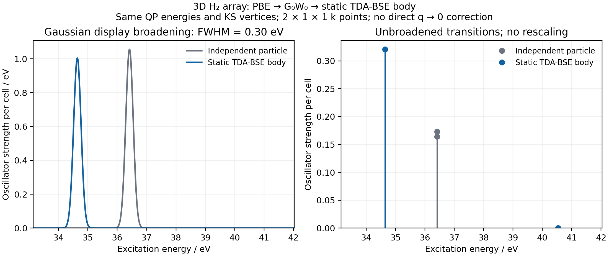

# A small periodic GW/BSE body spectrum

This functional demonstration uses a 3D H2 array: a 6-Bohr cubic cell,
H–H distance 1.4 Bohr, PBE/GTH-PBE/GTH-SZV, FFT 7³ and a 2×1×1 k mesh.
G0W0 uses 16 imaginary-frequency points, eta=0.001 Hartree and `fc=False`.
The static singlet TDA-BSE includes both OV and VO screening channels.
The independent-particle control uses **the same QP energies and fixed KS
length dipoles**. No fitted energy shift or intensity rescaling is applied.

| Model | Excitation energy (eV) | Oscillator strength per cell |
| --- | ---: | ---: |
| Independent particle, k=0 | 36.41790670 | 0.16402877 |
| Independent particle, second k | 36.41787978 | 0.17312113 |
| Static TDA-BSE body, state 1 | 34.64182756 | 0.32064959 |
| Static TDA-BSE body, state 2 | 40.53121980 | 0.00006767 |

Electron–hole coupling concentrates most intensity in the lower state in
this finite model. The higher state remains weak, with its raw strength
retained. The 0.30-eV Gaussian FWHM is a display resolution, not a lifetime.
The direct q→0 head/wing correction, converged k/grid/basis limits and BSE
AD are absent. These high-energy minimal-basis lines are not predictions
for experimental molecular hydrogen or a converged material spectrum.

Maximum QP and BSE eigenpair residuals are respectively 5.55e-17 and
6.50e-16 Hartree; raw BSE Hermiticity error is 1.11e-16 Hartree.
The broadened-spectrum integrals match the raw line sums within 5.56e-17.
On jy_gpu_1 (hostname c20), CPU16–31, JAX 0.10.0, float64/complex128 and
OMP/BLAS threads=2, the fresh calculation took 36.05 s with 1.82 GiB peak
RSS; plotting took 2.50 s. These are demonstration costs, not scaling data.

Reproduce with [the calculation](../../../examples/bse/periodic_hydrogen.py)
and [plotting](../../../examples/bse/plot_periodic_hydrogen.py), from the
repository root with `PYTHONPATH=src`. Physics and property formulas reside
in [src/gradscf/bse/pbc](../../../src/gradscf/bse/pbc/README.md).
`arrays.npz` retains matrices, amplitudes, QP levels, dipoles and line strengths;
`results.json` records settings and executed-source hashes.
`verification.json` records the independent Gamma/two-k checks and the
unsymmetrized OV-only versus full-channel diagnostic. Execution snapshots
and logs remain in ignored artifacts, not in this results directory.

This is the initial 3D execution snapshot. Later sharing of the full-channel
assembly and low-dimensional extensions changed some current source files;
`verification.json` records those differences while preserving the executed
hashes and original numerical data. The later wire/layer capsule records
its own final-source execution and does not replace this historical result.
