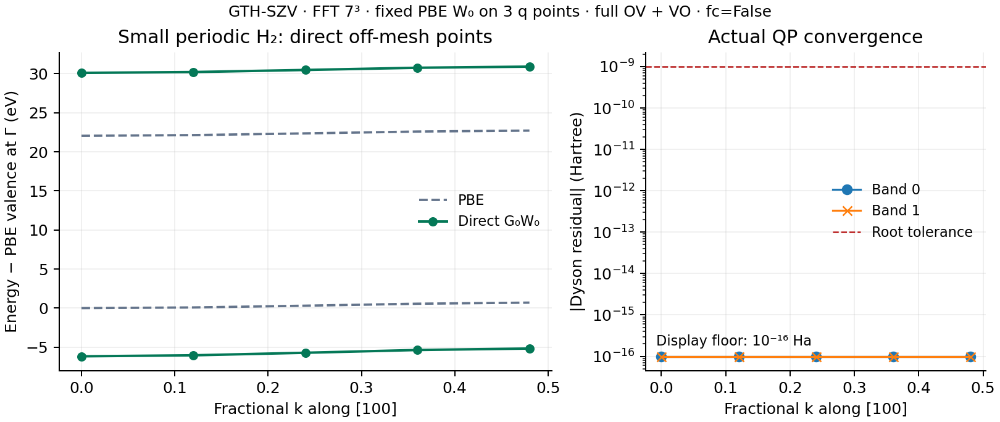

# Direct periodic G0W0 queries

This capsule demonstrates `gradscf.gw.pbc.g0w0_bands` at arbitrary k points.
The ordinary function example is [periodic_bands.py](../../../examples/gw/periodic_bands.py);
the independent reference is [compare_periodic_bands.py](../../../examples/gw/compare_periodic_bands.py).
All computational implementation lives in `src`. This directory contains only
scientific results, figures and provenance.

The H₂ array uses a cubic 6 Bohr cell, H at `(3,3,2.3)` and `(3,3,3.7)` Bohr,
PBE/GTH-SZV/GTH-PBE, FFT 7³, and the complete equal-weight `(3,1,1)` source mesh.
The query segment contains fractional x coordinates `0, .12, .24, .36, .48`.
Both output bands are requested. W₀ retains all source OV and VO transitions;
the internal Green function retains both bands at every shifted κ+q.
The contour uses 16 imaginary-frequency points, η = 0.001 Hartree, Ewald
exchange, and `fc=False` (no q→0 head/wing correction).

On 2026-10-16, all **10/10** requested QP points converged. The maximum actual
Dyson residual is **6.2450×10⁻¹⁷ Hartree**, against a root tolerance of 10⁻⁹.
The plotted residuals below 10⁻¹⁶ are placed at an explicitly labelled display
floor; [bands.npz](bands.npz) preserves the original values, including zeros.
The PBE SCF energy is −1.1218116489990795 Hartree. No interpolation produces
the displayed QP points; connecting lines guide the eye.

The independent NumPy check covers Γ and the `.12` and `.36` points. It builds
literal Fourier sums, full complex χ, dense auxiliary-space dielectric solves,
exchange, and the two contour branches independently. It shares the GradSCF
SCF/band orbitals and XC potential; it is not an independent SCF or material GW
benchmark. At the native QP energies, the maximum Σc difference is
**2.2555×10⁻¹⁷ Hartree**, the Dyson-residual difference is
**6.5399×10⁻¹⁶ Hartree**, and the maximum independently evaluated residual is
**6.5052×10⁻¹⁶ Hartree** (comparison threshold 2×10⁻¹⁰).
See [native.json](native.json), [numpy_reference.json](numpy_reference.json)
and [numpy_reference.npz](numpy_reference.npz).

The two imaginary-frequency sides happen to coincide to about 5.22×10⁻¹⁸
Hartree for this symmetric H₂ model. Non-even response is separately tested
with the analytic scalar model χ(z)=a/(z−Δ)−b/(z+Δ), a≠b: its independent
positive/negative RPA poles reproduce the total self-energy for occupied and
virtual internal G states, including active and inactive contour residues.
The symmetric a=b limit and finite-η complex G-pole continuation are also
checked. The full query tests additionally cover actual off-mesh points,
reciprocal representative covariance, output masks, joint-gap rejection,
gapped selected-band degeneracy rejection, JIT/AD rejection, unsupported
references, and pre-allocation resource checks.

The finite model uses canonical representatives in `[-0.5,0.5)` and G−q
product factors for both Σx and Σc. Wrapped grid edges can differ from an
exchange cutoff defined by raw source-k differences; the old folded-OV
periodic GW path is not used as a general full-response oracle. The Ewald
term is −`madelung` for every occupied query band. Imaginary-axis χ is
η-free while G keeps η; residues evaluate time-ordered χ at the matching
complex G pole. The original SCF mesh is retained in `screening_energy`,
whereas `mo_energy` and `mo_coeff` describe the query mesh.

This is an eager, forward-only demonstration for gapped, integer-occupation,
restricted 3D pure LDA/GGA references and nondegenerate selected bands.
Degenerate bands require an unsupported subspace self-energy. The tiny basis,
three q points, FFT7 and body-only screening do not establish bulk convergence,
experimental accuracy, arbitrary root-branch selection, or periodic GW AD.

The remote host is `jy_gpu_1`, Intel Xeon Platinum 8457C, CPU float64/complex128,
JAX 0.10.0 and Python 3.11.15. All jobs used CPU IDs 32–47, OMP/OpenBLAS/MKL/
NUMEXPR = 2, a 600-second task limit (short guards 120 seconds), and a 16 GiB
actual-RSS watchdog. The path took 79.02 seconds in the example / 84.64 seconds
in its wrapper, with peak RSS 2,442,216 KiB. The independent reference took
26.82 / 29.79 seconds and 1,470,724 KiB. These are observed resource summaries,
not a dense-versus-transition performance benchmark.

Development source snapshots, failed wiring attempts, commands and complete
logs are kept in the ignored central `completion_20261016/query` archive.
The original H₂ source/data record remains unchanged when the same public
example is extended with a separate optional Si segment. Source hashes and
the narrow verification chain are recorded in the accompanying manifests.
`delivery_source_sha256.json` identifies the frozen 3D delivery stage, before
the low-dimensional caller extension. Final caller source hashes and its
separate 25-test check are recorded in `lowdim_caller_validation.json`.

The same API also has one separately archived
[Si three-point generic segment](silicon/README.md), with its own model,
source hashes and actual QP certificates. The H₂ record above is unchanged.
