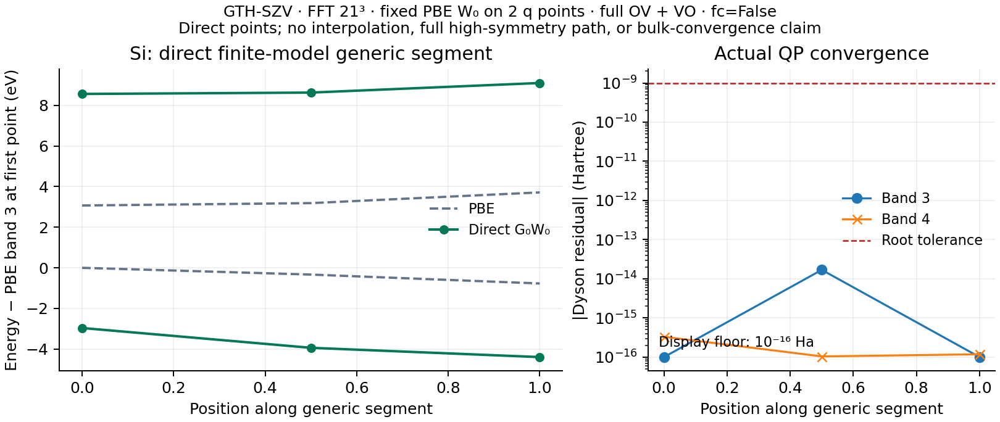

# Silicon: three direct generic-k G0W0 points

The same [ordinary function example](../../../../examples/gw/periodic_bands.py)
supports `run(system='silicon')`. It uses the fixed diamond-Si structure from
`examples/pbc/band_structures/systems.py` (lattice constant 5.431 Å),
PBE/GTH-SZV/GTH-PBE, a complete equal-weight `(2,1,1)` source mesh and FFT21³.
No structure, grid, point or output-window search was performed.

The fractional reciprocal points are `(0.07,0.11,0.13)`, `(0.18,0.17,0.15)`
and `(0.29,0.23,0.17)`. Only output bands 3 and 4 are requested. The complete
eight-band internal Green function and all occupied 0–3 / virtual 4–7
screening states are retained, including both OV and VO channels. The full
transition rank is 64; the shared complex solver uses its 128-dimensional
real representation. This run uses 16 imaginary-frequency nodes,
η=0.001 Hartree, Ewald exchange and `fc=False`.

The single fixed probe completed on 2026-10-16. SCF converged at
**−7.41142105705312 Hartree**. All **6/6** requested direct QP points passed
their convergence masks, with maximum actual Dyson residual
**1.68754×10⁻¹⁴ Hartree** against a 10⁻⁹ root tolerance. The query driver also
accepted the common insulating gap of the source/query/shifted spectra and
the selected-band nondegeneracy gates. Original residuals and computed masks
are in [bands.npz](bands.npz); [native.json](native.json) records source hashes
and the exact model.

This plot is a **direct finite-model generic segment**. It is not an
interpolated GW path, a complete high-symmetry band structure, a bulk-converged
Si gap or an independent Si GW benchmark. Method correctness is supported by
the separate [H₂ full-response NumPy comparison](../README.md) and analytic
non-even-response self-energy tests. This Si run supplies its own actual
SCF/QP certificates only. The original SCF W₀ remains fixed, and q→0 head/wing
corrections are absent. The very small basis and two-q sampling explain why
these levels must not be compared directly with experimental Si bands.

The CPU float64/complex128 example took 80.67 seconds / 86.65 seconds including
the process wrapper, with peak process-tree RSS **2,846,156 KiB**. It used
Intel Xeon Platinum 8457C CPU IDs 32–47, OMP/OpenBLAS/MKL/NUMEXPR=2, JAX 0.10.0,
Python 3.11.15, a 600-second timeout and a 16 GiB actual-RSS watchdog.
The delivered example adds only measured comments after this execution;
its computational AST matches the executed source snapshot.
