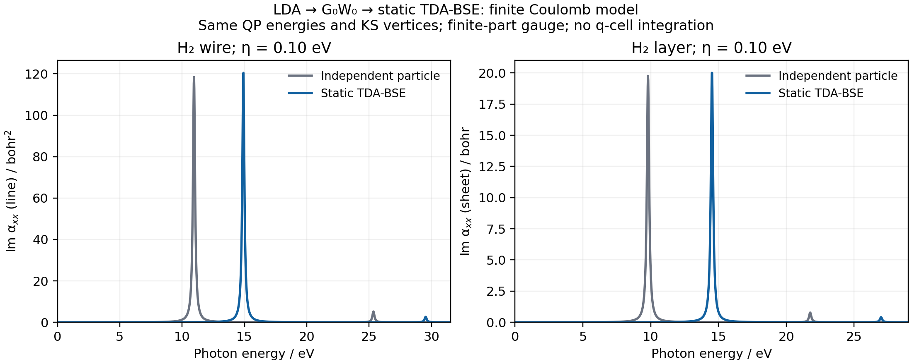

# Finite-model H₂ wire and layer: G₀W₀/BSE polarizability

The [calculation](../../../examples/bse/reduced_hydrogen.py) uses GradSCF
LDA/SVWN, GTH-SZV/GTH-PADE, two k points `(2,1,1)`, `exxdiv=None`, full
OV+VO G₀W₀ screening and static singlet TDA-BSE. Both optical curves use
the same QP energies and KS length vertices, including the nonlocal GTH
velocity contribution. [Plotting](../../../examples/bse/plot_reduced_hydrogen.py)
only reads the saved arrays.

These are finite Coulomb models with the original slab/wire finite-part
potential gauge. They contain no singular q-cell integration, imported 3D
finite-size correction, material-convergence study or BSE AD demonstration.
The negative finite head is omitted only from square-root correlation factors
after verifying zero OV/VO Fourier heads in the actual FFT metric. Its bare
contribution is restored in exchange and the BSE direct term. Non-head
negative Coulomb values are rejected; no matrix symmetrization is applied.

The plotted response is `Im alpha_xx` along the first periodic lattice vector.
The full complex resonant/antiresonant polarizability is divided by the wire
length (units bohr²) or layer area (units bohr). It is not an absorption
coefficient. The displayed `eta=0.10 eV` is imposed resolution, not a lifetime.
The IP-to-BSE shifts must not be read as converged exciton binding energies:
the finite-part bare head is significant in these coarse models. No peaks
or intensities have been shifted or rescaled for presentation.

| Quantity | H₂ wire | H₂ layer |
| --- | ---: | ---: |
| Lattice lengths / bohr | 5, 16, 16 | 5, 6, 18 |
| FFT mesh | 25 × 81 × 81 | 25 × 31 × 91 |
| SCF energy / Ha | −1.103487497321063 | −1.130455339598570 |
| Raw finite head `v0/V` / Ha | −0.684565318143 | −0.942477796077 |
| IP lines / eV, ascending | 10.95721003, 25.35063181 | 9.80697922, 21.76465043 |
| BSE lines / eV | 14.91493746, 29.54024990 | 14.52345165, 26.99271433 |
| Maximum QP residual / Ha | 6.25 × 10⁻¹⁷ | 4.51 × 10⁻¹⁷ |
| Maximum BSE residual / Ha | 5.60 × 10⁻¹⁶ | 7.24 × 10⁻¹⁶ |
| Raw Hermiticity error / Ha | 1.24 × 10⁻¹⁷ | 2.78 × 10⁻¹⁷ |
| Independent BSE matrix error / Ha | 9.55 × 10⁻¹⁴ | 2.81 × 10⁻¹⁴ |
| Independent spectral tensor error / stated optical unit | 1.59 × 10⁻¹⁴ | 3.55 × 10⁻¹⁵ |
| Monitored workflow time / s | 82.42 | 66.60 |
| Peak process RSS / GiB | 3.15 | 2.65 |

All four requested QP roots per system converged. The contour quadrature uses
16 imaginary frequencies and `eta=0.001 Ha`; root controls are
`ftol=xtol=1e-9 Ha`. Each geometry and coordinate list is recorded in its
`results.json`. The source-based independent NumPy reference shares the SCF
inputs and raw Coulomb boundary, but separately assembles Fourier pairs,
the full Lehmann response, signed-v Dyson contractions and the BSE matrix.
It solves only a small transition matrix. This does **not** independently
validate SCF or the Coulomb-cutoff implementation.

Measured on `jy_gpu_1` (reported hostname `c20`), Intel Xeon Platinum 8457C,
2026-10-16, CPU IDs 0–15, JAX 0.10.0, Python 3.11.15, float64/complex128.
OMP/OpenBLAS/MKL/NumExpr each used 2 threads. The two calculations ran in
separate fresh processes, each bounded to 600 s and 16 GiB. These are
single workflow timings, including compilation, not scaling or warm-runtime
benchmarks. `results.json` also records the internal calculation time.

`dimension_1/` and `dimension_2/` contain the raw NPZ arrays and short JSON
records, including QP coverage/convergence masks, full optical tensors,
independent matrices and executed-source hashes. Source snapshots and runtime
logs are retained in the central ignored development archive, not this data
directory. The related caller gates cover raw momentum checks, sampled and
AO metrics, exact-zero head handling, signed auxiliary inverses, phase/k
covariance and complex periodic-measure normalization.
